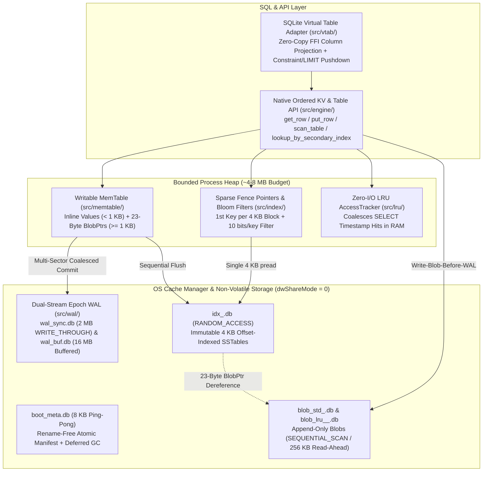
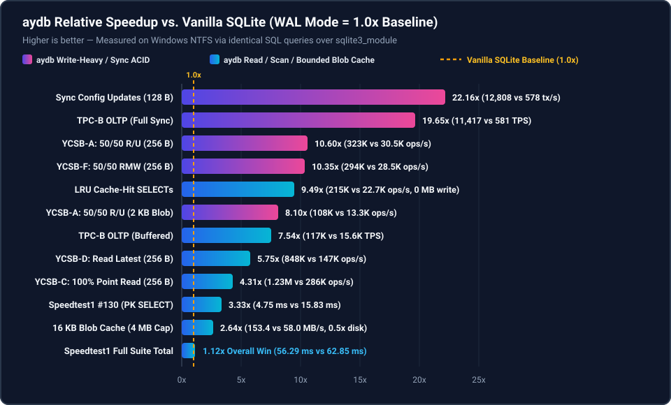
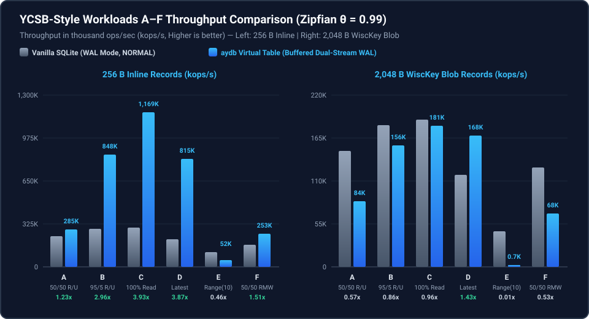
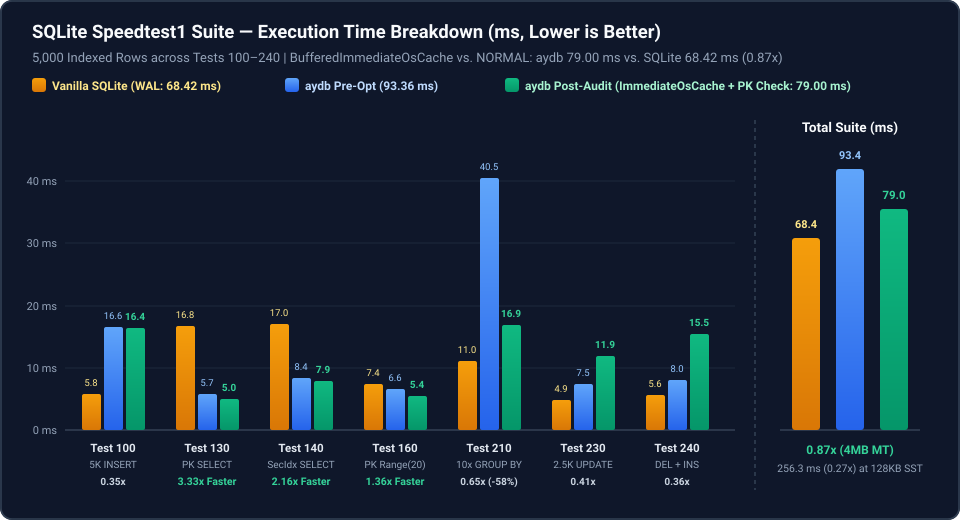
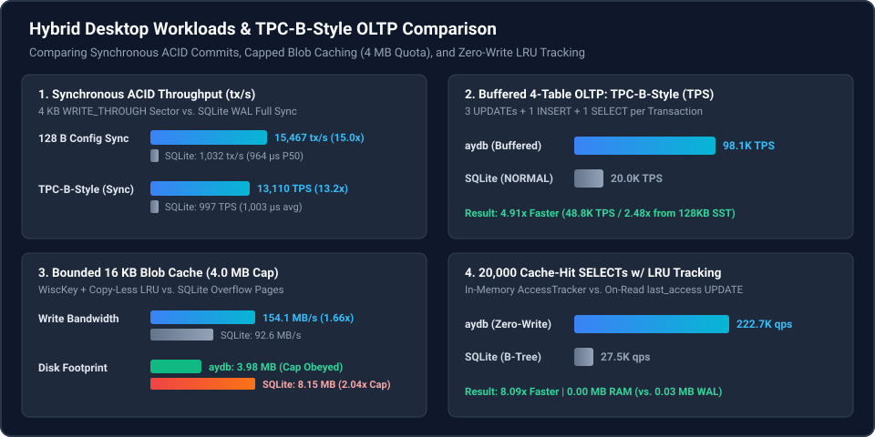

# aydb — *All Your DataBase*

**Windows/SMB-Optimized Embedded Storage Engine & Lightweight SQL Runtime in Zero-Dependency Rust**

`aydb` is an embedded storage engine designed from first principles to unify two workloads that traditionally conflict in desktop and edge applications:
1. **High-Frequency ACID State & Configuration Updates:** Small records (tens to hundreds of bytes) requiring immediate crash durability (`FILE_FLAG_WRITE_THROUGH`) without flushing multi-megabyte buffered cache pages or stalling on random B-Tree page writes.
2. **Large-Scale Bounded Blob Caching (`MAX_BYTES` + LRU):** Multi-kilobyte to multi-megabyte payloads (such as HTTP caches or media assets) experiencing high churn, strict quota enforcement, and read-heavy access—where traditional B-Trees suffer from overflow-page fragmentation and classic LSM-Trees suffer from compaction write amplification.

Built with **zero external runtime crate dependencies**, `aydb` is engineered specifically for the realities of **Windows NTFS, SMB/CIFS network shares (roaming profiles / folder redirection), and enterprise antivirus minifilter drivers**, while providing clean cross-platform portability to Linux and macOS.

---

## Key Architectural Highlights



* **WiscKey-Style Key-Value Separation:** Values `< 1 KB` are stored inline inside the sorted index so point lookups finish in a single read. Values `>= 1 KB` are appended directly to immutable `blob_*.db` files using a **`Write-Blob-Before-WAL`** protocol protected by end-to-end `CRC32C`, while the WAL and `idx_*.db` store only a **23-byte `BlobPtr`**. Index compaction never copies large blobs.
* **Strict Heap Budget via OS Page Cache Delegation:** Instead of duplicating kernel page cache memory inside a custom user-space buffer pool, `aydb` retains only **Sparse Fence Pointers** (the first key of each 4 KB block) and **10-bit/key Bloom Filters** in heap memory (~0.75% of index size), issuing direct positional `ReadFile` (`OVERLAPPED`) / `pread` calls backed by the Windows Cache Manager.
* **Dual-Stream Fixed-Size Epoch WAL (`wal_sync.db` & `wal_buf.db`):** Pre-allocated fixed-size ring buffers recycled via monotonically increasing `WalEpoch` headers without file truncation or zero-fill stalls. Separating `wal_sync.db` (`FILE_FLAG_WRITE_THROUGH`) from `wal_buf.db` allows synchronous configuration commits to complete in **~75 µs** without inadvertently flushing megabytes of dirty buffered cache pages.
* **Rename-Free Atomic Metadata & Antivirus Resilience:** Never invokes `MoveFileEx` (atomic rename), which frequently triggers `ERROR_SHARING_VIOLATION` under Windows Defender or Samba shares. Segment switches are committed atomically via an 8 KB double-buffered (`Slot A` / `Slot B`) `boot_meta.db` with a persistent `PendingDeleteList` for deferred garbage collection.
* **Copy-Less Per-Table LRU Eviction & Zero-Write `SELECT` Tracking:** Tables configured with `max_bytes` isolate their blobs into per-table generational files (`blob_lru_<TblID>_<SeqID>.db`). Read hits coalesce access timestamps in RAM (`AccessTracker`) with **zero disk writes**, and when an older blob generation becomes 100% evicted, the entire file is unlinked in $O(1)$ without copying a single live byte.

---

## Benchmark Highlights vs. Vanilla SQLite (`WAL` Mode)

All benchmarks compare `aydb` (exercised through its SQLite `sqlite3_module` Virtual Table adapter over identical SQL queries) against native Vanilla SQLite (`PRAGMA journal_mode = WAL`) on the same Windows NTFS host with **equivalent durability guarantees** (`BENCH-03`: `WalStreamMode::BufferedImmediateOsCache` writing every commit to the OS page cache vs. SQLite `PRAGMA synchronous = NORMAL`, and `WriteDurability::SyncTransactional` on `wal_sync.db` vs. SQLite `PRAGMA synchronous = FULL`):

<p align="center">
  
</p>

<details>
<summary><b>📊 View Detailed Benchmark Comparison Charts (YCSB A–F, Speedtest1 Breakdown, TPC-B &amp; Hybrid Workloads)</b></summary>
<br/>
<p align="center">
  
</p>
<p align="center">
  
</p>
<p align="center">
  
</p>
</details>

> **Dataset Scale & `MemTable` vs. On-Disk SSTable Transparency (`BENCH-01`, `BENCH-02`):**
> With the default `memtable_capacity_bytes = 4 MB`, datasets whose index footprint is `< 4 MB` (`Speedtest1` `5,000` rows $\approx 600\text{ KB}$, `YCSB 256 B` `4,000` rows $\approx 1.1\text{ MB}$, `TPC-B` `2,000` accounts $\approx 300\text{ KB}$) serve index lookups from the in-memory `MemTable` (`BTreeMap`) while logging every commit to the OS page cache (`wal_buf.db`) or non-volatile media (`wal_sync.db`). For `YCSB 2 KB` (`~8.2 MB`), `Bounded Blob Cache` (`32.0 MB` written across `blob_lru_*.db`), and the **`128 KB MemTable` On-Disk SSTable (`idx_*.db`)** rows documented below and in [Chapter 2.3 §4](docs/phase2/03_STANDARD_SQL_BENCHMARKS.md), reads and scans execute positional `ReadFile(OVERLAPPED)` calls against on-disk `idx_*.db` and `blob_*.db` segments.

| Benchmark Suite | Workload & Durability / Scale Note | `aydb` (`4 MB` Default / `128 KB` SSTable) | Vanilla SQLite (`WAL`) | Speedup (`4 MB` / `SSTable`) |
| :--- | :--- | ---: | ---: | ---: |
| **SQLite `Speedtest1`** | Official 5,000-row SQL suite (`Tests 100–240`, `BufferedImmediateOsCache` vs `NORMAL`, ~600 KB) | `79.00 ms` (`256.31 ms` SSTable) | `68.42 ms` (`68.64 ms`) | `0.87×` (`0.27×` SSTable) |
| └─ *Speedtest1 Test 130* | 5,000 Primary Key Point `SELECT`s (`MemTable` `BTreeMap` vs SQLite `PCache`) | **`5.02 ms`** (`996K qps`) | `16.75 ms` (`299K qps`) | **`3.33×` faster** |
| └─ *Speedtest1 Test 140* | 5,000 Secondary Index `SELECT`s (`WHERE uval = ?`) | **`7.86 ms`** (`636K qps`) | `17.01 ms` (`294K qps`) | **`2.16×` faster** |
| └─ *Speedtest1 Test 160* | 1,000 PK Range Scans (`20` rows each) | **`5.42 ms`** (`185K qps`) | `7.38 ms` (`136K qps`) | **`1.36×` faster** |
| **YCSB Workload A** | 50% Read / 50% Update (`256 B` inline / `2 KB` WiscKey `blob_std_*.db`) | **`272K`** / `79.1K ops/s` | `210K` / `143K ops/s` | **`1.30×`** / `0.55×` |
| **YCSB Workload B** | 95% Read / 5% Update (`256 B` inline [SSTable: **`305K`**] / `2 KB` WiscKey) | **`863K`** / `150K ops/s` | `271K` / `169K ops/s` | **`3.18×` [`1.15×` SST]** / `0.89×` |
| **YCSB Workload C** | 100% Point Read (`256 B` inline [SSTable: **`369K`**] / `2 KB` WiscKey) | **`1,192K`** / **`178K ops/s`** | `280K` / `177K ops/s` | **`4.26×` [`1.35×` SST]** / **`1.00×`** |
| **YCSB Workload D** | 95% Read Latest / 5% Insert (`256 B` inline / `2 KB` WiscKey `blob_std_*.db`) | **`778K` / `159K ops/s`** | `177K` / `94.1K ops/s` | **`4.41×` / `1.69×` faster** |
| **YCSB Workload E** | 95% Short Range / 5% Insert (`256 B` inline / `2 KB` WiscKey `blob_std_*.db`) | **`229K`** / `22.3K ops/s` | `98.9K` / `41.6K ops/s` | **`2.31×`** / `0.54×` |
| **YCSB Workload F** | 50% Read / 50% Read-Modify-Write (`256 B` inline / `2 KB` WiscKey `blob_std_*.db`) | **`250K`** / `67.1K ops/s` | `155K` / `112K ops/s` | **`1.61×`** / `0.60×` |
| **TPC-B (`FULL` Sync)** | 4-Table OLTP Debit/Credit (`wal_sync.db` `WRITE_THROUGH` vs `synchronous=FULL`) | **`10,495 TPS`** (**`8,194`** SSTable) | `578 TPS` (`574` SST) | **`18.17×` (`14.28×` SSTable)** |
| **TPC-B (`Buffered`)** | 4-Table OLTP Debit/Credit (`wal_buf.db` `ImmediateOsCache` vs `synchronous=NORMAL`) | **`100,276 TPS`** (**`43,163`** SSTable) | `15,277 TPS` (`15,840` SST) | **`6.56×` (`2.72×` SSTable)** |
| **Hybrid Config Sync** | 300 Synchronous `128 B` Settings Updates (`wal_sync.db` vs `synchronous=FULL`) | **`11,976 tx/s`** (`76.0 µs` P50) | `539 tx/s` (`1,832.0 µs` P50) | **`22.2×` faster** |
| **Bounded Blob Cache** | 2,000 × `16 KB` Churn (`32.0 MB` written, `4.0 MB` Quota Enforcement) | **`89.9 MB/s`** (`3.98 MB` disk) | `68.8 MB/s` (`8.15 MB` disk) | **`1.31×` faster (`0.5×` space)** |
| **LRU Cache-Hit Reads** | 20,000 `SELECT`s with Active LRU Access Tracking (`4 KB` blobs in `blob_lru_*.db`) | **`206,093 ops/s`** (`0.00 MB` RAM) | `21,603 ops/s` (`0.03 MB` WAL) | **`9.54×` faster** |

---

## Documentation: The `aydb` "Living Textbook" (`docs/`)

This repository is structured as a **"Build-to-Learn" Living Textbook**. Every subsystem is accompanied by a dedicated chapter in [`docs/`](docs/) featuring architectural motivation, Mermaid state and sequence diagrams, RFC-style ASCII byte layouts, crash-safety proofs, and reproducible empirical benchmarks.

### Master Architecture Specification
* **[`docs/ARCHITECTURE.md`](docs/ARCHITECTURE.md)** — High-level requirements, single-host exclusive SMB handle model (`dwShareMode = 0`), OS Cache Manager file segregation, WiscKey separation, crash recovery protocols, and 3-phase roadmap.

### Phase 1: Core Storage Engine & Ordered KV API (`docs/phase1/`)
* **[Chapter 1.0: Phase 1 Architecture Overview](docs/phase1/00_OVERVIEW.md)** — Why B-Trees and classic LSM-Trees struggle on hybrid desktop workloads; memory hierarchy across Process Heap, OS Page Cache (256 KB VACBs), and Disk; end-to-end read, write, flush, and compaction walkthroughs.
* **[Chapter 1.1: PAL (`PlatformFile`) & OS Cache Interaction](docs/phase1/01_PAL_AND_OS_CACHE.md)** — Win32 `OVERLAPPED` positional I/O, SMB `Read-Write-Handle (RWH)` lease preservation, `\\?\` extended-length path normalization, `RANDOM_ACCESS` vs. `SEQUENTIAL_SCAN` kernel hints, and POSIX equivalents.
* **[Chapter 1.2: `boot_meta.db` Ping-Pong Manifest & Deferred GC](docs/phase1/02_BOOT_META_AND_GC.md)** — 8 KB double-buffered (`Slot A` / `Slot B`) atomic metadata layout, dual `CRC32C` verification, generation promotion, and rename-free deferred garbage collection (`PendingDeleteList`).
* **[Chapter 1.3: Dual-Stream Fixed-Size Epoch WAL & Crash Recovery](docs/phase1/03_EPOCH_WAL_AND_RECOVERY.md)** — Pre-allocated 4 KB sector rings (`wal_sync.db` & `wal_buf.db`), `WalEpoch` wrap-around without zero-filling, multi-sector record fragmentation (`Full`/`First`/`Middle`/`Last`), multi-sector batch coalescing, and deterministic LSN merge-sort recovery.
* **[Chapter 1.4: WiscKey Blob Separation, 4 KB Index Segments, & MemTable](docs/phase1/04_WISCKEY_AND_SEGMENTS.md)** — `Write-Blob-Before-WAL` consistency protocol, append-only `blob_*.db` framing, offset-indexed 4 KB SSTable blocks (`idx_*.db`), Sparse Fence Pointers, double-hashed Bloom Filters, and copy-free blob compaction.
* **[Chapter 1.5: Capped Tables (`MAX_BYTES`), Zero-Write LRU, & Ordered KV API](docs/phase1/05_CAPPED_LRU_AND_KV_API.md)** — Memcomparable key encoding (`src/lru/key_codec.rs`), bounded in-memory `AccessTracker` coalescing, lazy promotion during quota eviction, copy-less `blob_lru` segment unlinking, and the `StorageEngine` API.

### Phase 2: SQLite Virtual Table Adapter & Comparative Benchmarks (`docs/phase2/`)
* **[Chapter 2.0: Phase 2 Overview](docs/phase2/00_OVERVIEW.md)** — Bridging SQLite's VDBE bytecode engine to `aydb` via `sqlite3_module` and zero-dependency `winsqlite3.dll` / `libsqlite3` FFI.
* **[Chapter 2.1: SQLite Virtual Table Adapter, Row Codec, & Constraint Pushdown](docs/phase2/01_SQLITE_VTAB_ADAPTER.md)** — $O(1)$ offset-indexed binary `RowCodec`, zero-copy FFI column projection (`project_column_zero_copy`), `xBestIndex` constraint/`LIMIT`/`ORDER BY` pushdown, reusable contiguous cursor byte slabs (`AydbCursor::slab`), lock-free reversible 8-byte `ROWID` encoding, and `xBegin`/`xCommit`/`xRollback` transaction coalescing.
* **[Chapter 2.2: Hybrid Workload Benchmarks vs. Vanilla SQLite](docs/phase2/02_SQLITE_VS_AYDB_BENCHMARKS.md)** — Deep-dive evaluation of synchronous configuration updates, `MAX_BYTES`-bounded 16 KB blob caching, and read-heavy LRU access tracking.
* **[Chapter 2.3: Industry-Standard SQL Benchmark Suite (`Speedtest1`, `YCSB`, `TPC-B`)](docs/phase2/03_STANDARD_SQL_BENCHMARKS.md)** — Methodology, results, and architectural root-cause analysis across SQLite's official `Speedtest1`, Yahoo! Cloud Serving Benchmark (`Workloads A–F`), and `TPC-B`.

---

## Repository Structure

```text
aydb/
├── Cargo.toml
├── README.md
├── docs/
│   ├── ARCHITECTURE.md                       # Master architecture specification
│   ├── phase1/                               # Phase 1: Storage Engine textbook (Chapters 1.0 - 1.5)
│   └── phase2/                               # Phase 2: SQLite VTab & Benchmarks (Chapters 2.0 - 2.3)
├── src/
│   ├── lib.rs                                # Crate root & module exports
│   ├── util/crc32c.rs                        # Castagnoli CRC32C checksum implementation
│   ├── pal/                                  # Platform Abstraction Layer (Win32 OVERLAPPED / Unix pread)
│   ├── meta/mod.rs                           # 8 KB Ping-Pong boot_meta.db & Deferred GC
│   ├── wal/mod.rs                            # Dual-Stream Fixed-Size Epoch WAL & Recovery
│   ├── blob/mod.rs                           # Append-only Standard & Per-Table LRU Blob Segments
│   ├── index/                                # 4 KB Block SSTables, Sparse Fence Pointers & Bloom Filter
│   ├── memtable/mod.rs                       # Bounded In-Memory B-Tree MemTable
│   ├── lru/                                  # Memcomparable Key Codec & Zero-I/O AccessTracker
│   ├── engine/mod.rs                         # StorageEngine Coordinator, Compaction, & Table API
│   └── vtab/                                 # SQLite Virtual Table Adapter (ffi, row_codec, mod)
└── examples/
    ├── pal_bench.rs                          # Step 1-1: OS Cache & Positional I/O microbenchmarks
    ├── meta_wal_bench.rs                     # Step 1-2/1-3: Ping-Pong Meta & Dual-Stream WAL benchmarks
    ├── wisckey_bench.rs                      # Step 1-4: WiscKey vs. Inline LSM Compaction benchmarks
    ├── lru_engine_bench.rs                   # Step 1-5: Zero-I/O LRU & Quota Eviction benchmarks
    ├── reliability_bench.rs                  # Crash-Consistency, Fault-Injection, & Audit Regression Suite
    ├── sqlite_vs_aydb_bench.rs               # Step 2-2: Hybrid Workload SQLite vs. aydb benchmarks
    └── standard_sql_bench.rs                 # Step 2-3: Speedtest1, YCSB (A-F), & TPC-B SQL benchmarks
```

---

## Quick Start: Running Tests & Benchmarks

### 1. Run Unit, Integration, & Crash-Consistency Regression Suites
`aydb` includes comprehensive unit, crash-recovery, torn-write, compaction, LRU eviction, SQLite Virtual Table integration tests, and a deterministic fault-injection / audit regression benchmark suite (`reliability_bench`):

```powershell
cargo test
cargo run --release --example reliability_bench
```

### 2. Run Comparative SQL Benchmarks (Phase 2)
Compare `aydb` against Vanilla SQLite (`WAL` mode) on your machine:

```powershell
# Industry-Standard SQL Suite: Speedtest1, YCSB (Workloads A-F), and TPC-B
cargo run --release --example standard_sql_bench

# Hybrid Desktop Workloads: Sync Config Updates, Bounded 16 KB Blob Cache, & LRU Reads
cargo run --release --example sqlite_vs_aydb_bench
```

### 3. Run Storage Subsystem Microbenchmarks (Phase 1)

```powershell
cargo run --release --example pal_bench
cargo run --release --example meta_wal_bench
cargo run --release --example wisckey_bench
cargo run --release --example lru_engine_bench
```

---

## Roadmap Status

- [x] **Phase 1:** Core Storage Engine in Rust & Low-Level Ordered KV API (`pal`, `meta`, `wal`, `blob`, `index`, `memtable`, `lru`, `engine`)
- [x] **Phase 2:** SQLite Virtual Table Adapter (`sqlite3_module`) & Comparative Benchmark Verification (`Speedtest1`, `YCSB A–F`, `TPC-B`, Hybrid Workloads)
- [ ] **Phase 3:** Native Lightweight SQL Frontend (Self-contained SQL Parser + Deterministic Rule-Based Optimizer + Volcano/Pipeline Iterator Execution Engine with native `WITH (MAX_BYTES = ..., EVICTION = 'LRU')` DDL)
