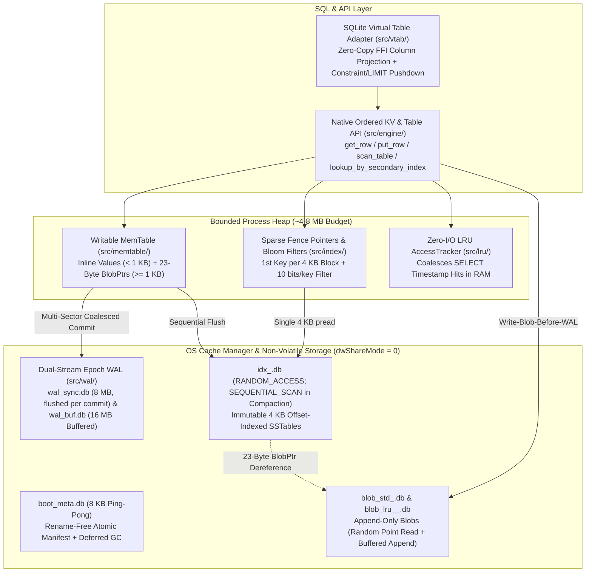

# aydb — *All Your DataBase*

**Windows/SMB-Optimized Embedded Storage Engine & Lightweight SQL Runtime in Zero-Dependency Rust**

[](https://github.com/toyoshim-i/aydb/actions/workflows/ci.yml)

Rendered documentation: <https://toyoshim-i.github.io/aydb/>. Latest CI test and benchmark results: <https://toyoshim-i.github.io/aydb/results.html>.

`aydb` is an embedded storage engine designed from first principles to unify two workloads that traditionally conflict in desktop and edge applications:
1. **High-Frequency ACID State & Configuration Updates:** Small records (tens to hundreds of bytes) requiring durability on commit return (write-through plus a device flush) without flushing multi-megabyte buffered cache pages or stalling on random B-Tree page writes.
2. **Large-Scale Bounded Blob Caching (`MAX_BYTES` + LRU):** Multi-kilobyte to multi-megabyte payloads (such as HTTP caches or media assets) experiencing high churn, strict quota enforcement, and read-heavy access—where traditional B-Trees suffer from overflow-page fragmentation and classic LSM-Trees suffer from compaction write amplification.

Built with **zero external runtime crate dependencies**, `aydb` is engineered specifically for the realities of **Windows NTFS, SMB/CIFS network shares (roaming profiles / folder redirection), and enterprise antivirus minifilter drivers**, while providing clean cross-platform portability to Linux and macOS.

---

## Key Architectural Highlights



* **WiscKey-Style Key-Value Separation:** Values `< 1 KB` are stored inline inside the sorted index so point lookups finish in a single read. Values `>= 1 KB` are appended directly to immutable `blob_*.db` files using a **`Write-Blob-Before-WAL`** protocol protected by end-to-end `CRC32C`, while the WAL and `idx_*.db` store only a **23-byte `BlobPtr`**. Index compaction never copies large blobs.
* **Strict Heap Budget via OS Page Cache Delegation:** Instead of duplicating kernel page cache memory inside a custom user-space buffer pool, `aydb` retains only **Sparse Fence Pointers** (the first key of each 4 KB block) and **10-bit/key Bloom Filters** in heap memory (~0.75% of index size), issuing direct positional `ReadFile` (`OVERLAPPED`) / `pread` calls backed by the Windows Cache Manager.
* **Dual-Stream Fixed-Size Epoch WAL (`wal_sync.db` & `wal_buf.db`):** Pre-allocated fixed-size ring buffers recycled via monotonically increasing `WalEpoch` headers without file truncation or zero-fill stalls. Separating `wal_sync.db` (write-through plus `FlushFileBuffers` on every commit) from `wal_buf.db` allows synchronous configuration commits to complete without inadvertently flushing megabytes of dirty buffered cache pages.
* **Rename-Free Atomic Metadata & Antivirus Resilience:** Never invokes `MoveFileEx` (atomic rename), which frequently triggers `ERROR_SHARING_VIOLATION` under Windows Defender or Samba shares. Segment switches are committed atomically via an 8 KB double-buffered (`Slot A` / `Slot B`) `boot_meta.db` with a persistent `PendingDeleteList` for deferred garbage collection.
* **Copy-Less Per-Table LRU Eviction & Zero-Write `SELECT` Tracking:** Tables configured with `max_bytes` isolate their blobs into per-table generational files (`blob_lru_<TblID>_<SeqID>.db`). Read hits coalesce access timestamps in RAM (`AccessTracker`) with **zero disk writes**, and when an older blob generation becomes 100% evicted, the entire file is unlinked in $O(1)$ without copying a single live byte.

---

## Benchmark Highlights vs. Vanilla SQLite (`WAL` Mode)

The charts below are regenerated from the CI results on every push to `main`: one run per operating system on shared GitHub-hosted runners, so they are noisy. Exact values, test status, and raw logs are published at <https://toyoshim-i.github.io/aydb/results.html>.

All benchmarks compare `aydb` (exercised through its SQLite `sqlite3_module` Virtual Table adapter over identical SQL queries) against native Vanilla SQLite (`PRAGMA journal_mode = WAL`) on the same machine with **equivalent durability guarantees** (`WalStreamMode::BufferedImmediateOsCache` writing every commit to the OS page cache vs. SQLite `PRAGMA synchronous = NORMAL`, and `WriteDurability::SyncTransactional` on `wal_sync.db` vs. SQLite `PRAGMA synchronous = FULL`) after passing a **pre-benchmark differential SQL result/state verification suite** (`verify_differential_sql_equivalence` in `examples/standard_sql_bench.rs` covering mixed numeric types, column affinities, `COLLATE NOCASE`/`RTRIM`, failed `UNIQUE` constraint statements, `SAVEPOINT`/`ROLLBACK TO`, cross-connection snapshot isolation, and mixed native-SQLite + `aydb` 2PC transactions):

<p align="center"><a href="https://toyoshim-i.github.io/aydb/results.html"></a></p>
<p align="center"><a href="https://toyoshim-i.github.io/aydb/results.html"></a></p>

<details>
<summary><b>More charts (YCSB-style A–F, SSTable mode, application scenarios)</b></summary>
<br/>
<p align="center"><a href="https://toyoshim-i.github.io/aydb/results.html"></a></p>
<p align="center"><a href="https://toyoshim-i.github.io/aydb/results.html"></a></p>
<p align="center"><a href="https://toyoshim-i.github.io/aydb/results.html"></a></p>
<p align="center"><a href="https://toyoshim-i.github.io/aydb/results.html"></a></p>
</details>

> **Dataset Scale, Workload Scope, & Failure-Model Transparency:**
> * **Workload Coverage:** `examples/standard_sql_bench.rs` implements selected **`Speedtest1`-style** (`Tests 100–240`), **`YCSB`-style** (`Workloads A–F`), and **`TPC-B`-style** (`pgbench`-like 4-table OLTP) workloads rather than full certified/official benchmark suites.
> * **Warm OS Cache vs. Larger-Than-RAM Datasets:** With the default `memtable_capacity_bytes = 4 MB`, datasets whose index footprint is `< 4 MB` (`Speedtest1`-style `5,000` rows $\approx 600\text{ KB}$, `YCSB`-style `256 B` `4,000` rows $\approx 1.1\text{ MB}$, `TPC-B`-style `2,000` accounts $\approx 300\text{ KB}$) serve index lookups from the in-memory `MemTable` (`BTreeMap`) while logging every commit to the OS page cache (`wal_buf.db`) or non-volatile media (`wal_sync.db`). Lowering `memtable_capacity_bytes = 128 KB` forces `idx_*.db` SSTable flushes and size-tiered compactions ([Chapter 2.3 §4](docs/phase2/03_STANDARD_SQL_BENCHMARKS.md)), exercising positional `ReadFile(OVERLAPPED)` calls against warm OS page cache; establishing cold-storage or larger-than-RAM behavior requires multi-gigabyte datasets beyond these quick-running examples.
> * **Durability Contract:** `SyncTransactional` commits are durable on return (earlier buffered commits are made durable first); `BufferedFast` commits survive process crashes but an OS crash or power loss may roll back the most recent ones. Crash consistency relies on CRC-verified WAL/`boot_meta`/blobs and assumes the storage honours flush/write-through. A WAL write/sync failure poisons the engine (mutations fail until reopen, reads continue; the failed commit's outcome is then unknown, never partial), and both WAL epochs are rotated on every open.
> * **Local Host & Simulated Fault Model:** The charts come from shared CI runners, not from dedicated hardware. Power-loss and I/O fault tests in `examples/reliability_bench.rs` use deterministic in-memory simulation (`FaultInjectingFs`) and do not substitute for physical power-cut hardware testing or live SMB network-outage/reconnection testing.

---

## Documentation: The `aydb` "Living Textbook" (`docs/`)

This repository is structured as a **"Build-to-Learn" Living Textbook**. Every subsystem is accompanied by a dedicated chapter in [`docs/`](docs/) featuring architectural motivation, Mermaid state and sequence diagrams, RFC-style ASCII byte layouts, crash-safety proofs, and reproducible empirical benchmarks.

### Master Architecture Specification
* **[`docs/ARCHITECTURE.md`](docs/ARCHITECTURE.md)** — High-level requirements, single-host exclusive SMB handle model (`dwShareMode = 0`), OS Cache Manager file segregation, WiscKey separation, crash recovery protocols, and 3-phase roadmap.

### Phase 1: Core Storage Engine & Ordered KV API (`docs/phase1/`)
* **[Chapter 1.0: Phase 1 Architecture Overview](docs/phase1/00_OVERVIEW.md)** — Why B-Trees and classic LSM-Trees struggle on hybrid desktop workloads; memory hierarchy across Process Heap, OS Page Cache (256 KB VACBs), and Disk; end-to-end read, write, flush, and compaction walkthroughs.
* **[Chapter 1.1: PAL (`PlatformFile`) & OS Cache Interaction](docs/phase1/01_PAL_AND_OS_CACHE.md)** — Win32 `OVERLAPPED` positional I/O, SMB `Read-Write-Handle (RWH)` lease preservation, `\\?\` extended-length path normalization, `RANDOM_ACCESS` vs. `SEQUENTIAL_SCAN` kernel hints, and POSIX equivalents.
* **[Chapter 1.2: `boot_meta.db` Ping-Pong Manifest & Deferred GC](docs/phase1/02_BOOT_META_AND_GC.md)** — 8 KB double-buffered (`Slot A` / `Slot B`) atomic metadata layout, dual `CRC32C` verification, generation promotion, and rename-free deferred garbage collection (`PendingDeleteList`).
* **[Chapter 1.3: Dual-Stream Fixed-Size Epoch WAL & Crash Recovery](docs/phase1/03_EPOCH_WAL_AND_RECOVERY.md)** — Pre-allocated 4 KB sector rings (`wal_sync.db` & `wal_buf.db`), `WalEpoch` wrap-around without zero-filling, multi-sector record fragmentation (`Full`/`First`/`Middle`/`Last`), multi-sector batch coalescing, and deterministic LSN merge-sort recovery.
* **[Chapter 1.4: WiscKey Blob Separation, 4 KB Index Segments, & MemTable](docs/phase1/04_WISCKEY_AND_SEGMENTS.md)** — `Write-Blob-Before-WAL` consistency protocol, append-only `blob_*.db` framing, offset-indexed 4 KB SSTable blocks (`idx_*.db`), Sparse Fence Pointers, double-hashed Bloom Filters, and copy-free blob compaction.
* **[Chapter 1.5: Capped Tables (`MAX_BYTES`), Zero-Write LRU, & Ordered KV API](docs/phase1/05_CAPPED_LRU_AND_KV_API.md)** — Memcomparable key encoding (`src/index/key_codec.rs`), bounded in-memory `AccessTracker` coalescing, lazy promotion during quota eviction, copy-less `blob_lru` segment unlinking, and the `StorageEngine` API.

### Phase 2: SQLite Virtual Table Adapter & Comparative Benchmarks (`docs/phase2/`)
* **[Chapter 2.0: Phase 2 Overview](docs/phase2/00_OVERVIEW.md)** — Bridging SQLite's VDBE bytecode engine to `aydb` via `sqlite3_module` and zero-dependency `winsqlite3.dll` / `libsqlite3` FFI.
* **[Chapter 2.1: SQLite Virtual Table Adapter, Row Codec, & Constraint Pushdown](docs/phase2/01_SQLITE_VTAB_ADAPTER.md)** — $O(1)$ offset-indexed binary `RowCodec`, zero-copy FFI column projection (`project_column_zero_copy`), `xBestIndex` constraint/`LIMIT`/`ORDER BY` pushdown, reusable contiguous cursor byte slabs (`AydbCursor::slab`), lock-free reversible 8-byte `ROWID` encoding, and `xBegin`/`xCommit`/`xRollback` transaction coalescing.
* **[Chapter 2.2: Hybrid Workload Benchmarks vs. Vanilla SQLite](docs/phase2/02_SQLITE_VS_AYDB_BENCHMARKS.md)** — Deep-dive evaluation of synchronous configuration updates, `MAX_BYTES`-bounded 16 KB blob caching, and read-heavy LRU access tracking.
* **[Chapter 2.3: Selected Standard SQL Benchmark Workloads (`Speedtest1`-Style, `YCSB`-Style, `TPC-B`-Style)](docs/phase2/03_STANDARD_SQL_BENCHMARKS.md)** — Pre-benchmark differential SQL equivalence verification, methodology, results, and architectural root-cause analysis across `Speedtest1`-style, `YCSB`-style (`Workloads A–F`), and `TPC-B`-style workloads.

---

## Repository Structure

```text
aydb/
├── Cargo.toml
├── README.md
├── docs/
│   ├── ARCHITECTURE.md                       # Master architecture specification
│   ├── phase1/                               # Phase 1: Storage Engine textbook (Chapters 1.0 - 1.5)
│   └── phase2/                               # Phase 2: SQLite VTab & Benchmarks (Chapters 2.0 - 2.3)
├── src/
│   ├── lib.rs                                # Crate root & module exports
│   ├── util/                                 # Shared utilities (CRC32C, ByteReader, test helpers)
│   │   ├── mod.rs
│   │   ├── crc32c.rs
│   │   ├── byte_reader.rs
│   │   └── test_util.rs
│   ├── pal/                                  # Platform Abstraction Layer (Win32 OVERLAPPED / Unix pread)
│   ├── meta/mod.rs                           # 8 KB Ping-Pong boot_meta.db & Deferred GC
│   ├── wal/mod.rs                            # Dual-Stream Fixed-Size Epoch WAL & Recovery
│   ├── blob/mod.rs                           # Append-only Standard & Per-Table LRU Blob Segments
│   ├── index/                                # 4 KB Block SSTables, Key Codec, Sparse Fence Pointers & Bloom Filter
│   │   ├── mod.rs
│   │   ├── bloom.rs
│   │   └── key_codec.rs
│   ├── memtable/mod.rs                       # Bounded In-Memory B-Tree MemTable
│   ├── lru/mod.rs                            # Zero-I/O AccessTracker & Capped Table Metadata
│   ├── engine/                               # StorageEngine Coordinator, Transactions, Scans, Compaction & Eviction
│   │   ├── mod.rs
│   │   ├── tx.rs
│   │   ├── scan.rs
│   │   ├── compaction.rs
│   │   ├── eviction.rs
│   │   └── tests.rs
│   └── vtab/                                 # SQLite Virtual Table Adapter
│       ├── mod.rs
│       ├── ddl.rs
│       ├── rowid_map.rs
│       ├── connection.rs
│       ├── row_codec.rs
│       ├── ffi.rs
│       └── tests.rs
└── examples/
    ├── pal_bench.rs                          # Step 1-1: OS Cache & Positional I/O microbenchmarks
    ├── meta_wal_bench.rs                     # Step 1-2/1-3: Ping-Pong Meta & Dual-Stream WAL benchmarks
    ├── wisckey_bench.rs                      # Step 1-4: WiscKey vs. Inline LSM Compaction benchmarks
    ├── lru_engine_bench.rs                   # Step 1-5: Zero-I/O LRU & Quota Eviction benchmarks
    ├── reliability_bench.rs                  # Crash-Consistency, Fault-Injection, & Audit Regression Suite
    ├── sqlite_vs_aydb_bench.rs               # Step 2-2: Hybrid Workload SQLite vs. aydb benchmarks
    └── standard_sql_bench.rs                 # Step 2-3: Differential SQL check & Speedtest1/YCSB/TPC-B-style benchmarks
```

---

## Quick Start: Running Tests & Benchmarks

### 1. Run Unit, Integration, & Crash-Consistency Regression Suites
`aydb` includes comprehensive unit, crash-recovery, torn-write, compaction, LRU eviction, SQLite Virtual Table integration tests, and a deterministic fault-injection / audit regression benchmark suite (`reliability_bench`):

```powershell
cargo test
cargo run --release --example reliability_bench
```

### 2. Run Comparative SQL Benchmarks (Phase 2)
Compare `aydb` against Vanilla SQLite (`WAL` mode) on your machine:

```powershell
# Differential SQL Verification + Selected Speedtest1-Style, YCSB-Style (A-F), and TPC-B-Style Workloads
cargo run --release --example standard_sql_bench

# Hybrid Desktop Workloads: Sync Config Updates, Bounded 16 KB Blob Cache, & LRU Reads
cargo run --release --example sqlite_vs_aydb_bench
```

### 3. Run Storage Subsystem Microbenchmarks (Phase 1)

```powershell
cargo run --release --example pal_bench
cargo run --release --example meta_wal_bench
cargo run --release --example wisckey_bench
cargo run --release --example lru_engine_bench
```

---

## Roadmap Status

- [x] **Phase 1:** Core Storage Engine in Rust & Low-Level Ordered KV API (`pal`, `meta`, `wal`, `blob`, `index`, `memtable`, `lru`, `engine`)
- [x] **Phase 2:** SQLite Virtual Table Adapter (`sqlite3_module`) & Comparative Benchmark Verification (`Speedtest1`, `YCSB A–F`, `TPC-B`, Hybrid Workloads)
- [ ] **Phase 3:** Native Lightweight SQL Frontend (Self-contained SQL Parser + Deterministic Rule-Based Optimizer + Volcano/Pipeline Iterator Execution Engine with native `WITH (MAX_BYTES = ..., EVICTION = 'LRU')` DDL)
