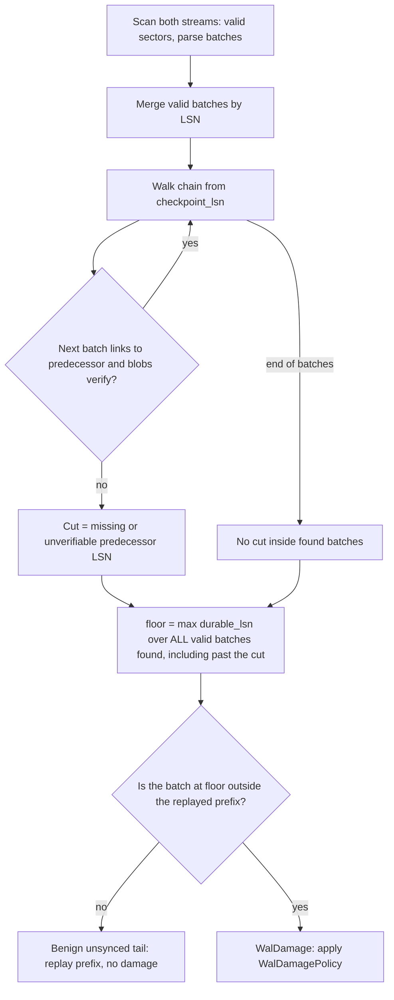

# aydb — Architecture & Design Specification

*Windows/SMB-Optimized Embedded Storage Engine & Lightweight SQL*

---

## 1. Background and Target Requirements

`aydb` (*All Your DataBase*) is an embedded storage engine designed to handle both persistent application state (immediate synchronization of small settings and states) and large-scale caching (blob management with automatic eviction, such as HTTP caches) within a single unified, high-performance, crash-safe foundation for desktop applications.

The planned extension is to support a third application workload: local information retrieval for AI agents. Durable application state, bounded caches, and searchable derived data should share a storage foundation while retaining explicit durability and resource policies. This extends the existing desktop and edge focus; the search capabilities described in the roadmap are not implemented yet.

### 1.1 Core Requirements

* **Hybrid Workload Support:**
  * **Settings & State Management:** Small records (tens to hundreds of bytes), random updates, durability on return for `SyncTransactional` commits.
  * **Cache Management:** Medium-to-large payloads (blobs ranging from a few KB to several MB), high churn rates, and automatic LRU purging governed by per-table logical size limits (`MAX_BYTES`).
* **Zero-Allocation & Bounded Memory Footprint:**
  * The data-holding components have fixed budgets: the MemTable (`memtable_capacity_bytes`), the verified block cache (`block_cache_bytes`, default 4 MB) and the verified blob cache (`blob_cache_bytes`, default 4 MB). Their sum is the deterministic part of the private heap.
  * Four further structures are bounded differently and are **not** included in that sum:
    * *Bloom filters and sparse fence pointers* are kept in memory for every `idx_*.db` segment. They are small relative to the data (about one fence pointer per 4 KB block and `bloom_bits_per_key` bits, default 10, per key) but grow in proportion to the size of the database.
    * *The transaction overlay* holds the uncommitted writes of the open transaction. It is limited by `max_transaction_bytes` (default 64 MB; `0` means unlimited), and a write that would exceed the limit fails. Commits waiting for a group flush (§4.5) are held in memory as well, at most one per connection.
    * *The `AccessTracker`* that coalesces read hits for LRU is capped by entry count (`max_in_memory_access_ticks`, default 65,536 keys), not by bytes.
    * *The SQLite adapter's rowid map* for non-integer primary keys retains at most 262,144 entries once all cursors are closed; while cursors are open it can hold more.
  * **Primary Storage Caching via OS Page Cache:** Raw file caching, OS-level write-behind, and sequential readahead are delegated to the host operating system's page cache (e.g., Windows Cache Manager VACBs).
  * **Optional Bounded Verified Block/Blob Cache:** Rather than a blanket prohibition on in-process caching, the engine supports an optional, strictly-bounded user-space cache for verified 4 KB index blocks (`block_cache_bytes`) and small verified blobs (`blob_cache_bytes` in `EngineConfig`).
    * *Rationale:* While the OS page cache eliminates physical disk I/O on warm pages, every uncached `idx_*.db` 4 KB block read still pays an OS kernel transition (`ReadFile` / `pread` via `CcCopyRead`) plus a full-block CRC32C pass. On Windows, this overhead amounts to microseconds per lookup. Caching already-verified immutable 4 KB data blocks and small verified blobs in user space eliminates both the syscall and repeated CRC verification on hot internal/leaf blocks, reducing lookup latency to tens of nanoseconds while keeping the cache and MemTable budgets fixed (`memtable_capacity_bytes` + `block_cache_bytes` + `blob_cache_bytes`; the structures listed above are accounted for separately). Setting `block_cache_bytes = 0` and `blob_cache_bytes = 0` preserves the zero-cache footprint for ultra-constrained environments.
* **Optimization for Windows FS (NTFS) and SMB (CIFS / Samba):**
  * Must operate without performance degradation or data corruption not only on local NTFS volumes, but also over SMB/CIFS shares common in enterprise folder redirection, roaming profiles, and WSL/container mounts.
* **Cross-Platform Portability:**
  * Built upon a design tailored for the strictest constraints (Windows/SMB), while isolating OS-specific primitives behind a minimal low-level Platform Abstraction Layer (PAL / VFS) so that Linux (`ext4`/`XFS`) and macOS (`APFS`) also achieve near-theoretical peak performance.

---

## 2. System Architecture and Filesystem Strategy

### 2.1 Single-Host Exclusive Handle Model

* **Core Assumption:** Even when the underlying storage resides on an SMB share, all concurrent access is assumed to originate from a **single host** (simultaneous access from other hosts is safely rejected via exclusive sharing mode `dwShareMode = 0`).
* **Preserving SMB RWH Leases:**
  * Database files are opened at startup with `dwShareMode = 0` (complete exclusivity) and kept open (never calling `CloseHandle` until a segment is retired).
  * This allows the client OS to continuously hold a `Read-Write-Handle (RWH) Lease` from the SMB server, eliminating network round-trip times (RTT) and serving reads and buffered writes entirely from the local RAM cache.
* **Future Multi-Process Extension (Gateway / Multiplexer Architecture):**
  * While primarily implemented as an in-process library, the engine is structured so that if multiple worker processes need concurrent access in the future, a single gateway process can hold the exclusive file handles and communicate zero-copy with workers over anonymous shared memory (`CreateFileMapping(INVALID_HANDLE_VALUE)`) and local IPC (Named Pipes / `WaitOnAddress`).

### 2.2 File Segregation Aligned with OS Prefetcher (Cache Manager) Boundaries

To maximize the effectiveness of the Windows Cache Manager (which maps files in 256 KB Virtual Address Control Block [VACB] views and tracks stride read-ahead per file stream), physical files are strictly segregated by access pattern and mutability.

| File Category | Naming Convention | OS Open Flags (Win / Unix) | Role & Lifecycle |
| :--- | :--- | :--- | :--- |
| **Boot Metadata** | `boot_meta.db` | Standard (4 KB-aligned, device flush after every write) | Fixed 8 KB size (4 KB × 2 ping-pong buffer). Stores active segment ID lists, table statistics, and pending GC lists. |
| **Sync Journal (WAL)** | `wal_sync.db` | `OVERLAPPED` (buffered, device flush per commit) | Default 8 MB size (physically pre-zeroed). Logs critical synchronous mutations without flushing buffered cache pages. See §4.5 for the commit path. |
| **Buffered Journal (WAL)** | `wal_buf.db` | `OVERLAPPED` + `SEQUENTIAL_SCAN` | Fixed 16 MB size (pre-allocated). Sequentially logs high-frequency buffered updates in OS cache without disk stalls. |
| **Index Layer** | `idx_<SeqID>.db` | `RANDOM_ACCESS` / `FADV_RANDOM` | Immutable sorted key-value file (SSTable format). Stores keys, small inline column values, and pointers to out-of-line blobs. |
| **Standard Blob Layer** | `blob_std_<SeqID>.db` | Standard (`OVERLAPPED` / positional I/O) | Append-only immutable file storing values larger than the inline threshold (e.g., 1 KB). Opened without `SEQUENTIAL_SCAN` to avoid 256 KB read-ahead amplification on random point reads. |
| **LRU Blob Layer** | `blob_lru_<TblID>_<SeqID>.db` | Standard (`OVERLAPPED` / positional I/O) | Append-only blob file dedicated to a specific LRU-capped table. Enables whole-generation file deletion (Copy-less Eviction) while optimizing random point reads. |

### 2.3 Rename-Free & Deferred GC File Management (Samba / Antivirus Resilience)

On Windows systems with antivirus minifilter drivers or on Samba shares, renaming (`MoveFileEx`) or deleting (`DeleteFile`) files that have recently been accessed or remain open frequently triggers `ERROR_SHARING_VIOLATION` or `STATUS_DELETE_PENDING`. `aydb` eliminates these failure modes completely through three rules:

1. **Monotonically Increasing Sequence IDs (No Filename Reuse):**
   Every `idx` and `blob` segment receives a monotonically increasing 64-bit `SeqID`. Once a filename is used, it is never reused.
2. **Rename-Free Pointer Switching:**
   When a flush or compaction completes, no file renaming or atomic file replacement is performed. Instead, the active segment ID list inside `boot_meta.db` is atomically updated.
3. **Close-Before-Delete and Deferred GC Queue:**
   Obsolete segments have all in-process handles explicitly closed (`CloseHandle`) before `DeleteFile` is invoked. If deletion fails (e.g., because an antivirus scanner is momentarily inspecting the file), the error is ignored and the segment ID is recorded in the `PendingDeleteList` of `boot_meta.db` to be retried at the next checkpoint or startup.

---

## 3. Core Storage Engine Design (KV Separation + Low-Memory Index)

### 3.1 WiscKey-Style Key-Value Separation

To support both fast random updates of small configuration records and zero write amplification for multi-megabyte HTTP cache payloads, values are stored differently based on size:

* **Inline Storage (`Value < 1 KB`):**
  Stored directly alongside the key inside the MemTable and `idx_<SeqID>.db`. A single index lookup retrieves both the key and the value.
* **Out-of-Line Blob Storage (`Value >= 1 KB`):**
  The payload is appended first to `blob_*_<SeqID>.db`, while the index stores only a compact 23-byte pointer structure:
  `[Kind (1B) | TableID (2B) | SegID (8B) | Offset (4B) | Length (4B) | ValueCRC32C (4B)]`.
  Consequently, index compaction never copies large blob payloads.

### 3.2 Index Storage: Immutable Offset-Indexed SSTables (`idx_*.db`) and Bounded Caching

* **Writable MemTable (In-Memory, Fixed Size Cap: e.g., 4 MB – 8 MB):**
  An in-memory ordered map absorbing the latest writes, stored as a sorted directory of copy-on-write chunks of at most 512 entries each. A read snapshot shares the directory, so the first write after a snapshot copies only the directory and the one chunk it touches. Once it reaches its memory cap (`memtable_capacity_bytes`), it is flushed to disk as an immutable `idx_<SeqID>.db` segment.
* **Immutable Index Segments (Sparse Fence Pointers & In-Heap Bloom Filters):**
  On-disk `idx_<SeqID>.db` files are organized into 4 KB blocks. The database process keeps **only the first key of each 4 KB block (Sparse Fence Pointers) and a Bloom Filter in heap memory**. Both are proportional to the indexed data (a few hundred KB to a few MB for typical databases, more for larger ones) and are not covered by the fixed cache budgets below. During lookups, the engine locates the target block offset via binary search over the fence pointers and reads the 4 KB block.
* **Complementary Caching Architecture: OS Page Cache + Optional Bounded Verified Cache:**
  * **OS Page Cache as Primary Substrate:** The host OS page cache (Windows Standby List / VACBs, Linux page cache) serves as the primary data cache, handling physical file buffering, write-behind, and sequential read-ahead without custom in-process buffer pool bloat.
  * **Optional Bounded Verified Block Cache (`block_cache_bytes`):** Caches 4 KB `idx_*.db` data blocks in user-space fixed slots indexed by `(seq_id, block_idx)` **after** CRC32C verification.
  * **Optional Bounded Small Blob Cache (`blob_cache_bytes`):** Caches verified small blob payloads ($\le 16\text{ KB}$) indexed by `(BlobKind, table_id, seg_id, offset)` with a dedicated sub-budget so that large-blob churn cannot evict index blocks. For the append-only active blob segment, only records below `flushed_offset()` are cached.
  * **Rationale:** While the OS page cache eliminates physical disk I/O on warm pages, every uncached `idx_*.db` 4 KB block read still pays an OS kernel transition (`ReadFile` / `pread`) plus a full-block CRC32C pass. Caching already-verified immutable 4 KB data blocks and small verified blobs in user space eliminates both the syscall and repeated CRC verification on hot internal/leaf blocks, dropping read latency from microseconds to tens of nanoseconds while keeping the cache and MemTable budgets fixed (`memtable_capacity_bytes` + `block_cache_bytes` + `blob_cache_bytes`). Setting `block_cache_bytes = 0` and `blob_cache_bytes = 0` preserves the zero-cache footprint for ultra-constrained environments.
  * **Immutability & Zero Cache Invalidation Hazard:** Because `idx` and `blob` segments are immutable and `SeqID`s are never reused (`ARCHITECTURE.md` §2.3), cached entries never become stale. Invalidation is needed only when a segment is retired (during compaction commit or LRU segment reclamation), where all cached blocks for that `seq_id` are purged.
  * **Scan-Resistance:** Unbounded full-table scans do not insert blocks into the cache, and compaction reads `idx_*.db` inputs through a streaming reader that fetches one 4 KB block at a time without cache insertion. Batch passes therefore do not displace hot point-lookup working sets. This bypass comes from the readers, not from an open hint: `OpenHint::BackgroundBulk` (`FILE_FLAG_SEQUENTIAL_SCAN` plus a low I/O priority hint on Windows) is defined and implemented in the Windows PAL, but compaction does not currently open its files with it, so it is not used.

---

## 4. Crash Recovery and Durability

`aydb` avoids random-I/O flushes during normal transactions and relies on sequential journal writes and ordered metadata updates for crash consistency. The contract is deliberately narrow:

* **`SyncTransactional` commits** are durable when the call returns; before one is appended, all earlier buffered commits are made durable first (prefix durability).
* **`BufferedFast` commits** survive process crashes (`kill -9` / `TerminateProcess`) because they reach the OS page cache, but an OS crash or power loss may roll back recent buffered commits that were not yet synced.
* Consistency rests on CRC-verified WAL sectors, `boot_meta.db` slots, and blobs, and **assumes the storage honours flush semantics**. It is exercised by deterministic fault-injection simulation (`FaultInjectingFs`), not by physical power-cut testing.

### 4.1 `boot_meta.db` Ping-Pong Buffer (Double Buffering)

* Fixed 8 KB file size: `Offset 0..4096` is **Slot A**, and `Offset 4096..8192` is **Slot B** (if the catalog payload exceeds 4,028 bytes it is written to an immutable overflow file `manifest_<SeqID>.db`, and the slot stores a 20-byte pointer to it: `[SeqID (8B) | FileLen (8B) | PayloadCRC32C (4B)]`).
* Layout of each 4 KB slot (64-byte fixed header + variable payload + 4-byte slot trailer):
  `[Header(64B): Magic "AYDB"(4B) | Version(2B) | Flags(2B) | Generation(8B) | NextSeqID(8B) | CheckpointLSN(8B) | SyncWalEpoch(8B) | BufWalEpoch(8B) | PayloadLen(4B) | PayloadCRC32C(4B) | Reserved(4B) | HeaderCRC32C(4B)] + [Payload: CatalogPayload, or the external manifest pointer when `Flags` bit 0 is set; `Flags` bit 1 marks a database with a `UNIQUE` index] + [ZeroPadding] + [SlotCRC32C(4B at offset 4092..4096)]`
  The header offsets are `0..4` magic, `4..6` version, `6..8` flags, `8..16` generation, `16..24` next sequence ID, `24..32` checkpoint LSN, `32..40` sync WAL epoch, `40..48` buffered WAL epoch, `48..52` payload length, `52..56` payload CRC32C, `56..60` reserved, `60..64` header CRC32C (over bytes `0..60`). The trailer CRC32C covers bytes `0..4092`. The segment counts are not part of the header: the catalog payload is a sequence of length-prefixed lists (index segments, standard blob segments, LRU blob segments, table quotas, pending deletes). The overflow file starts with its own magic `AYMF` and carries a payload CRC32C. See [phase1/02_BOOT_META_AND_GC.md](./phase1/02_BOOT_META_AND_GC.md) for the field-level specification.
* A manifest file referenced by a valid slot always holds exactly the bytes that slot describes, because a manifest file name (its SeqID) is never reused. If a commit fails after writing the manifest but before touching any slot, the failure is retryable, yet the SeqID that attempt consumed stays consumed: the retry writes a fresh `manifest_<SeqID>.db` instead of overwriting the failed one (a shorter retry would keep the stale tail of the longer file). A crash during the failed attempt is covered at open, which durably advances `NextSeqID` past every `manifest_*`, `idx_*` and `blob_*` file found on disk before any SeqID is allocated.
* When updating metadata, the engine overwrites whichever slot has the older `Generation` in a single 4 KB aligned write and invokes `sync_barrier()` / `sync_durable()`. Upon startup after a crash, both slots are read, and the slot with valid CRCs and the higher `Generation` is selected. Fallback to the other slot happens only on genuine corruption (CRC / format failure or a missing external manifest); a transient I/O error fails the open instead of silently booting from an older generation.
* **Unknown flags.** Only bit 0 (`FLAG_EXTERNAL_MANIFEST`) is defined. A slot with any other flag bit set is invalid, like a slot with a bad CRC, and the open does not fall back to it. `FORMAT_VERSION` is not changed.

### 4.2 Pre-Allocated Fixed-Size WAL and Physical Two-Stream Commit

* **Zero-Fill-Free Reuse via Epoch Numbers:**
  Both WAL files (`wal_sync.db` at 8 MB by default, `wal_buf.db` at 16 MB fixed) are treated as arrays of 4 KB sectors. Each sector begins with a 16-byte `WalSectorHeader`: `[SectorCRC32C (4B) | WalEpoch (8B) | ValidBytes (2B) | WalFormatVersion (2B) = 2]`, followed by 3-byte fragment headers (`[FragType (1B) | FragLen (2B)]`) framing logical `WalBatch` payloads (`[LSN (8B) | BatchCRC32C (4B) | RecordCount (4B) | PrevLsn (8B) | DurableLsn (8B) | Records...]`; §4.6.5). When a WAL file wraps around or is reused after a MemTable flush, its `WalEpoch` is incremented (and **both** epochs are rotated unconditionally on every `open`, even if recovery found nothing, so a stale same-epoch sector left behind by write-back reordering can never be replayed; this costs one `boot_meta.db` commit per open) and sectors are overwritten directly without zero-filling the file. Fragments carry no checksum of their own: the sector CRC32C covers the whole sector (header, fragments and padding), and each reassembled batch is additionally verified by its `BatchCRC32C`. During recovery, the engine scans sequentially from the beginning of each file and finds the valid prefix of each file: it ends at the first sector with a **CRC mismatch (torn write)**, an unparsable body, an unsupported format version or a non-current `WalEpoch`. The scan itself continues past such a sector, to collect later intact batches that bound the lost range (§4.6.4); under default `WalDamagePolicy::Truncate`, it ends at the ordinary end of the log (a sector that is all zeros, or an older-epoch sector with a valid CRC), whereas `WalDamagePolicy::Fail` and `open_with_salvage` continue scanning past end-of-log sectors so later intact batches hidden behind zeroed or stale sectors are still discovered (§4.6.6, §4.6.9).
* **Two-Tier Durability via Physical Stream Separation (`wal_sync.db` vs. `wal_buf.db`):**
  To preserve `dwShareMode = 0` exclusivity, avoid flushing multi-megabyte buffered cache pages during small synchronous commits, and prevent LSN sector holes on power loss, `aydb` separates the journal into two physical streams:
  1. **Sync Mode (`wal_sync.db`, Critical configuration & catalog changes):** Physically pre-zeroed so NTFS `ValidDataLength (VDL)` equals `EOF` from creation. Sectors are padded to 4 KB boundaries, written to the OS cache, and flushed to the device before the commit returns (§4.5).
  2. **Buffered Mode (`wal_buf.db`, HTTP cache insertions & high-frequency state updates):** Opened as a standard buffered sequential file. Writes enter the OS page cache immediately and return without disk stalls, so committed batches survive application crashes or `TerminateProcess` / `kill -9`. A full OS crash or power outage may roll back the most recent unflushed buffered writes. At every buffered-WAL sync point (prefix sync before a `wal_sync.db` append, transaction prepare, LRU segment reclaim) the open sector is **sealed**, so an already-synced sector is never rewritten in place by a later append (cost: at most one partly used 4 KB sector per sync point). During recovery, valid records from both `wal_sync.db` and `wal_buf.db` are merge-sorted in ascending order of their global 64-bit `LSN`. The replay is a strict prefix of this global order: if one stream stops early, batches of the other stream at or after the first missing or unverifiable batch (the cut) are not replayed either, and the loss of acknowledged commits is detected and reported (§4.6).

### 4.3 Consistency Protocol for KV Separation (`Write-Blob-Before-WAL`)

To prevent dangling pointers (where an index entry survives recovery but its target blob payload is missing), the following write ordering is strictly enforced:

1. **Write Ordering:** Always write `[Magic | BlobCRC32C | Key | Value]` to `blob_<SeqID>.db` first, and only then append the pointer record `[Key | BlobSegID | Offset | Len | BlobCRC32C]` to the WAL (`wal_sync.db` or `wal_buf.db`).
2. **CRC Verification on Recovery and Read:**
   For `BufferedFast` commits, expensive `FlushFileBuffers` calls on `blob` files are omitted. (`SyncTransactional` commits sync the blob writers before the WAL record.) Instead, during WAL replay after a power failure (or during normal reads), the engine verifies the `BlobCRC32C` stored in the WAL/index against the actual bytes in the `blob` file. If a power outage prevented the blob write from reaching disk (file truncated or CRC mismatch), the engine does **not** treat the database as corrupted; instead, it safely discards the uncommitted record. This validation happens only at startup (`recover_two_streams` + `validate_blob_ptr` for WAL-replayed pointers; blobs referenced from `idx` segments were synced before their checkpoint). After open, a blob that fails verification (CRC/magic/key mismatch, short read, missing segment) is genuine corruption and is **never** silently reported as absence: per-table `on_corrupt` policy either returns `InvalidData` / `SQLITE_CORRUPT` naming the table and primary key (`error`, default for uncapped tables; explicit deletes still succeed and clean up) or hides the row and queues it for automatic deletion at the next safe write (`evict`, default for capped tables). Both modes bump `StorageEngine::corrupt_blob_detections()`.
   Recovery applies the startup validation to the merged log of both streams and has **prefix semantics**: the first batch (or transaction group) with an unverifiable blob is the cut, and it and everything after it, in either stream, is discarded, so that replay never exposes a hole in the commit order (§4.6.2). Dropping one batch while keeping later ones could replay a commit that read from the dropped one. An unverifiable blob is expected after a power loss in `wal_buf.db`, where blobs and WAL records are flushed independently, so a later commit can persist while an earlier one is lost; there it is the benign unsynced tail and is not reported. A blob below the durable watermark that fails verification is damage (§4.6.4). Only a blob that was never durably written counts as unverifiable. A real I/O error while reading a blob during validation is not treated as absence; it aborts recovery and fails the open, so that a transient error cannot cause a committed batch to be dropped.
   Because recovery verifies the blobs of every batch above `checkpoint_lsn`, a blob segment must not be unlinked while a logged batch of the current WAL epoch may point into it. A `blob_lru` segment reclaimed after an eviction therefore leaves the catalog at once but is queued for deletion only by the next commit that rotates the WAL epochs; a crash before that leaves an uncataloged file that recovery adopts if a batch references it and sweeps otherwise.
3. **WAL Failure Poisons the Engine:**
   If a WAL write/sync, a blob segment sync, or a metadata slot write/sync fails, the engine is poisoned. Further mutations return errors until the database is reopened, while reads keep working. A failed WAL commit may or may not be present after recovery, but it is never partially applied. A failed blob sync is never retried: on Linux a failed `fsync` can drop the dirty pages and mark them clean, so a second `fsync` on the same file may report success for bytes that never reached the disk ("fsyncgate"). Retrying would let a later checkpoint commit `idx` entries that point at lost blobs and rotate away the WAL that held the only other evidence of them. Only a failure of the file sync itself (including `ENOSPC` reported at `fsync` time) poisons; a blob `write` that fails before the sync leaves its buffer intact and is simply retried, without poisoning. This covers every blob sync that feeds a commit or checkpoint: the pre-WAL sync of a `SyncTransactional` commit, the sync of the active writers before a MemTable flush or checkpoint, and the sealing of a segment when it rolls. The one sync whose failure is ignored is the one in `drop_table`, because every byte of the dropped table's segment is already dead. A failed metadata update may already have made its new slot authoritative, so index outputs and both generations' files are retained and metadata updates and garbage collection stop until recovery resolves the on-disk state.
4. **Recovery from SMB Write-Behind Failures (design intent, not implemented):**
   The intended design is that, if a background flush error is detected on an SMB handle, the engine closes and reopens the file handles to discard any poisoned local OS cache pages and reconstructs the MemTable from the last verified checkpoint generation. This in-place recovery does not exist. The engine instead poisons itself on the first failed WAL append/sync, blob sync or metadata slot write/sync (item 3), and the application has to drop the engine and reopen the database, which runs the normal crash recovery from the last verified state. A write-behind failure that is reported only when the OS later flushes cached pages is not detected unless a sync call returns it.

### 4.4 Checkpoints and Post-Commit Maintenance

* **`StorageEngine::checkpoint`:** Brings the persisted state up to date so that the next `open` has no replay work. A non-empty MemTable is flushed to a new `idx` segment, which also commits blob segment lengths, dead bytes and quota totals. With an empty MemTable, the lengths of blob segments that have grown since the last commit (for example through a rolled-back transaction) are committed instead. Dead bytes are persisted, and a fully dead blob segment is unlinked, only for deletions that a checkpoint covers: the dead bytes of a transaction that is still being committed (for example when its commit rotates a full WAL, or while it waits in the group commit) are left out of both, because that transaction may still be lost and the rows it overwrote must keep their blobs. They are applied by the first flush after the transaction is published. It fails with `InvalidInput` while a transaction is active. Dropping the engine does not run a checkpoint; a drop without one is treated as a crash by the next `open`.
* **Post-commit maintenance failures do not fail the commit:** Once the WAL append of a write or transaction has succeeded, the commit is durable and the call returns `Ok`, even if the follow-up maintenance (blob segment reclaim, quota persistence, quota eviction, compaction, MemTable flush) fails. Such failures are counted in `StorageEngine::maintenance_failures()` and the text of the latest one is kept in `last_maintenance_error()`. Retryable failures leave the flush condition or exceeded quota in place for later commits. WAL append/sync and metadata slot write/sync failures poison the engine and require reopen (item 3 above), including a metadata failure during post-commit maintenance.

### 4.5 Commit Path and Group Commit

A synchronous SQL commit (`xCommit`) has three steps, and only the first and last hold the engine lock:

1. Under the lock, the WAL batch is written to `wal_sync.db` without a device flush.
2. Without the lock, the commit waits for a device flush that covers its batch.
3. Under the lock, the batch moves to the MemTable, which makes it visible to readers.

* **Readers are not held up by the flush.** They keep reading the committed state, and a transaction becomes visible only after a flush has made it durable.
* **The writer slot is released after step 1.** The next writer starts at once. Its transaction overlay begins with the batches still waiting for durability, so it builds on them and no update is lost. Readers on other connections do not see those batches. These are bounded because each connection has at most one commit waiting.
* **One flush covers a group.** The first waiting commit becomes the leader and flushes the file. The flush covers every batch written before it started. Commits that arrive during the flush are covered by the next leader.
* **Waiting instead of `SQLITE_BUSY`.** `xBegin` waits up to `writer_wait_timeout_ms` (default 1 second) for another connection's transaction to end. The wait is bounded because that connection could be held open by the same thread, which could never end it. `0` restores immediate failure.
* **Connecting while another connection writes.** `xConnect` of an existing table changes no durable state, so it succeeds immediately even while another connection's transaction is open. `xCreate` of a new table writes durable state (its catalog entry and rowid mapping marker), so it waits up to `writer_wait_timeout_ms` for that transaction to end and then fails with `SQLITE_BUSY`. A table that is in the catalog without its rowid mapping marker was written by an unsupported older format; connecting it fails with `SQLITE_CORRUPT` and nothing is repaired.
* **Paths that bypass the group flush it first.** Rotating the WAL, flushing the MemTable, checkpointing, a commit that is not part of the group, and a non-transactional write all flush and publish the waiting batches first, so the MemTable holds every earlier commit before they proceed.
* **A failed flush fails the whole group.** The engine is poisoned and every waiting commit returns an error, as with any WAL sync failure (§4.3 item 3).
* **Commits outside the group.** A synchronous commit with post-commit maintenance (capped tables, dropped tables, quota persistence, a due MemTable flush) keeps the writer slot during its own flush, still without the engine lock. A transaction split across several WAL batches (over 512 KB) flushes under the lock.
* **Why `wal_sync.db` is not write-through on Windows.** NTFS holds `FILE_FLAG_WRITE_THROUGH` writes back while the same file is being flushed, so such writes could not join a group flush in progress. Write-through alone also does not guarantee durability, because it can complete in a drive's volatile cache. Each commit relies on the device flush instead.

### 4.6 WAL Damage Detection and Ordered Recovery (implemented)

This subsection describes the implemented behaviour (`src/wal/recovery.rs`, `src/engine/salvage.rs`), together with the rationale, the alternatives that were rejected and the limitations that were accepted. The decided exceptions are listed in 4.6.12.

#### 4.6.1 The problem

Before this work, recovery treated each WAL stream on its own. `recover_single_wal_stream` stopped at the first sector whose epoch was wrong, whose CRC failed, or whose contents did not parse. `recover_two_streams` then filtered each stream (the buffered stream was cut at the first unverifiable blob, the sync stream dropped only the offending batch) and merged what was left by LSN. `StorageEngine::open` replayed that and rotated both epochs, which overwrites the evidence. Two ordering holes followed, and both were reproduced (`damaged_sync_sector_cuts_later_buffered_batches` and `unverifiable_sync_blob_cuts_later_batches_of_both_streams`, now regression tests):

1. **A stream stops early but the other stream keeps going.** If `wal_sync.db` stops at a damaged sector, batches with higher LSNs in `wal_buf.db` are still replayed.
2. **A sync batch with an unverifiable blob is dropped while later batches are kept.** A later commit may have read the value that the dropped commit wrote.

In both cases the recovered state can contain a commit that read a value from a commit that is missing. Neither hole can be reached by power loss or `kill -9` alone, because the engine orders its flushes: before a synchronous append, `make_buf_wal_durable` syncs the buffered blobs and the buffered WAL; before any later append, `drain_pending_durable` flushes group-committed sync batches; sync blobs are synced before their WAL record; a failed blob sync poisons the engine. A 10,000-seed crash run with an LSN-level oracle found no violation. Both holes need **media damage of data that was already synced** (a bad sector, a bit flip, a file truncated by a third party). The crash harness originally corrupted no synced data and did not drive group commit, so it could not see them; it now does both (4.6.11).

The issue is therefore not that power loss breaks ordering. It is that when durable data has been damaged, the engine silently turns a loss of acknowledged commits into a state that is not a prefix of history.

#### 4.6.2 Invariant

> The recovered state is the replay of exactly the batches below a **cut point**: the first commit, in global LSN order across both streams, that is missing or unverifiable. Nothing at or after the cut is replayed, in either stream.

This is prefix semantics lifted from one stream (as §4.3 item 2 already does for the buffered stream) to the merged log. Prefix semantics is the only property under which "a commit never sees a missing predecessor" holds without tracking read sets.

Recovery then has two separate jobs, and the design keeps them separate:

* **Where is the cut?** Decided by the predecessor link (4.6.3). Always applies.
* **Was acknowledged data lost at the cut?** Decided by the durable watermark (4.6.4). Only this is reported and governed by a policy (4.6.6).

A cut caused by the ordinary unsynced tail of a power cut is normal and silent. A cut that lies at or below something the engine had already made durable is damage.

#### 4.6.3 Predecessor link

LSNs are **not dense**. Inside an explicit transaction every statement advances `next_lsn`, but only one batch is logged at commit, so a transaction of k statements leaves k-1 unused LSNs before its batch; multi-chunk transactions behave likewise. A missing LSN therefore proves nothing, and "look for gaps" cannot work.

Each batch instead records `prev_lsn`: the LSN of the batch appended immediately before it, **across both streams**. The engine appends under a single lock and keeps `last_appended_lsn`, updated only after an append succeeded (a failed append poisons the engine, so no later batch can name it). The chunks of a multi-chunk transaction are ordinary batches and are part of the chain. Group-committed sync batches are appended under the same lock before their flush, so they are chained in append order, which equals LSN order.

Recovery merges the valid batches of both streams by LSN and walks the chain:

* the first batch must have `prev_lsn <= checkpoint_lsn` (the batches before it are in an `idx` segment);
* every later batch must have `prev_lsn` equal to the LSN of the batch before it in the merged order.

A broken link means the batch named by `prev_lsn` is missing or was unverifiable, and **that named LSN is the cut**. It is an exact, real batch LSN, not a guess from a gap. A batch with an unverifiable blob is treated the same way: its LSN is the cut.



The alternative of re-allocating LSNs densely at flush time was rejected (4.6.10).

#### 4.6.4 Durable watermark and the damage rule

The chain locates the cut but cannot say whether the lost batches had been promised to anyone. After a power cut, the buffered stream may legitimately lose a suffix, and with out-of-order write-back it may even keep batch 12 and lose batch 11. That is not damage: nothing in 11 or 12 was ever durable.

Every batch therefore records `durable_lsn`: the highest LSN **known durable** when the batch was appended. It is always the LSN of a real batch (or at most `checkpoint_lsn`), taken from an engine field that advances only after a device sync that covered the batch, in both streams, returned success. A sync batch that does not join a group commit is appended after the buffered stream has been made durable and after pending group batches were drained, so it carries a watermark that covers everything before it. A group-committed sync batch is appended while earlier group batches still await their flush, so it carries the watermark of the last completed flush. A buffered batch carries the watermark of the last completed sync. A watermark that is lower than it could be only makes the damage rule below report less, never more.

Recovery computes

```
floor = max(durable_lsn)   over every valid batch it finds,
                           including batches found by scanning past a stop point
```

and applies **one rule**:

> The WAL is damaged if and only if the batch at `floor` is not in the replayed prefix (`floor` is above the last chain-valid batch).

`floor` is the `durable_lsn` of a batch that was found, so it names a real batch. If that batch is not among the chain-valid ones it is missing, or it lies at or after the cut. This is the same as "some missing or unverifiable LSN is `<= floor`", but it does not depend on which LSN the chain names: a lost run of batches is named by its last member (the `prev_lsn` of the first batch found after it), which may lie above `floor` while an acknowledged batch at or below `floor` is gone as well.

Consequences:

* A missing range entirely above `floor` is the legitimate unsynced tail of a power cut, including out-of-order persistence in the buffered stream. It is never reported as damage.
* If the batch whose LSN equals `floor` is not itself found, an acknowledged batch is gone, whether or not the chain also breaks. With no break, or a break above `floor` that is not a missing predecessor (an unverifiable blob, a batch past an unusable sector), the reason is `AcknowledgedTailLost`; with a break named by `prev_lsn` it is `MissingPredecessor`.
* A valid sector after a stop is **not** damage by itself. Its only roles are to contribute its `durable_lsn` to `floor` and to bound the lost range (it is the proof that something at or after the stop existed). Treating "valid data after a hole" as damage would flag every power cut that persisted buffered pages out of order, which is the false positive the watermark exists to avoid.

**Where the scan of a file ends.** Each file is scanned from sector 0 in 64-sector (256 KB) windows. A sector that is not a usable current-epoch sector (CRC32C failure, unparsable body, unsupported format version, a newer epoch, or an older epoch whose CRC32C fails, which is a torn write) stops the valid prefix, but the scan reads on and collects the later intact current-epoch batches, for the reasons above. Only the **ordinary end of the log** ends the scan itself, wherever it comes: a sector that is all zeros (never written), or a sector of an older epoch whose CRC32C is valid (left over from before the last epoch rotation). Nothing is read past it. Since both epochs rotate on every `open`, after a clean shutdown sector 0 of each file is already of an older epoch, so a clean open reads one window per file instead of 8 MB plus 16 MB.

*Accepted limitation:* a sector that was lost and now holds intact older-epoch content, or zeros, is indistinguishable from the end of the log. It ends the scan, the batches behind it are not read, and the loss is neither counted in `torn_tail_sectors` nor used for `floor`, so damage of that kind can go unreported. The replay is still a correct prefix of the log. A lost sector that fails its CRC32C (a torn write, bit rot) is not affected and is still reported.

Example (buffered stream persisted out of order; power cut):

```
LSN        10(sync)  11(buf)   12(buf)
persisted  yes       NO        yes        12.prev_lsn = 11 -> broken, cut = 11
floor      = max(durable_lsn(10), durable_lsn(12)) = 10    (nothing past 10 was synced)
11 > 10    -> not damage. Replay 10. Batch 12 is discarded (it is past the cut).
```

Example (same, but a sync batch 13 followed):

```
13 is a sync batch, appended after 11 and 12 were made durable: durable_lsn(13) = 12.
Batch 11 is lost: floor = 12 >= 11 -> damage (MissingPredecessor, cut = 11).
```

#### 4.6.5 Format

The link and the watermark are stored in a **fixed batch header extension**. A batch payload (§4.2) becomes:

```
 0                   1                   2                   3
 0 1 2 3 4 5 6 7 8 9 0 1 2 3 4 5 6 7 8 9 0 1 2 3 4 5 6 7 8 9 0 1
+---------------------------------------------------------------+
|                         LSN (u64, LE)                         |
|                                                               |
+---------------------------------------------------------------+
|                      BatchCRC32C (u32)                        |
+---------------------------------------------------------------+
|                      RecordCount (u32)                        |
+---------------------------------------------------------------+
|                       PrevLsn (u64, LE)                       |   new
|                                                               |
+---------------------------------------------------------------+
|                      DurableLsn (u64, LE)                     |   new
|                                                               |
+---------------------------------------------------------------+
|                    Records ... (RecordCount)                  |
+---------------------------------------------------------------+
```

`BatchCRC32C` covers one contiguous range, bytes 12 to the end of the batch: `RecordCount`, `PrevLsn`, `DurableLsn` and the records. Before this change it covered only the records, so a flipped `RecordCount` was caught only indirectly; decode now verifies the CRC before it reads any of those fields. The header grows from 16 to 32 bytes: 16 bytes per batch.

Measured with `examples/meta_wal_bench` on Windows, 3 runs each, at ad88cf0 (before) and cc36201 (the header change; point-in-time numbers): a batch of one 25-byte key and 48-byte value grows from about 101 to 117 bytes, so 50,000 such batches take 1434 sectors instead of 1238 (+15.8%). `wal_sync.db` at batch sizes 1, 10 and 50, `BufferedImmediateOsCache` and the recovery scan showed no change beyond run-to-run noise. `BufferedUserSpaceCoalesced`, which is only a copy and a CRC per batch, went from 7.0M-7.4M to 5.5M-6.4M batches per second. Step 3 added no bytes: it fills the same two fields.

**Why a fixed extension and not a leading record with LEB128 deltas.** Deltas relative to the batch LSN would usually cost 2 to 4 bytes instead of 16, but they make the batch header variable-length, add a record type that every record parser and test helper must skip, and make a corrupted delta indistinguishable from a legal one unless it is separately checked. 16 bytes against a 4 KB sector is small next to the payloads this engine logs, and a fixed header keeps parsing trivial and offsets constant. If measurements later show the overhead matters for tiny buffered batches, delta encoding is a compatible refinement under a further version bump.

**Format version.** The version is stored in the **sector header's former reserved two bytes at offsets 14..16**, which older code wrote as zero and which are covered by the sector CRC32C:

```
 0                   1                   2                   3
 0 1 2 3 4 5 6 7 8 9 0 1 2 3 4 5 6 7 8 9 0 1 2 3 4 5 6 7 8 9 0 1
+---------------------------------------------------------------+
|                      SectorCRC32C (u32)                       |
+---------------------------------------------------------------+
|                        WalEpoch (u64, LE)                     |
|                                                               |
+-------------------------------+-------------------------------+
|        ValidBytes (u16)       |   WalFormatVersion (u16) = 2  |   was Reserved = 0
+-------------------------------+-------------------------------+
```

Old format is `0` (the reserved value), the new one is `2`. Version `1` was the first revision of this format (the link and the watermark without the continuation marker below); it never shipped and is rejected like `0`. Only the version of a sector is checked **after** its epoch and CRC match, so sectors left over from earlier epochs are still ignored silently and cost nothing. A sector with the current epoch and a valid CRC but a version other than `2` is an `UnsupportedFormat` damage at that sector.

**Transaction framing.** A transaction larger than one chunk (512 KB) is logged as several batches: the first holds a `TxBegin` record, every middle one a `TxContinue` record (op byte `6`), the last a `TxCommit` record. A batch without any of the three is always a complete single-batch transaction. Without `TxContinue` a middle chunk whose begin and commit chunks are lost could not be told from a single-batch transaction. The cost is one byte per middle chunk of a transaction above 512 KB, and nothing for any other batch.

**No backward compatibility.** `aydb` is pre-release. There is no legacy reader, no "unverified" replay mode, and no `boot_meta.db` downgrade flag for this feature. A current-epoch sector of version 0 or 1 stops the valid prefix of its stream, like a bad CRC (`UnsupportedFormat` internally). Whether that is reported depends on the damage rule, which needs a `durable_lsn` from a batch that could be read: if a version-2 batch past the old sector records a watermark at or above the lost range, the loss is damage with reason `UnsupportedFormat` (`Truncate` discards the log from the old sector on, `Fail` refuses). A WAL written **entirely** in an old format carries no readable LSN, so nothing can be compared with the watermark: it is replayed as empty and **not reported**, whichever policy is set. This is accepted for a pre-release format. A database that was closed cleanly (checkpoint, empty WAL, both epochs rotated) has only stale sectors, which are ignored whatever version they carry, and opens normally. Tests: `old_format_sector_with_acknowledged_data_beyond_it_is_unsupported_format`, `old_format_sector_with_nothing_beyond_it_cannot_be_told_from_a_tail`, `old_format_wal_is_unsupported_format_and_stale_sectors_are_ignored`.

#### 4.6.6 At the cut, and the policy

At the cut:

* Replay stops before it, in both streams. The sync stream's per-batch dropping of an unverifiable blob (§4.3 item 2) and the buffered stream's per-stream prefix cut are both replaced by this one global cut.
* `next_lsn` becomes **the highest LSN seen anywhere plus one**, including batches past the cut that are discarded and the `durable_lsn` values read, so no LSN that was ever logged is reused. A reused LSN would let a stale batch left behind in an old sector be mistaken for a new one.

Damage handling is chosen with `EngineConfig::wal_damage_policy`, in the style of `CorruptPolicy { Error, Evict }` for blobs:

```rust
pub enum WalDamagePolicy {
    /// Default. Replay the verified prefix, discard the rest, and continue.
    Truncate,
    /// Refuse to open; leave every file untouched.
    Fail,
}
```

* **`Truncate` (default).** Replay the prefix below the cut, commit the catalog, and rotate the epochs, as an open without damage does. The batches at and after the cut are discarded. `open` succeeds, and the damage is visible only in the report (4.6.8).
* **`Fail`.** `open` returns `io::ErrorKind::InvalidData` whose inner error is a `WalDamage` value (downcastable with `get_ref()` / `downcast_ref`). It runs recovery in full-scan mode (`WalScanMode::FullScan`), reading past zeroed or intact older-epoch sectors so damage that zeroed or overwrote a middle sector on a single stream does not pass unnoticed. The decision is made **before** blob reconciliation, before any catalog commit, and before the epoch rotation, and before a log file that is shorter than configured (one truncated by a third party) is lengthened: the engine opens both streams without preallocation (`open_unallocated`) and allocates to the configured size (`allocate_to_target`, with the same strategy as before) only after the check. Recovery therefore scans a short file as it is; a partly persisted trailing sector that the zero extension used to complete is now ignored, which can cost at most unsynced buffered data. `wal_sync.db`, `wal_buf.db`, `boot_meta.db` and every other file are byte-identical to what they were. The one exception is a log file that does not exist at all: it is still created empty before the decision (see 4.6.12). The application can restore from a backup, or open with salvage (4.6.7) to keep what it can.

**Why `Truncate` is the default.** How a database handles a damaged log depends on who is there when it happens. Server databases such as PostgreSQL and InnoDB stop and leave the decision to an administrator, who has backups and tools to repair or discard the log. An embedded database usually has nobody: if an application cannot open its data, the user sees an application that does not start, and uninstalls or resets it. SQLite, the closest precedent, never refuses: its WAL checksums are chained, and recovery silently keeps the frames before the first bad one. `aydb` is embedded first, and its SQLite tables are meant to behave like SQLite tables, so it does the same by default. It differs from SQLite in two ways: the replayed state is a prefix of the global order across both streams (4.6.2), and the loss is reported instead of passing unnoticed.

**No evidence copy.** `Truncate` does not copy the damaged WAL files aside before it discards them. For the embedded case nobody reads such copies, and they cost disk space on a device that may be short of it. An application that wants the data uses `Fail` and salvage instead.

A SQLite application opens the engine itself and passes it to the adapter (see [guides/SQLITE.md](./guides/SQLITE.md)). Both `Fail` and salvage are therefore used at the engine level, from the application's own open call, before the adapter exists. The adapter needs no new error path and offers no salvage of its own, as SQLite offers none.

#### 4.6.7 Salvage

Under `Truncate`, the batches after the cut are discarded although many of them are intact and were acknowledged to their writers. They are discarded because any of them may have read a value written by a lost commit, and only the application can tell whether replaying one is still correct. Salvage hands them to the application instead of deciding for it:

```rust
impl<FS: PlatformFs> StorageEngine<FS> {
    /// Opens as `Truncate` does and returns the transactions it discarded.
    pub fn open_with_salvage(
        fs: Arc<FS>,
        config: EngineConfig,
    ) -> io::Result<(Self, Vec<SalvagedTx>)>;
}

pub struct SalvagedTx {
    pub lsn: u64,                // LSN of the transaction's last batch
    pub ops: Vec<SalvagedOp>,
}

pub enum SalvagedOp {
    Put { table: String, key: Vec<u8>, value: Vec<u8> },
    Delete { table: String, key: Vec<u8> },
}
```

* **Why inside `open`.** A discarded batch may point at blobs that the open itself reclaims as unreferenced. Salvage reads those values before blob reconciliation and returns them as bytes, so the application never has to order the steps. A separate read-only function run before `open` would leave that ordering to the application.
* **Whole transactions only.** A transaction larger than one chunk spans several batches framed by `TxBegin` and `TxCommit`; it is returned only if every chunk is intact, present and linked to the one before it by `prev_lsn` (the engine appends the chunks of a transaction back to back), and the whole transaction lies at or after the cut. A single-batch transaction is returned if its batch is intact. A multi-chunk transaction that lost a chunk is not returned and not counted in `unsalvageable`: like the unsynced tail of a power cut it is simply lost. The rule is exact because of the framing markers (4.6.5): a batch without a marker is a complete single-batch transaction, and a `TxContinue` or `TxCommit` batch whose open transaction is missing (its begin or an earlier chunk is lost) is an orphan continuation, never returned and not counted.
* **Primary rows only.** Only records in the primary-row namespace are returned, with the table named through the catalog. Secondary index entries, unique index entries, rowid mappings, row metadata and catalog records are derived data: writing the rows back through the normal API rebuilds them.
* **Not returned, only counted** in the report: schema changes after the cut (a table created, dropped or renamed: any catalog record), records of tables the catalog does not know, and values whose blob fails verification. Each such operation counts once, and its **whole transaction is dropped** from the list, so the other operations of that transaction are lost silently. The catalog is the one that stands after the replay of the prefix below the cut. The count is the same for `open` and `open_with_salvage`, under `Truncate` and under `Fail`. It needs the blobs of the discarded batches to be read and verified, so it is computed only when damage was found; an undamaged open pays nothing.
* **The data is engine-level.** Keys and values are in the `aydb` encoding. An application that uses the SQLite adapter must decode them itself, with the row codec.

`open_with_salvage` opens as `Truncate` whatever `EngineConfig::wal_damage_policy` says, so it can follow an `open` that failed under `Fail`, and likewise uses `WalScanMode::FullScan` so transactions intact beyond a zeroed or stale sector are both detected and returned. With no damage it returns an empty list and is otherwise the same as `open`; both share one code path. The list exists only in memory: a crash before the epoch rotation of the open reproduces it at the next open, a crash after it leaves nothing to salvage. An application usually calls it after `open` under `Fail` returned `WalDamage`, but it can also call it every time.

#### 4.6.8 Report

`StorageEngine::last_wal_recovery()` returns the report of the most recent `open` (defined even when nothing happened):

```rust
pub struct WalRecoveryReport {
    pub torn_tail_sectors: StreamCounts,   // informational; benign unsynced tail
    pub replayed_batches: StreamCounts,    // per stream
    pub last_replayed_lsn: u64,
    pub damage: Option<WalDamage>,
}

pub struct WalDamage {
    pub reason: WalDamageReason,
    pub first_lost_lsn: u64,               // lowest LSN proven lost: min(cut, floor)
    pub last_lsn_seen: u64,                // highest LSN found anywhere
    pub discarded_batches: StreamCounts,   // valid batches at or after the cut
    pub unsalvageable: u64,                // operations: schema changes, unknown tables, bad blobs
}

pub enum WalDamageReason {
    MissingPredecessor,    // chain broken: a named predecessor is not there
    UnverifiableBlob,      // batch present, its blob failed validation
    CorruptSector,         // CRC/parse failure with acknowledged data beyond it
    AcknowledgedTailLost,  // the batch at `floor` is gone
    UnsupportedFormat,     // WalFormatVersion mismatch, including the old format
}
```

When several reasons apply, the reported one is chosen by priority: `UnverifiableBlob` (a rotted blob is the cause whatever else is wrong), then `UnsupportedFormat`, then `CorruptSector`, then the reason the chain gave (`MissingPredecessor` or `AcknowledgedTailLost`). So when a broken link and a corrupt current-epoch sector are both present the reason is `CorruptSector`, because the log cannot tell them apart. `AcknowledgedTailLost` is reached when the batch at `floor` is gone and the chain names nothing at or below `floor`: no break at all, or a break above `floor` that is not a link (for example a batch past an unusable sector, or an unverifiable blob). `first_lost_lsn` is `min(cut, floor)`: a lost run of batches is named by its last member, so when `floor` lies below the cut it is the lowest LSN proven lost, not necessarily the first lost batch.

`torn_tail_sectors` counts the current-epoch sectors that failed their CRC32C or did not parse, which are silently ignored and are **not** damage by themselves; the ordinary end of the log is not counted. Under the default `Truncate`, the report is the only trace of a loss. It costs little, and it lets an application put the loss in its own logs or crash reports, which is how a developer can learn that it happens in the field. The report is plain Rust data and, by decision, is not exposed through SQL (4.6.12).

#### 4.6.9 Concurrency and cost

Under default `Truncate`, recovery reads each file in 64-sector windows and stops at the ordinary end of the log (a never-written sector or an intact older-epoch sector, 4.6.4), so a clean open reads one window per file rather than both files completely (8 MB plus 16 MB by default). Reading both files completely on every open, as an earlier revision of the scan did, cost a clean reopen about 6.0 ms; with the early end it is about 3.0 ms. Measured against 97075fb with the stop rule changed only in `recover_single_wal_stream`: `StorageEngine::open` with `EngineConfig::default()` on a directory holding 20 rows, release build, Windows, warm cache, median of 25 opens, repeated runs gave 5.7 to 6.2 ms before and 2.9 to 3.1 ms after. Moving the preallocation behind the `Fail` check (7a4ff05) did not add to this: measured the same way at ec1920e against 5eb761c, with the two builds run alternately three times (four medians each), a clean reopen took 3.2 to 3.5 ms against 3.5 to 3.8 ms. These figures are higher than the ones above because the machine state differed, so only figures from the same session can be compared. Past an unusable sector (or throughout the file under `WalDamagePolicy::Fail` / `open_with_salvage`) the scan reads to the end of the file, so damaged or `Fail`-opened logs inspect the full file (8 MB plus 16 MB by default). Measured the same way on `StorageEngine::open` at `f234c2f` (reflecting the `WalScanMode::FullScan` change in `f9b6734`), alternating `WalDamagePolicy::Truncate` (`StopAtEndOfLog`) and `WalDamagePolicy::Fail` (`FullScan`) across three rounds (four medians of 25 opens each, release build, Windows, warm cache, 20 rows), a clean reopen took `6.8 to 8.5 ms` (`6.82`–`8.45 ms`) under `Truncate` against `13.7 to 16.6 ms` (`13.68`–`16.59 ms`) under `Fail` (`+6.9 to +8.1 ms`, roughly 2×). The chain walk is a linear pass over the merged batches and keeps only the previous LSN. Normal operation adds two `u64` per batch, 16 bytes (measured in 4.6.5), and two engine fields (`last_appended_lsn`, `durable_lsn`), both guarded by the engine lock that already serializes appends. No extra sync is introduced: the watermark records what the existing flush ordering already established.

#### 4.6.10 Alternatives considered

* **Dense LSN allocation at flush.** If LSNs were assigned when a batch is written, a gap would prove loss. But `MemTable` entries and `idx` entries carry the LSN from mutation time and transactions read their own writes by LSN, so the change would reach the MemTable, the transaction overlay and the `idx` format, none of which has been audited for it. The predecessor link gives the same information without moving any LSN.
* **Watermark in the two reserved sector bytes only.** Two bytes cannot hold a 64-bit LSN. (They are used for the format version instead.)
* **Look-ahead heuristics without the watermark** ("a valid sector after a stop means damage", or "a gap of more than n sectors"). After a power cut the buffered stream can persist later pages and lose earlier ones, so these report damage for an ordinary crash. A false positive under `Fail` would refuse to open after every power cut.
* **Keep silent truncation.** Simplest, and what the code does. It hides the loss of acknowledged commits and can replay a state that is not a prefix of history. The default `Truncate` keeps the silence toward the user of the application but fixes both problems: the state is a prefix, and the loss is in the report.
* **`Fail` as the default.** The right default for a server with an administrator (4.6.6), but for an embedded application it turns recoverable damage into an application that does not start.
* **Copy the damaged WAL aside before truncating.** Rejected for the embedded case (4.6.6): nobody reads the copies, and they need retention rules, an exclusion from the orphan sweep and a failure path of their own.
* **Salvage in the SQLite adapter**, for example as SQL statements or decoded column values. SQLite itself salvages nothing, and an application that needs salvage can use the engine-level data and the row codec.

#### 4.6.11 Testing plan

* **The two reproductions** as permanent regression tests, written first against the current code to fail, then passing after the change: (1) sync stream stops early, later buffered batches exist; (2) sync batch with an unverifiable blob, later batches exist.
* **A permanent LSN-order oracle in the crash harness.** After every recovery, the recovered set of batch LSNs must be a prefix of the logged LSNs in global order. The 10,000-seed run is repeated with it.
* **Extend the crash harness** to corrupt already-synced WAL data (bit flips, zeroed sectors, truncation in either stream) and to **drive group commit**, so the paths that the engine's ordering protects against power loss are exercised against media damage.
* **Unit tests** of the chain walk (gaps from transactions and multi-chunk batches are not breaks; first batch links to `<= checkpoint_lsn`; a break names the right cut) and of the damage rule (power-cut tail above `floor` is silent; out-of-order buffered persistence is silent; the two examples in 4.6.4; `floor` taken from batches past a stop).
* **`Fail` leaves the WAL byte-identical:** hash every file before and after a failed open, including `boot_meta.db`.
* **`Truncate` is the default:** an open with damage and a default `EngineConfig` succeeds, replays exactly the prefix and reports the damage.
* **Salvage:** `open_with_salvage` returns the intact transactions after the cut, in LSN order, with blob values read before reconciliation; a multi-chunk transaction with a missing chunk is not returned; derived records are not returned; schema changes and unknown tables are counted in `unsalvageable`; with no damage the list is empty.
* **Crash during recovery:** a crash before the rotation reopens to the same result and the same salvage list; a crash after the rotation reopens cleanly, with nothing left to salvage.
* **Old format:** a current-epoch sector of version 0 or 1 is `UnsupportedFormat` when acknowledged data lies beyond it; stale sectors from earlier epochs are ignored (4.6.5).

#### 4.6.12 Decisions and known exceptions

The design was built in eight separately committed steps (reproductions and oracle, format, engine tracking, ordered recovery, policy, salvage, harness extension, docs). No further work on it is planned. These are the behaviours that were decided rather than left open:

* **A missing log file is created before the `Fail` decision.** `wal_sync.db` or `wal_buf.db` that does not exist is created empty when the streams are opened, so a refused open on such a directory still leaves a new, empty file. Every other file stays as it was, and a truncated existing file is not lengthened (7a4ff05). Pinned by `fail_policy_with_a_missing_wal_file_refuses_and_creates_it_empty`.
* **The report is not exposed through SQL.** The SQLite adapter takes an engine that the application has opened, and the application reads `last_wal_recovery()` there (see the SQLite guide). There is no pragma or table-valued function for it.
* **The salvage list is memory-only** (4.6.7), and a transaction that lost a chunk, or the good operations of a transaction dropped for an unsalvageable one, are not counted individually.
* **A WAL in an older format** takes the same path as any file in an unknown format (4.6.5); it has no handling of its own.
* **Under default `Truncate`, a lost sector that holds intact stale content or zeros** ends the scan and is not reported (4.6.4); `WalDamagePolicy::Fail` and `open_with_salvage` read past such sectors with `WalScanMode::FullScan` and report/salvage any later batches.

---

## 5. SQL Mapping and Per-Table LRU (Capped Tables)

### 5.1 Memcomparable Key Encoding

SQL tables, primary rows, and secondary indexes are mapped into a single ordered key-value namespace separated by prefixes. Numeric types are encoded using sign-bit flipping plus big-endian byte order, and strings/byte arrays use escape-encoded null termination so that raw lexicographical byte comparison (`memcmp`) directly preserves SQL sort order and range scans.

* **Primary Row Data:**
  * Key: `[TableID (2B) | 'r' (1B) | EncodedPrimaryKey]`
  * Value: The row payload (inline bytes), or a `BlobPtr` when it is stored out of line.
* **Secondary Index:**
  * Key: `[TableID (2B) | 'i' (1B) | IndexID (2B) | EncodedIndexColumns | EncodedPrimaryKey]`
  * Value: `Empty`
  * `IndexID` values `1, 2, ...` belong to the declared `indexes`. The ids `0x8000 | column_index` hold the entries of `UNIQUE` columns, and `0xFFFF` is a completion marker without a primary-key part (section 5.3).
* **System-Managed LRU Tracking Index:**
  * Key: `[TableID (2B) | 'l' (1B) | AccessTick (8B, Big-Endian) | EncodedPrimaryKey]`
  * Value: `Empty`
* **Row Metadata (capped tables, tables with secondary indexes, and rows with `UNIQUE` entries):**
  * Key: `[TableID (2B) | 't' (1B) | EncodedPrimaryKey]`
  * Value: `RowMetaRecord`: the recorded `AccessTick`, the logical size, and the secondary index values of the row.

### 5.2 Per-Table Size Caps (`MAX_BYTES`) and Zero-Write-Amplification Approximate LRU

Automatic eviction mechanism for tables declared with size bounds (e.g., a virtual table declared with `max_bytes = 104857600`):

1. **Logical Size Counter (`CurrentLogicalBytes`):**
   Each table maintains an atomic counter tracking the total logical bytes of all live rows (key length + inline column bytes + referenced blob lengths).
2. **Deferred Access Timestamp Updates on `SELECT` (In-Memory Access Coalescing):**
   Writing a new `AccessTick` to disk on every `SELECT` would turn reads into writes and degrade performance. Instead, a read hit updates `[TableID, PK] -> LatestTick` inside a **bounded in-memory map** (`max_in_memory_access_ticks` keys, default 65,536; the older half is dropped when full) with zero disk I/O.
   Ticks are not written back on a timer or at a flush. During quota enforcement (below), a row whose in-memory tick is newer than its queue entry is promoted in the LRU index instead of being evicted.
3. **Automatic Eviction Sequence on Quota Overflow:**
   When an `INSERT` or `UPDATE` causes `CurrentLogicalBytes > MAX_BYTES`, the engine iterates from the beginning of `[TableID | 'l' | ...]` (smallest `AccessTick` = oldest accessed rows) and executes cascading eviction:
   * Fetches the primary row `[TableID | 'r' | PK]` and deletes the primary row, all associated secondary index entries `[TableID | 'i' | ...]`, and the system LRU entry.
   * If the row contains blob pointers, increments the `DeadBytes` counter of the corresponding `blob_lru_<TblID>_<SeqID>.db` segment and decrements `CurrentLogicalBytes`.
   * When the live data ratio of a `blob_lru` segment drops to 0% (all blobs in that generation have been evicted), the segment file is immediately closed and deleted without copying a single byte (Copy-less Eviction).

### 5.3 Persistent `UNIQUE` Index

A `UNIQUE` column promises that no two rows hold an equal value, so every `INSERT`, `UPDATE` and `REPLACE` must ask "does a row with this value exist?" before it writes. The first implementation answered by scanning the table in batches: correct, with no extra state to keep consistent, but linear in the table size for every statement, and a single unreadable row made every insert into the table fail because the scan had to read it. A native SQLite table answers the question with one probe of a B-tree per unique column. The question is a point lookup, and an LSM tree with a bloom filter and a block cache answers point lookups well, so the adapter keeps the equivalent structure: an ordered index from column value to primary key.

Alternatives considered:

* **A hash table per column in memory.** Cheap to probe, but it must be rebuilt by a scan at every start, it competes with the bounded process heap (section 3.2), and it cannot be shared by connections without its own locking.
* **A bloom filter.** It can prove that a value is absent, but never that a conflict exists, so a positive answer still needs the scan.
* **A separate index file.** It would need its own durability protocol and its own recovery. Entries that live in the same ordered key space as the rows ride on the row's WAL batch and are covered by the existing crash tests.

`aydb` therefore stores the entries in the `'i'` namespace (section 5.1) and records them in the row's `'t'` record. Because the `'t'` record lists the entries, overwrite, `DELETE`, capped-table eviction and `drop_table` remove them with the code that already removes declared secondary indexes. The index costs one extra key per row and unique column, written in the same atomic WAL batch as the row.

```text
Unique index entry (the value is empty)

  0       2   3        5                              n
  +-------+---+--------+------------------------------+----------+
  |TableID|'i'| 0x8000 | Escaped(component)           |    pk    |
  | u16 BE|   | | col  | (0x00 -> 0x00 0xFF,          |   raw    |
  |       |   | u16 BE | terminator 0x00 0x01)        |  bytes   |
  +-------+---+--------+------------------------------+----------+

Completion marker (one per table; the key has no primary-key part)

  key:    +-------+---+--------+
          |TableID|'i'| 0xFFFF |
          +-------+---+--------+
  value:  +-----+--------+---------------------------------------+
          | ver | n      | n x ( column | collation | affinity ) |
          |  1  | u16 BE |       u16 BE |    u8     |    u8     |
          +-----+--------+---------------------------------------+

Digest component (used only when the canonical key is longer than 256 bytes)

  +------+--------------+--------------------+-------------------+
  | 0xFE | key length   | first 64 key bytes | 64-bit hash of    |
  |      | u32 BE       |                    | the whole key     |
  +------+--------------+--------------------+-------------------+
```

The index id has the high bit set so that it can never collide with the ids `1, 2, ...` of declared `indexes`, and `0xFFFF` is reserved for the marker. The marker key has no primary-key part, so the orphan scan that looks for entries by primary key never matches it.

**Canonical keys.** SQLite compares `1` and `1.0` as equal, but the column key (section 5.1) stores an integer as 9 bytes and an exact-integer float as 17 bytes with an all-zero remainder. The index stores the *canonical* key: the 17-byte shape is mapped to the 9-byte one, and every other key is unchanged. Equality of canonical keys is then exactly SQLite's equality under the column's collation (`BINARY`, `NOCASE`, `RTRIM`) and affinity. A test compares this with a native SQLite `UNIQUE` column over every pair of a pool of values (integers around 2^53 and at the `i64` limits, `-0.0`, large floats, case and trailing-space variants, blobs and strings over 256 bytes) for all five affinities and three collations. The key is always computed from the finished row bytes, after affinity has been applied, so `INSERT`, `UPDATE` and the migration derive the same bytes.

**Long values.** A value is never rejected for its length. A canonical key of up to 256 bytes is stored as it is. A longer key is replaced by a fixed 77-byte digest: its length, its first 64 bytes and a 64-bit hash. The hash is only a filter. A hit on a digest is a *candidate*, and the check reads that row and compares the real key before it reports a conflict. This keeps the index entry within one 4 KB block (section 3.2) however large the value is, and it keeps the common case, a hit on a full key, free of any row read. An unreadable candidate follows the table's corruption policy: it fails the statement under `on_corrupt=error` and counts as no conflict under `evict`.

**The check.** One probe per non-`NULL` unique column of the new row, in the writer's own view, so it sees the entries and tombstones of its own open transaction and savepoint. The union of the primary keys found is deduplicated, the row being updated is excluded, and a hit whose row no longer exists is ignored. Hits on full keys are exact, so no row is read: an insert costs a few index probes, independent of the table size, and one corrupt row no longer fails unrelated inserts. A real conflict with the corrupt row's value is still reported, and `REPLACE` deletes that row without reading its value.

**Trusting the index: the marker and the latch.** The check may use the index only when every row has its entries, which is not so for a table that is declared with `UNIQUE` columns over rows that were stored without them, or with other collations or affinities (for example when a new schema file attaches existing data). The completion marker says that the index is complete. It records the definition the index was built for (the unique columns with their collation and affinity); a marker for a different definition, or none, means "not built". A new table has no marker until its first write, which finds no rows to reconcile and writes it. An in-memory latch per connection is set only when the marker is seen in the committed view. The marker is written outside any transaction, so a rollback can never remove it. Until the latch is set the check scans, which is correct at every stage. Once it is set the common path costs one atomic load per transaction, and a table without unique columns pays nothing.

**Rebuild.** Every write maintains its own entries. The entries of rows that lack them are built by a rebuild that runs in `xBegin`, before the engine transaction of the triggering statement starts. It never runs at connect (connecting must not write) and never in `xUpdate` (which already runs inside the engine transaction and cannot release the engine lock). It works in chunks of 512 rows. Each chunk reads its rows and reconciles their entries under one hold of the engine lock, so an entry is never derived from a value that another connection replaced in between; the lock is free between chunks. One `xBegin` processes at most eight chunks (4096 rows), and the following transactions resume from an in-memory key cursor, so the first write after the definition changed waits for a bounded amount of work. Reconciling a row writes its missing entries and rewrites its `'t'` record in one WAL batch and keeps the row value, blob pointer and recorded tick, so the rebuild is idempotent and a crash at any point resumes. Chunks are buffered writes; the marker is the only write that waits for the device (once, with the table's durability), and the prefix rule of the WAL makes every earlier chunk durable no later than the marker. The rebuild stands aside whenever a transaction is open, whether its own connection's or another's, or when the connection holds a read snapshot (its commits would make that snapshot stale), and it never fails the statement that triggered it. A failure, such as an unreadable row under `on_corrupt=error`, writes no marker, is counted as a maintenance failure of the engine, and is not retried by that connection until it reconnects. Rows that already hold equal values in a column that is now declared `UNIQUE` get entries for each row; no conflict is reported for them. When the definition of a table changes, the old marker is removed first and the reconciliation of each row deletes the entries of the old definition. A table that no longer has any unique column is not visited, so its old entries disappear only when their rows are rewritten or deleted.

**Measured cost.** All figures below are from a release build on Windows with the default buffered durability, one thread, and short rows (an integer primary key and two short text columns, one of them `UNIQUE`). Each is tied to the commit that was measured.

| Quantity | Commit | Result |
|---|---|---|
| Writing the entries: one transaction loading 16,000 rows, conflict check disabled in both builds | `0bce75e` | 1.3 us per row without entries, 3.2 to 3.6 us per row with them |
| Insert on a table with a complete index, autocommit and inside one transaction | `5a6d60e` | 1,000 rows: 6.4 to 6.8 us and 3.1 to 3.2 us. 16,000 rows: 10.3 to 10.5 us and 6.7 to 7.0 us. 100,000 rows: 10.3 to 11.2 us and 6.8 to 7.5 us. 1,000,000 rows: 10.8 to 11.1 us and 7.2 to 7.4 us |
| The same insert with the scan check, before that commit | `eda13f5` | 1,000 rows: 207 to 210 us and 338 to 345 us. 16,000 rows: 2.65 to 2.71 ms and 2.94 to 3.01 ms. 100,000 rows: 30.3 to 31.4 ms and 31.0 to 31.8 ms |
| Index rebuild of 100,000 rows (one unique text column), synchronous and buffered marker alike | `eda13f5` | 0.646 to 0.656 s in total; each chunk of 512 rows held the engine lock for a median of 2.8 ms, 13 to 18 ms at the 99th percentile, and 68 to 73 ms at the maximum (a memtable flush or compaction triggered inside a commit) |
| Index rebuild of 1,000,000 rows | `5a6d60e` | 6.64 to 6.70 s |

Each insert figure is the mean over 1,000 inserts (300 at 100,000 rows); the ranges are the lowest and highest of three runs. The cost with the index is flat from 16,000 to 1,000,000 rows, as expected from a probe whose work does not depend on the table size, whereas the scan grows linearly. At the measured commits the first marker of a database also added two `boot_meta` commits, also for a buffered table (the downgrade guard of that time, since removed).

---

## 6. OS Abstraction Layer (PAL / VFS) Interface Definition

To port the Windows/SMB-hardened design cleanly to Linux (`ext4`/`XFS`) and macOS (`APFS`), OS-specific system call differences are encapsulated behind the following trait boundary:

```rust
use std::io;

#[derive(Debug, Clone, Copy, PartialEq, Eq)]
pub enum OpenHint {
    /// For boot_meta.db and wal_sync.db
    /// - Win: no extra open flag; durability comes from sync_barrier / sync_durable
    /// - Unix: no access advice; the hint selects the sync behaviour below
    MutableSyncLog,

    /// For wal_buf.db
    /// - Win: FILE_FLAG_SEQUENTIAL_SCAN
    /// - Linux: POSIX_FADV_SEQUENTIAL; macOS: F_RDAHEAD(1)
    MutableBufferedLog,

    /// For idx_<SeqID>.db
    /// - Win: FILE_FLAG_RANDOM_ACCESS
    /// - Linux: POSIX_FADV_RANDOM; macOS: F_RDAHEAD(0)
    ImmutableRandom,

    /// For blob_*_<SeqID>.db (random point reads + buffered append writes)
    /// - Win: Standard OVERLAPPED handle without FILE_FLAG_SEQUENTIAL_SCAN (avoids 256 KB read-ahead amplification on point reads)
    /// - Unix: Standard positional pread/pwrite handle
    ImmutableSequential,

    /// For Compaction / GC bulk read/write. Defined, but not used by the
    /// engine: compaction does not open its files with this hint.
    /// - Win: FILE_FLAG_SEQUENTIAL_SCAN + SetFileInformationByHandle(IoPriorityHint = Low)
    /// - Linux: POSIX_FADV_NOREUSE; macOS: F_NOCACHE(1)
    BackgroundBulk,
}

pub trait PlatformFile: Send + Sync {
    /// Thread-safe positional read at a given offset
    /// - Win: ReadFile with OVERLAPPED(Offset, OffsetHigh)
    /// - Unix: pread (FileExt::read_exact_at)
    fn read_exact_at(&self, buf: &mut [u8], offset: u64) -> io::Result<()>;

    /// Batched positional reads for scatter/gather prefetching (e.g., WiscKey blob dereferencing)
    /// - All platforms: requests are sorted by offset, nearby ones are
    ///   coalesced into one larger read (gap <= 16 KB, span <= 64 KB), and
    ///   the resulting reads are issued sequentially with read_exact_at.
    ///   Concurrent OVERLAPPED reads on Windows and io_uring batching on
    ///   Linux are possible extensions and are not implemented.
    fn read_many_at(&self, requests: &mut [(u64, &mut [u8])]) -> io::Result<()>;

    /// Thread-safe positional write at a given offset
    /// - Win: WriteFile with OVERLAPPED(Offset, OffsetHigh)
    /// - Unix: pwrite (FileExt::write_all_at)
    fn write_all_at(&self, buf: &[u8], offset: u64) -> io::Result<()>;

    /// Write ordering barrier (guarantees ordering prior to metadata update)
    /// - Win: FlushFileBuffers
    /// - Linux: fdatasync
    /// - macOS: same as sync_durable (F_FULLFSYNC) for MutableSyncLog
    ///   handles, otherwise fsync. F_BARRIERFSYNC is not used.
    fn sync_barrier(&self) -> io::Result<()>;

    /// Full durability flush to non-volatile physical media
    /// - Win: FlushFileBuffers
    /// - Linux: fsync (File::sync_all)
    /// - macOS: fcntl(fd, F_FULLFSYNC), falling back to fsync if it fails
    fn sync_durable(&self) -> io::Result<()>;

    /// Intended: explicit eviction of unneeded OS page cache pages (e.g.,
    /// after compaction reads). Current state: a no-op returning Ok(())
    /// on every platform, and not called by the engine. The design intent
    /// was posix_fadvise(POSIX_FADV_DONTNEED) on Linux and F_NOCACHE on
    /// macOS.
    fn evict_os_cache(&self, offset: u64, len: u64) -> io::Result<()>;
}
```

> **Note on File Descriptor Limits & POSIX `HandlePool` (e.g., macOS `RLIMIT_NOFILE = 256`):**
> On Windows, every open segment handle holds an SMB `Read-Write-Handle (RWH) Lease`; because Windows supports millions of handles per process, segment handles remain open until segment retirement. On POSIX targets, where `RLIMIT_NOFILE` can be as low as 256, the file manager maintains a reference-aware `HandlePool` (`src/pal/unix.rs`) with a configurable descriptor cap (default: 128). The pool bounds the number of simultaneously open OS file descriptors across idle segment handles using LRU eviction, without evicting or closing handles that are currently pinned by an active `Arc` reference, an open `LazyBlob` cursor, or an in-flight `pread`. Cold unpinned handles are transparently closed and reopened on demand.

---

## 7. Phased Implementation Roadmap

**Documentation deliverables:** Maintain distinct [application guides](README.md), an [API reference](reference/README.md), and the existing subsystem textbook. The [public API boundaries](reference/PUBLIC_API.md) distinguish native storage, SQLite wrappers, advanced integrations, and implementation machinery. New vector primitives extend the native API documentation; the native SQL frontend adds its own execution API reference and SQL language manual. Guides and reference contracts accompany each implemented feature; roadmap syntax is not a current API.

Phases 1 and 2 describe the existing storage engine and SQLite integration, with remaining validation work noted above. Phase 3 and the search milestones below describe planned work. Optional compression and search primitives can be developed and validated through the existing SQLite adapter before the native SQL frontend is complete. Each new subsystem requires a detailed design and reproducible validation before implementation, following [DEVELOPMENT.md](./DEVELOPMENT.md).

### Phase 1: Core Storage Engine in Rust & Low-Level Ordered KV API
* Implement the `PlatformFile` trait (Windows / Unix) and extended-length path normalization (`\\?\` prefix on Windows to bypass `MAX_PATH` limits).
* Implement `boot_meta.db` (ping-pong buffer), pre-allocated fixed-size `wal_sync.db` / `wal_buf.db` (Epoch + CRC recovery), and the KV-separated `idx` / `blob` segment engine.
* Implement per-table `MAX_BYTES` accounting, the in-memory `AccessTick` coalescing buffer, and automatic LRU eviction.
* Expose a low-level Rust-native Ordered KV API (`get_row`, `put_row`, `delete_row`, `scan_table`, transactions).

### Phase 2: SQLite Virtual Table Adapter & Benchmark Verification
* Implement a SQLite `sqlite3_module` (`xBestIndex`, `xFilter`, `xUpdate`) backed by the Phase 1 storage engine.
* Enable immediate execution of full SQL queries via SQLite's battle-tested SQL frontend.
* **Benchmark Evaluation:** Run comparative benchmarks against vanilla SQLite (standard B-Tree in WAL mode) under identical hybrid workloads (random small configuration updates + high-churn multi-KB/MB HTTP cache replacements over both local NTFS and SMB), quantifying improvements in write amplification, file fragmentation, and P99 latency.

Column `NOT NULL` and `UNIQUE` constraints are enforced by the adapter. A `UNIQUE` column is checked through a persistent index (section 5.3): one index probe per column of the new row, using the column's supported collation and affinity. A table whose index is not complete for its declared `UNIQUE` columns (section 5.3) is checked by scanning its rows in batches until the index is rebuilt. `CHECK` constraints and `DEFAULT` declarations are rejected by `CREATE VIRTUAL TABLE` with an error message, because the adapter does not evaluate `CHECK` expressions and SQLite's virtual table declaration does not retain column defaults for omitted values. A table that already exists with one of them in its stored definition still connects: it can be read, deleted from, renamed and dropped, but every `INSERT` and `UPDATE` fails with a plain `SQLITE_ERROR` and a message, in every conflict mode, because a row that omits the column would be stored with `NULL` instead of the default and a `CHECK` could not be honoured. SQL comments in column definitions, per-column `ON CONFLICT` policies, table-level constraints and generated columns are rejected at create and at connect; no build ever accepted them, so no stored table has them. The adapter does not implement column-specific conflict policies, and SQLite does not accept generated columns in a virtual table declaration.

SQL read transactions retain a committed MemTable version and immutable index/blob readers across statements. MemTable versions share entries until a writer changes them. A long reader can therefore retain a MemTable budget per distinct version and delay reclamation of old files and handles. A stale read transaction must restart before becoming a writer, reported as `SQLITE_BUSY`. The adapter chapter describes statement and cursor lifetimes in detail.

### Phase 3: Native Lightweight SQL Frontend (RBO + Iterator Execution)
* Provide a self-contained SQL execution path that does not require SQLite, while retaining the SQLite virtual table adapter as another frontend to the same storage primitives.
* Parse SQL into an AST (using `sqlparser-rs` or a lightweight PEG parser) and lower it through a **deterministic Rule-Based Optimizer (RBO)** without cost-based optimizer (CBO) overhead:
  * Select `IndexScan` whenever an equality or range predicate matches an available index; otherwise fall back to `SeqScan`.
  * Restrict joins to declaration-order `Index Nested Loop Join` or in-memory `Hash Join` for small tables.
* Implement the execution engine using Rust iterators (Volcano / Pipeline model), natively supporting the custom DDL extension `CREATE TABLE ... WITH (MAX_BYTES = ..., EVICTION = 'LRU')`.

### Phase 4: Optional Compression and Rebuildable Search Storage

**Goal:** Add storage primitives for search without weakening the durability contract of application settings or requiring every application to enable search and compression.

* **Optional Pure Rust compression:** Keep the core usable without external crate dependencies when optional features are disabled. Evaluate feature-gated codecs such as `lz4_flex` and `brotli` for Value Log payloads. Codec selection should follow measured write cost, read cost, and space savings; dependency-free operation is a configuration choice, not a reason to exclude a useful optional codec. Store codec/version and any dictionary identity with the data needed to decode a record.
* **Compression lifecycle:** Compress during ingestion or explicit maintenance. Continuous patrol for recompression and automatic dictionary retraining are outside scope. This does not prohibit the existing background compaction worker or application-scheduled indexing. Shared or segment-anchor dictionaries remain candidates pending codec support, recovery, dictionary lifetime, and compression-ratio experiments.
* **Separate durability domains:** Preserve the existing WAL-backed contracts for authoritative data and index management metadata. Permit explicitly rebuildable search structures to use an unlogged cache domain. Existing `BufferedFast` writes still use the WAL; unlogged search storage is a new opt-in contract, not a reinterpretation of that mode. Whether extracted text, vectors, and relationships are authoritative or derived depends on the application and its available source of truth.
* **Recovery boundary:** Specify index generations, source revisions, update progress, integrity checks, and publication ordering. A damaged or stale derived index must be rejected or safely rebuilt without making durable application data unavailable. A dirty flag or progress LSN alone is not a complete recovery protocol. Define replay of updates and deletions, interrupted rebuild handling, and safe fallback before allowing in-place unlogged updates.
* **Resource accounting:** Give vector pages, search caches, optional dictionaries, and maintenance their own budgets. Account separately for logical live data, physical files, retained generations, and temporary rebuild space. Retain the Windows/SMB file lifecycle constraints and explicit handle ownership.

### Phase 5: Model-Independent Vector and Hybrid Search

**Goal:** Supply reusable retrieval primitives through the SQLite adapter and, when available, the native SQL frontend. Embedding inference and model downloads remain the responsibility of the application or its tooling.

* **Vector representation:** Design a model-independent `VECTOR(dim, elem_type)` representation, initially evaluating `f32`, scalar-quantized `i8`, and binary representations. Define distance metrics, normalization, quantization metadata, and model/version compatibility explicitly. Different metrics and representations require appropriate scoring kernels.
* **Exact baseline first:** Implement bounded-memory exhaustive search as a correctness and recall baseline and as a useful path for small or highly selective candidate sets. Measure aligned layouts and SIMD kernels rather than prescribing a single layout for every dimension and representation.
* **Scalable approximate search:** Evaluate a hierarchical centroid index (working design: `B+VectorTree`) with local splits, configurable beam search, and optional boundary replication. This is a candidate design, not a committed on-disk format or a guarantee of logarithmic work at fixed recall. Validate occupancy, insertion-order sensitivity, distribution drift, duplicate handling, deletion/reclamation, and filtered-search recall. Specify safe concurrent page access, lifetime management, and split publication before adopting optimistic techniques such as seqlocks.
* **Hybrid retrieval and late materialization:** Combine lexical/identifier matching, vector similarity, SQL metadata filters, and relational traversal. Define score fusion, candidate selection, and result deduplication. Retrieve large source payloads from the Value Log only for selected candidates. Choose filter-first exact search or approximate search according to the candidate set; define filter visibility consistently with the queried data snapshot.
* **Shared backend:** Expose low-level vector/search primitives to both SQL frontends, avoiding a separate competing high-level database API. Application CLI and MCP interfaces may compose these primitives with ordinary queries and source reads.
* **Validation gate:** Publish recall@K against exact search, end-to-end p50/p95/p99 latency, throughput, bytes read, memory and disk usage, ingestion/update cost, and crash/rebuild behavior. Report warm/cold cache conditions, dimensions, representations, filter selectivity, and dataset distributions. Evaluate small and medium application datasets first, then larger-than-RAM datasets; scaling toward 100 million vectors is a research target, not an established performance claim.

### Phase 6: Local Codebase Information Bank as a Reference Workload

**Goal:** Validate the storage and retrieval capabilities with a practical, repository-local information bank for agent-assisted development on a codebase of roughly one million source lines. The index is a local artifact excluded from version control, reusable across agent sessions and reconstructible from the checkout and available Git history.

1. **Initial ingestion:** Scan the repository, extract source chunks and symbols, and generate embeddings through an application-selected model, for example EmbeddingGemma. Store file/symbol relationships, identifiers, content hashes, source locations, and ingestion progress. Honor repository exclusions and make an interrupted scan resumable. AST parsing and embedding inference belong to the reference tooling rather than the storage core.
2. **Incremental maintenance:** Provide an explicit update command suitable for a commit workflow, processing changed, added, renamed, and deleted files. Also support working-tree updates before a commit, invoked before search or at agent workflow boundaries, so development does not depend on an index of committed code alone. File watching is optional. Track the indexed revision, working-tree content, extraction configuration, and embedding model/version; invalidate or rebuild affected derived data when they change. Handle branch switches and interrupted updates explicitly.
3. **Agent access:** Provide CLI and/or MCP access in the reference tooling for identifier/text search, semantic search, and relationship traversal. Return paths, symbols, source spans, and freshness information so an agent can inspect current source and verify a result before editing. Reuse one local bank across sessions; coordinate access through the owning process or gateway when needed, preserving the engine's exclusive file-handle model.
4. **History and impact analysis:** Extend the baseline with symbol history, Git commit/diff links, static relationships, and co-change evidence to help locate modifications and investigate design decisions. Preserve source provenance; historical evidence supports an explanation rather than proving intent. Apply retention policies to derived history and caches.
5. **Practical acceptance:** Exercise the tool on `aydb` itself and a representative larger repository. Measure initial build and incremental update time, retrieval quality for real development questions, stale/deleted-result handling, and the time required for an agent to locate relevant code and tests. Validate interruption and recovery alongside query benchmarks.

This reference workload informs the general storage API. Repository parsing, model execution, Git workflow integration, and CLI/MCP presentation remain application concerns so other desktop applications can reuse the same durable-state, cache, and search foundation.

---

## 8. Performance Characteristics and Open Items

Measured figures are in the phase chapters, each labelled with the commit it was measured at, so that a figure matches the implementation its chapter describes. The CI results page (<https://toyoshim-i.github.io/aydb/results.html>) shows the latest run. This section records why the engine behaves as it does.

### 8.1 Compared with SQLite in WAL Mode

* **Point reads** served from the MemTable or the verified caches avoid a system call, and are where `aydb` is strongest. Reads also continue at nearly full speed during synchronous commits (§4.5).
* **Buffered commits** are faster because each one coalesces into a single WAL batch in the OS cache.
* **Concurrent synchronous writers** share device flushes (§4.5; measured in phase 2, Chapter 2.2 §4). A single synchronous writer is about level with SQLite, because the device flush dominates the commit once both engines flush the device.
* **Bulk writes inside one transaction** are slower through the SQLite virtual table: each row crosses the `sqlite3_module` boundary and checks primary key uniqueness. A `UNIQUE` column adds one index entry per row.
* **Updates to values stored out of line** cost at least two writes per buffered commit (blob append and WAL sector).
* **Short range scans** are slower: rows of a B-tree are clustered in leaf pages, while `aydb` needs a blob read per out-of-line row, and merges several sorted sources.
* **SSTable mode with a small MemTable** pays LSM read amplification: several segments can be probed per lookup. The block cache reduces this but does not remove it.

Windows-specific file handling is not the limit here. The remaining gaps come from the costs of system calls, CRC verification, and the virtual table boundary.

### 8.2 Cache Verification Trade-off

Only CRC-verified bytes enter the block and blob caches, so a hit skips re-verification. The cache is process-private memory, so this is safe against other processes, but a hit does not detect corruption that occurred on disk after the first read.

### 8.3 Open Items

* Issue the reads of `read_many_at` concurrently (OVERLAPPED on Windows, `io_uring` on Linux) instead of sequentially. This matters most on SMB.
* Avoid per-entry key and value clones in `MemTable::write_to_segment`, and decode-before-filter in `scan_prefix_range`.
* Read blobs directly into `Vec` spare capacity with a streaming CRC, avoiding the zeroed 16 KB stack buffer and the extra copy.
* Combine the overlay and MemTable lookups of owner reads, or skip the overlay probe for untouched key ranges.
* Use a cheaper coalescing path for buffered commits from several connections, without rewriting a synced sector in place.
