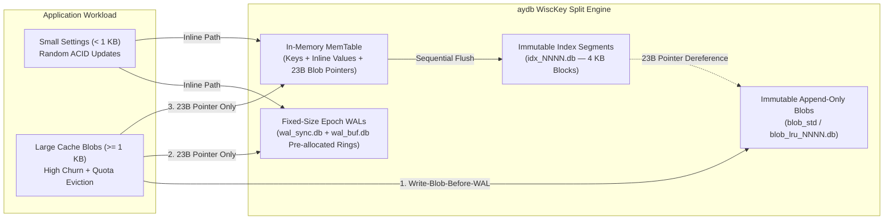
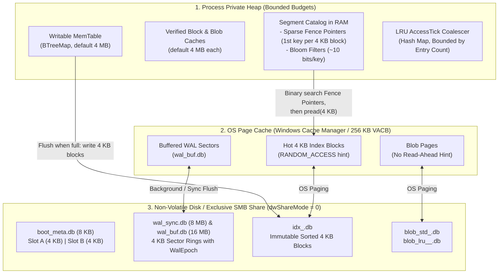
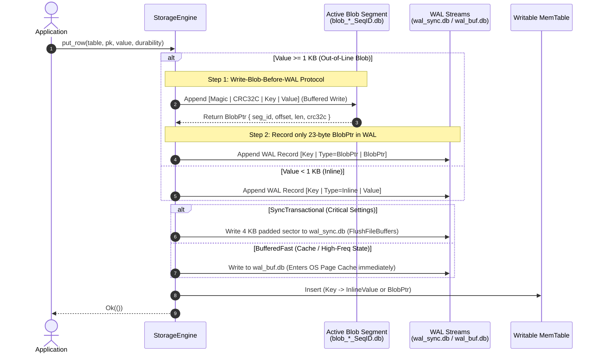
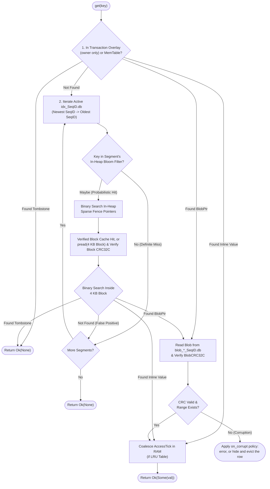
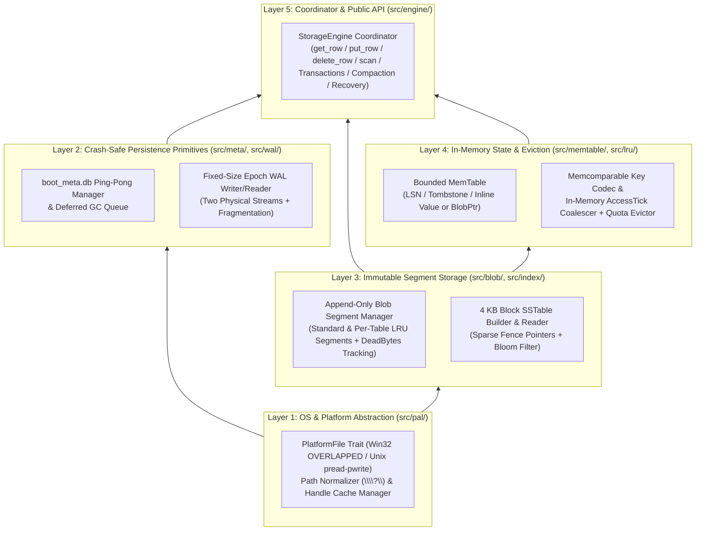

# Chapter 1.0: Phase 1 Architecture Overview — Anatomy of the `aydb` Storage Engine

This document serves as the high-level architectural textbook for **Phase 1** of `aydb` (*All Your DataBase*). Before diving into byte-level specifications of individual subsystems, this chapter explains **why** the storage engine is structured the way it is, **how** its components interact across memory and disk tiers, and **how** data flows through the system during reads, writes, background compaction, and crash recovery.

---

## 1. The Storage Engine Dilemma: Why Not Just Use a B-Tree or Standard LSM?

Every storage engine is fundamentally a trade-off between three competing hardware realities: **Read Amplification** (how many bytes must be read from storage to answer a query), **Write Amplification** (how many bytes are written to storage per byte of logical application data), and **Space Amplification** (how much extra disk/memory space is consumed by fragmentation and obsolete versions).

### 1.1 Why B-Trees Struggle with Hybrid Desktop Workloads

Traditional embedded databases (such as SQLite) use an in-place update **B-Tree** organized into fixed-size pages (typically 4 KB).

1. **Random I/O and Page Amplification:** Updating a 50-byte setting inside a 4 KB B-Tree page requires rewriting the entire 4 KB page (a write amplification factor of $80\times$).
2. **Overflow Page Fragmentation with Blobs:** When storing a 500 KB HTTP cache entry alongside small rows, a B-Tree splits the payload across a linked list of 4 KB overflow pages. As cache entries expire and are replaced by differently sized blobs, free pages scatter across the file. Reading a single cached file degenerates into dozens of non-contiguous random seeks, defeating the operating system's sequential prefetcher.
3. **SMB & Antivirus Fragility:** B-Tree engines rely on shared-memory index files (`-shm`), rolling WAL truncation, or atomic file renames. Over SMB/CIFS shares or under Windows Defender / enterprise minifilter antivirus scanners, frequent metadata extensions and lock transitions break SMB caching leases and trigger `ERROR_SHARING_VIOLATION`.

### 1.2 Why Classic LSM-Trees Struggle with Large Values

**Log-Structured Merge-Trees (LSM-Trees)** (such as LevelDB and RocksDB) solve the random-write problem by buffering mutations in memory (**MemTable**) and flushing them sequentially as immutable sorted files (**SSTables**).

However, a classic LSM-Tree embeds both keys and values together inside the SSTables. As background **Compaction** merges SSTables from Level $L$ to Level $L+1$ to maintain sort order and reclaim deleted keys, **every multi-megabyte blob is repeatedly read and rewritten across disk**—often 10 to 30 times over its lifetime. For a high-churn HTTP cache, this causes catastrophic write amplification, saturating disk bandwidth and wearing out SSDs.

### 1.3 The `aydb` Solution: WiscKey Separation + OS-Native Caching

`aydb` resolves this tension by combining four core architectural principles:



1. **WiscKey-Style Key-Value Separation:** Small values (`< 1 KB`) are stored inline inside the sorted index so point lookups finish in a single read. Large values (`>= 1 KB`) bypass the LSM compaction tree entirely: they are written once to append-only `blob_*.db` files, while the index stores only a **23-byte pointer** (`Kind`, `TableID`, `SegID`, `Offset`, `Length`, `CRC32C`). Compaction only merges keys and 23-byte pointers.
2. **Bounded Heap with the OS Page Cache as the Primary Cache:** Instead of a multi-hundred-megabyte user-space Buffer Pool (which duplicates pages already cached by the OS kernel, known as *Double Caching*), `aydb` keeps **Sparse Fence Pointers** and **Bloom Filters** in the process heap, and reads 4 KB data blocks from the Windows Cache Manager (Standby List) via positional I/O. Small, strictly bounded verified caches (default 4 MB each for index blocks and small blobs) keep the hottest entries in user space to avoid repeated system calls and CRC passes.
3. **Zero-Allocation, Rename-Free File Lifecycle:** Both WAL files are pre-allocated and recycled using `WalEpoch` counters without truncating or zero-filling. Active segments are switched atomically via an 8 KB ping-pong metadata file (`boot_meta.db`), never calling `MoveFileEx` (rename).
4. **Copy-Less Per-Table LRU Eviction:** Tables with `MAX_BYTES` quotas isolate their blobs into per-table generational files (`blob_lru_<TblID>_<SeqID>.db`). Read hits coalesce timestamp updates in RAM without disk writes; once an old blob generation becomes 100% evicted, the entire file is unlinked in $O(1)$ without copying a single byte.

---

## 2. Memory Hierarchy & Physical File Layout

A critical part of understanding a storage engine is knowing **what lives where** across the three hardware/OS boundaries:
1. **Process Private Heap (User Space RAM)** — The MemTable and the optional caches have fixed budgets (e.g., 8–16 MB in total). Bloom filters and fence pointers grow in proportion to the database size, the open transaction's overlay is limited by `max_transaction_bytes`, and the access tracker and rowid map are capped by entry count (see [ARCHITECTURE.md](../ARCHITECTURE.md) §1.1). Lost on process termination (`kill -9`).
2. **OS Page Cache / System Cache (Kernel Space RAM)** — Managed by Windows Cache Manager (in 256 KB Virtual Address Control Block [VACB] views) or Linux/macOS page cache. Survives process termination; lost only on OS kernel panic or power outage.
3. **Non-Volatile Storage (Physical Disk / Remote SMB Server)** — Survives power outages once flushed via `FlushFileBuffers` / `fdatasync` (`FILE_FLAG_WRITE_THROUGH` alone can stop in a drive's volatile cache).



### Why Separate Index and Blob Files?

Inside the Windows kernel, the **Cache Manager** maps open files into kernel virtual address space using **256 KB views (VACBs)**. When a file is opened:
* **`FILE_FLAG_RANDOM_ACCESS` (`idx_<SeqID>.db`):** Instructs the Cache Manager *not* to perform speculative read-ahead when a 4 KB block is read, and discourages aggressive unmapping of views so frequently accessed index blocks stay hot in the Standby List.
* **No read-ahead hint (`blob_*_<SeqID>.db`):** Blob files mostly serve random point reads, so they are opened without `FILE_FLAG_SEQUENTIAL_SCAN`, which would prefetch 256 KB windows that a point read does not use.

If index blocks and large blobs were interleaved inside a single file (as in SQLite), index lookups and blob reads would share one read-ahead tracker and pollute the same 256 KB VACB views.

---

## 3. End-to-End Lifecycle Walkthroughs

To see how all Phase 1 subsystems cooperate, let us trace the four fundamental operations of the engine.

### 3.1 Walkthrough 1: The Write Path (`put_row`)

When an application writes a key-value pair (or an atomic batch of mutations), the engine branches based on payload size (`inline_threshold_bytes`, default 1024 bytes):



Inside an explicit transaction the mutations go to a private overlay instead of the MemTable, and they are published when the commit is durable. See [ARCHITECTURE.md](../ARCHITECTURE.md) §4.5 for the commit path and group commit.

#### Deep Dive: Why `Write-Blob-Before-WAL` Avoids Double `fsync`
In a naive KV-separated engine, guaranteeing that a pointer in the WAL never points to uninitialized garbage in the blob file would require:
1. Write to `blob.db` $\rightarrow$ call `fsync(blob.db)` (Disk Stall #1)
2. Write pointer to `wal.db` $\rightarrow$ call `fsync(wal.db)` (Disk Stall #2)

Two `fsync` calls per write would halve throughput. Instead, `aydb` writes to `blob.db` using a fast buffered write **before** writing to `wal.db`, and embeds the blob's expected `BlobCRC32C` inside the WAL record (and index pointer).
* In the normal case, the OS flushes dirty pages in arrival order, or both live in the OS cache.
* If a sudden power outage occurs after the WAL sector hits disk but before the `blob.db` buffered write reaches physical media, recovery (or a subsequent read) recomputes the CRC of the target byte range in `blob.db`. Seeing either a truncated file or a CRC mismatch against `BlobCRC32C`, `aydb` safely treats that specific record as an incomplete/uncommitted write rather than failing with database corruption! This applies at recovery only; a blob that fails verification during a normal read after open is reported as corruption per the table's `on_corrupt` policy (see `docs/ARCHITECTURE.md` §4.3).
* This applies to `BufferedFast` commits. A `SyncTransactional` commit syncs the blob writers before its WAL record, so a durable commit never refers to a blob that could be lost.

---

### 3.2 Walkthrough 2: The Read Path (`get`)

Because `aydb` is an LSM-based engine, the latest version of a key may reside in the in-memory MemTable or in one of several immutable `idx_<SeqID>.db` segments on disk. Reads always search from **newest to oldest** and stop at the first match:



#### Deep Dive: How Sparse Fence Pointers Keep Heap Usage Under 1%
Suppose an `idx_<SeqID>.db` file is **64 MB** on disk, consisting of $16,384$ blocks of **4 KB** each.
* Instead of loading 64 MB into heap, `aydb` stores an array of $16,384$ entries containing only the **first key of each 4 KB block** (`Sparse Fence Pointer`).
* If keys average 24 bytes, $16,384 \times 24\text{ B} \approx 393\text{ KB}$ of heap memory indexes the entire 64 MB file!
* Adding a **Bloom Filter** at 10 bits per key (~1% false positive rate) allows point lookups (`get`) to skip any `idx_<SeqID>.db` segment that does not contain the target key without issuing a single system call.

---

### 3.3 Walkthrough 3: MemTable Flush, Ping-Pong Metadata Update, and Crash Recovery

When the active `MemTable` reaches its size cap (e.g., 4 MB) or a WAL stream fills up, the engine performs a **Checkpoint / Flush**:

```text
+-----------------------------------------------------------------------------------+
|                        boot_meta.db (Fixed 8 KB on Disk)                          |
+-----------------------------------------+-----------------------------------------+
|           Slot A (0 .. 4096)            |           Slot B (4096 .. 8192)         |
|  Magic: "AYDB"                          |  Magic: "AYDB"                          |
|  Generation: 41 (Older)                 |  Generation: 42 (Current Active)        |
|  SyncWalEpoch: 7                        |  SyncWalEpoch: 8                        |
|  ActiveIdxList: [101, 102]              |  ActiveIdxList: [101, 102, 103]         |
|  PendingDeleteList: []                  |  PendingDeleteList: []                  |
|  HeaderCRC32C / PayloadCRC32C: Valid    |  HeaderCRC32C / PayloadCRC32C: Valid    |
+-----------------------------------------+-----------------------------------------+
```

1. **Write New Index Segment:** The MemTable is written sequentially as 4 KB blocks to a newly allocated `idx_103.db`, followed by `sync_barrier()`.
2. **Ping-Pong `boot_meta.db` Switch:** If Slot A currently holds `Generation = 41` and Slot B holds `Generation = 40`, the engine formats the new metadata state (`Generation = 42`, adding `idx_103.db` to `ActiveIdxList` and advancing `SyncWalEpoch` to `8`) and overwrites **Slot B** at offset `4096` in a single 4 KB aligned write, followed by `sync_durable()`.
   * **Why Ping-Pong Works:** Even if power fails mid-write while updating Slot B (corrupting Slot B's CRC), Slot A (`Generation = 41`) remains completely untouched on disk! On reboot, the engine reads both slots, discards Slot B due to CRC mismatch, boots cleanly from Slot A, and replays both WAL streams to reconstruct the exact MemTable that produced `idx_103.db`.
3. **Zero-Fill-Free WAL Reuse:** Now that the epochs have advanced in `boot_meta.db`, the next write to each WAL stream wraps back to offset `0` with the new epoch. No `SetEndOfFile` (truncation) or zero-fill is needed: any sector past the current write cursor still carries the previous epoch, which recovery immediately recognizes as the end of the log.

---

### 3.4 Walkthrough 4: Background Compaction & Copy-Less LRU Eviction

Over time, two background maintenance tasks keep read performance high and disk usage bounded:

1. **Index Compaction (Merging `idx_<SeqID>.db`):**
   * Multiple `idx` segments are merge-sorted into a new `idx_<NewSeqID>.db`, discarding overwritten key versions. Tombstones (`DELETE` markers) are dropped only when every segment takes part in the merge.
   * Because large values live in `blob_*.db`, compaction only copies keys, small inline values, and 23-byte blob pointers.
   * Once the new `idx` segment is registered in `boot_meta.db`, the old `idx` segments are closed (`CloseHandle`) and deleted (`DeleteFile`). If an antivirus filter temporarily blocks deletion, their IDs stay in `PendingDeleteList` inside `boot_meta.db` until a subsequent checkpoint succeeds.
   * Merges are triggered by segment count and pick a size-tiered suffix of the segments. Through SQL, a background worker runs the merge without the engine lock (see [Chapter 1.4](./04_WISCKEY_AND_SEGMENTS.md) §4.3).
2. **Copy-Less LRU Eviction (For Capped Tables):**
   * When a table exceeds its `MAX_BYTES` quota, the engine scans its system LRU index (`[TableID | 'l' | AccessTick | PK]`) from the oldest `AccessTick` forward.
   * Before evicting a candidate row, the engine checks the **In-Memory `AccessTick` Coalescer**: if the row was recently read via `SELECT` (meaning its in-memory `LatestTick` is newer than the on-disk `AccessTick`), its LRU index entry is lazily updated instead of evicting the row!
   * Otherwise, the row and its secondary index entries are deleted, and the referenced `blob_lru_<TblID>_<SeqID>.db` segment's `DeadBytes` counter is incremented. When all blobs in a `blob_lru` segment are dead, the segment file is closed and deleted in $O(1)$ with zero compaction I/O.

---

## 4. Phase 1 Crate & Module Architecture

To keep the implementation modular, testable in isolation, and educational, Phase 1 is organized into five strictly layered internal subsystems inside the `aydb` crate:



### Chapter Map

Phase 1 is documented bottom-up, one chapter per subsystem:

| Step | Textbook Chapter | Core Topics |
| :--- | :--- | :--- |
| **Step 1-1** | `docs/phase1/01_PAL_AND_OS_CACHE.md` | Win32 `CreateFileW` flags (`dwShareMode=0`, `OVERLAPPED`), SMB RWH Lease mechanics, the two-stream WAL separation, `\\?\` UNC path normalization, POSIX `pread`/`pwrite`/`fcntl` equivalents, and FD LRU pooling. |
| **Step 1-2** | `docs/phase1/02_BOOT_META_AND_GC.md` | Exact 4096-byte binary layout of `boot_meta.db` slots, CRC32C placement, handling variable-length segment lists within a fixed 4 KB budget, atomic generation promotion, and rename-free deferred GC state machine. |
| **Step 1-3** | `docs/phase1/03_EPOCH_WAL_AND_RECOVERY.md` | 4 KB WAL sector header layout, spanning records larger than 4 KB (`FIRST`/`MIDDLE`/`LAST` fragments), `WalEpoch` wrap-around invariants, torn-write detection, and deterministic crash recovery replay. |
| **Step 1-4** | `docs/phase1/04_WISCKEY_AND_SEGMENTS.md` | `blob_*.db` record framing, `idx_*.db` 4 KB data block internal layout (offset directory), trailer block, Bloom Filter construction, Sparse Fence Pointer index, MemTable flushing, and background compaction. |
| **Step 1-5** | `docs/phase1/05_CAPPED_LRU_AND_KV_API.md` | Memcomparable key encoding rules, `AccessTick` coalescing ring/hash buffer sizing, lazy promotion during eviction scans, copy-less `blob_lru` unlinking, and the public Phase 1 Rust API. |
