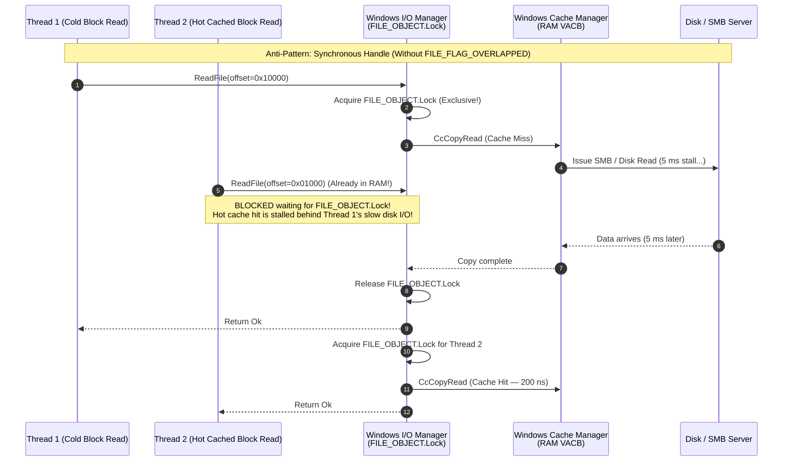
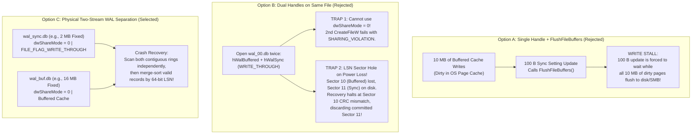

# Chapter 1.1: The OS Boundary — PAL/VFS, Windows Cache Manager (VACB), and SMB Leases

This chapter defines the detailed architecture of **Layer 1: The Platform Abstraction Layer (PAL / VFS)** of `aydb`.

In an embedded storage engine that delegates data block caching to the operating system and targets both local SSDs and remote SMB/CIFS shares, the OS file interface is not merely a thin wrapper around `std::fs::File`. Naive use of standard library file APIs introduces hidden kernel lock contention, catastrophic NTFS metadata journaling stalls, SMB lease revocations, and unrecoverable process crashes on network glitches.

This document walks through each design decision at the OS boundary, the kernel mechanics that dictate the design, the concrete Rust interfaces, and the empirical benchmark suite used to validate our assumptions.

---

## 1. Design Decision 1: Positional Syscalls (`pread`) vs. Memory-Mapped I/O (`mmap`)

Because `aydb` delegates page caching of immutable `idx_<SeqID>.db` and `blob_*_<SeqID>.db` files to the operating system's page cache instead of maintaining a redundant user-space buffer pool, we must first choose how the engine reads pages from the OS cache.

### 1.1 The Two Alternatives

| Option | Mechanism | Advantages | Disadvantages & Failure Modes |
| :--- | :--- | :--- | :--- |
| **Option A: Positional System Calls** *(Selected)*<br/>Win: `ReadFile` + `OVERLAPPED`<br/>Unix: `pread` / `pwrite` | Issue an explicit offset-based read into a caller-supplied buffer (e.g., a 4 KB stack/heap buffer). | 1. **Graceful I/O Error Handling:** Disk errors or SMB disconnects return a normal `io::Result::Err` that the engine can handle safely.<br/>2. **Deterministic Handle Release:** Closing the file handle immediately releases all kernel references, allowing instant `DeleteFile`.<br/>3. **Minimal `unsafe` Footprint.** | **Syscall, Copy & CRC Overhead:** Every 4 KB block lookup incurs a user/kernel transition (~150–300 ns), a 4 KB memory copy from the OS cache into user space, and a CPU-bound 4 KB CRC32C verification pass (~1–2 µs). Mitigated by pairing with an optional bounded verified user-space block cache (§1.3). |
| **Option B: Memory-Mapped Files (`mmap`)**<br/>Win: `CreateFileMapping` + `MapViewOfFile`<br/>Unix: `mmap` | Map the segment file directly into the process's virtual address space and dereference pointers directly. | **Zero Syscall & Zero Copy:** Cache hits resolve at raw CPU memory bus speed (a few nanoseconds) via hardware page tables. | **Fatal Crash on SMB / Bad Sectors:** If an SMB connection drops or a storage read fails while dereferencing a mapped pointer, the CPU raises a hardware page-fault exception (`EXCEPTION_IN_PAGE_ERROR` on Windows, `SIGBUS` on Unix), immediately terminating the process.<br/>**Delayed Deletion & Working Set Bloat:** Mapped views inflate process working set accounting and can delay `DeleteFile` on Windows. |

### 1.2 Why `mmap` Is Unacceptable for `aydb`

In safe Rust, dereferencing a `&[u8]` slice backed by `mmap` assumes the underlying memory is always valid. If the file resides on an SMB share (e.g., enterprise folder redirection or a NAS) and the network experiences a transient drop during a page fault, the Windows Memory Manager cannot populate the page and raises structured exception `0xC0000006` (`STATUS_IN_PAGE_ERROR`). Standard Rust error handling (`Result<T, E>`) cannot catch hardware page faults; the entire host desktop application crashes instantly.

With **Option A (Positional System Calls)**, the kernel's Cache Manager (`CcCopyRead` on Windows) accesses the exact same physical RAM pages in the OS Standby/System Cache, copies the 4 KB block inside a kernel `__try / __except` block, and converts any underlying SMB or disk failure into a clean error code returned to `ReadFile`.

### 1.3 Complementary Caching: OS Page Cache + Optional Bounded Verified Block Cache

While Option A delivers rock-solid crash safety across network glitches and bad sectors, delegating *all* block access purely to the OS page cache introduces a throughput bottleneck on hot point lookups:
1. **User/Kernel Transition Overhead:** Every `ReadFile` or `pread` incurs CPU mode switching and kernel dispatch overhead.
2. **Kernel Cache Copy (`CcCopyRead`):** The Windows Cache Manager copies the 4 KB page from its kernel Virtual Address Control Block (VACB) mapping into the application buffer.
3. **Repeated 4 KB CRC32C Verification:** Because the OS page cache contains raw storage pages that could theoretically suffer undetected in-memory corruption or bit-rot, every uncached block read must run a full-block CRC32C verification pass across 4,092 payload bytes.

To eliminate this repeated overhead without violating bounded-memory requirements, `aydb` pairs the OS page cache with an **optional, strictly-bounded verified user-space block and blob cache** (`block_cache_bytes` and `blob_cache_bytes` in `EngineConfig`):

* **Complementary Division of Labor:**
  * **OS Page Cache (Primary Storage Tier):** Manages raw file page residency, asynchronous write-behind buffering, and zero-copy sequential read-ahead in 256 KB VACB windows. It absorbs the vast majority of disk I/O across the entire database volume without requiring a massive in-process buffer pool.
  * **User-Space Verified Block/Blob Cache (Hot-Tier Acceleration):** Keeps hot, already-verified 4 KB index blocks and small blobs ($\le 16\text{ KB}$) in process heap memory.
* **Key Invariants and Performance Advantages:**
  * **Zero Syscall & Zero CRC Recalculation:** Cache hits bypass `ReadFile`/`pread` entirely and serve data in tens of nanoseconds. Because blocks were already verified when inserted into the cache, repeated CRC32C calculations are eliminated on hot internal and leaf index blocks.
  * **Strict Deterministic Bounds:** Total private heap consumption is strictly capped at `memtable_capacity_bytes + block_cache_bytes + blob_cache_bytes + sparse_fence_metadata`. Setting both cache budgets to `0` reverts cleanly to the pure OS-cache-only model for ultra-constrained environments.
  * **Immutability & Zero Cache Invalidation Complexity:** SSTable segments and blob files are immutable with strictly monotonic `SeqID`s. Cached entries never become stale while the segment is active. When compaction or LRU reclamation retires a segment, all cache entries for that `SeqID` are discarded wholesale.
  * **Scan Resistance:** Compaction bulk inputs (`BackgroundBulk` / `FILE_FLAG_SEQUENTIAL_SCAN`) and full-table scans bypass cache insertion to avoid displacing hot point-lookup data.

---

## 2. Design Decision 2: True Concurrent Positional I/O on Windows

Having chosen positional system calls over `mmap`, we encounter a subtle and widely overlooked trap in the Windows I/O subsystem when multiple threads read from the same file handle concurrently.

### 2.1 The Hidden Serialization Lock in `FO_SYNCHRONOUS_IO`

On Unix, `pread(fd, buf, len, offset)` is completely stateless and lock-free at the file-descriptor level: 16 threads calling `pread` on the same `fd` execute in parallel inside the kernel.

On Windows, Rust's standard library provides `std::os::windows::fs::FileExt::seek_read`, which passes an `OVERLAPPED` structure containing `{ Offset, OffsetHigh }` to `ReadFile` on a standard synchronous file handle (opened **without** `FILE_FLAG_OVERLAPPED`). While this avoids mutating the global file pointer, **it does NOT execute concurrently!**



When a file is opened without `FILE_FLAG_OVERLAPPED`, the Windows kernel sets the `FO_SYNCHRONOUS_IO` flag on the internal `FILE_OBJECT`. Whenever `NtReadFile` is invoked on a `FO_SYNCHRONOUS_IO` handle, the I/O Manager acquires `FileObject->Lock` **before** calling into NTFS or the Cache Manager. Consequently, if a single thread misses the OS page cache and stalls for 5 ms over SMB or SSD, **every other thread attempting to read hot, already-cached 4 KB blocks from that same `idx_<SeqID>.db` handle is stalled in a queue waiting for `FileObject->Lock`** (Head-of-Line Blocking).

### 2.2 The Solution: `FILE_FLAG_OVERLAPPED` with Synchronous Fast-Path & Thread-Local Event

To achieve true lock-free parallel `pread`/`pwrite` semantics on Windows equivalent to Unix, `aydb` opens segment handles with **`FILE_FLAG_OVERLAPPED`** (omitting `FO_SYNCHRONOUS_IO`):

1. **Zero Kernel Serialization:** Without `FO_SYNCHRONOUS_IO`, `NtReadFile` never acquires `FileObject->Lock`. Multiple threads enter `NtfsFsdRead` and `CcCopyRead` simultaneously.
2. **Synchronous Cache-Hit Fast Path:** Even on a `FILE_FLAG_OVERLAPPED` handle, if the requested 4 KB block is already resident in the Windows Cache Manager, `ReadFile` copies the bytes immediately and returns `TRUE` synchronously! No context switch or event wait occurs.
3. **Thread-Local Manual-Reset Event for Cache Misses:** Only when `ReadFile` returns `FALSE` with `GetLastError() == ERROR_IO_PENDING` (meaning a physical disk or SMB request was queued) does the calling thread wait. To avoid calling `CreateEventW` on every I/O, each thread caches a reusable manual-reset event handle in `thread_local!` storage and passes `(hEvent as usize | 1) as HANDLE` in `OVERLAPPED.hEvent` (setting the low bit `1` instructs the Windows kernel not to post completion packets to any I/O Completion Port if one is ever associated).

```rust
// Conceptual execution flow inside WindowsPlatformFile::read_exact_at
// 1. Borrow reusable manual-reset Event from thread_local!
// 2. Populate OVERLAPPED { Offset, OffsetHigh, hEvent: h_event | 1 }
// 3. Call ReadFile(...)
//    - If TRUE: completed synchronously from OS Page Cache! (Fast path)
//    - If FALSE && GetLastError() == ERROR_IO_PENDING:
//        Call GetOverlappedResult(..., bWait = TRUE)
```

---

## 3. Design Decision 3: Physical Two-Stream WAL Separation (`wal_sync.db` vs. `wal_buf.db`)

`aydb` supports two durability tiers for mutations:
* **`Durability::Sync`:** For critical settings and catalog changes; durable when the commit returns (survives power loss and OS panics, assuming the device honours write-through), with earlier buffered commits made durable first.
* **`Durability::Buffered`:** For high-churn HTTP cache insertions and transient state; enters the OS page cache immediately (surviving application crashes or `TerminateProcess` / `kill -9`; an OS crash or power loss may roll back the most recent ones), without stalling on physical disk flushes.

### 3.1 Why Single-File WAL Designs Fail Under Dual Durability

We evaluated three architectures for combining `Sync` and `Buffered` writes:



1. **Why Option A (Single Handle + `FlushFileBuffers`) Fails Performance Goals:**
   `FlushFileBuffers` (`fdatasync`) flushes *every* dirty page belonging to that file descriptor. If the application writes 10 MB of HTTP cache metadata in `Buffered` mode and then updates a 64-byte user preference in `Sync` mode, `FlushFileBuffers` forces the 64-byte write to block until all 10 MB of buffered writes finish writing over the disk or SMB link.
2. **Why Option B (Dual Handles on the Same File) Fails Correctness & Exclusivity:**
   * **Exclusivity Breakdown:** On Windows, if a process opens `wal_00.db` with `dwShareMode = 0`, even the *same process* cannot open a second handle (`hWalSync`) to `wal_00.db` without receiving `ERROR_SHARING_VIOLATION`. Opening with `FILE_SHARE_WRITE` compromises single-host exclusivity.
   * **The LSN Sector Hole Hazard:** Suppose Transaction 1 (`LSN = 100`) writes Sector 10 via `hWalBuffered` (remaining in RAM), and Transaction 2 (`LSN = 101`) immediately writes Sector 11 via `hWalSync` (`FILE_FLAG_WRITE_THROUGH`, going straight to disk). If power fails a microsecond later, Sector 11 is on disk, but **Sector 10 is still old data (or zeros) on disk**. Upon reboot, sequential WAL recovery scans from Sector 0, hits an invalid epoch/CRC at Sector 10, assumes it has reached the log tail, and **silently drops Transaction 2 (`Sector 11`)**, violating ACID durability for a committed `Sync` write!

### 3.2 How Option C (`wal_sync.db` + `wal_buf.db`) Solves Everything

By splitting the journal into two separate pre-allocated physical files—**`wal_sync.db`** (opened with `dwShareMode = 0` and `FILE_FLAG_WRITE_THROUGH`) and **`wal_buf.db`** (opened with `dwShareMode = 0` and standard buffered caching):

1. **Full `dwShareMode = 0` Exclusivity:** Every file in the database directory is opened exactly once with `dwShareMode = 0`, preserving SMB RWH leases unconditionally.
2. **Zero Flush Coupling:** `wal_sync.db` only ever contains `Sync` records. Flushing or writing through to `wal_sync.db` never touches the dirty OS cache pages of `wal_buf.db`.
3. **Contiguous Prefix Invariant per File:** Within `wal_sync.db`, every sector is written synchronously in strict sequential order; there is never an unflushed gap. Within `wal_buf.db`, sectors are flushed sequentially by the OS; any power-loss truncation only affects the tail of `wal_buf.db`.
4. **Mathematical Soundness of Two-Stream `LSN` Merge Recovery:**
   Because `aydb` logs **idempotent state-replacement records** (`Put(Key, InlineValue | BlobPtr)` or `Delete(Key)`) tagged with a global monotonically increasing 64-bit `LSN`—rather than byte-offset page diffs—recovery simply scans valid sectors from `wal_sync.db` and `wal_buf.db` independently and performs a two-way merge sort by `LSN`:
   * If `Key_A` was written as `Buffered` (`LSN = 10`) and then overwritten as `Sync` (`LSN = 11`), and `LSN = 10` is lost in a power outage, replaying `LSN = 11` from `wal_sync.db` still produces the exact final state for `Key_A`.
   * If `Key_A` was written as `Sync` (`LSN = 10`) and overwritten as `Buffered` (`LSN = 11`), and `LSN = 11` is lost in a power outage, `Key_A` cleanly rolls back to its last durable `Sync` state (`LSN = 10`).

---

## 4. Design Decision 4: Pre-Allocation and the NTFS Valid Data Length (VDL) Cliff

To avoid file fragmentation and NTFS Master File Table (MFT) size-extension locks on every write, both `wal_sync.db` and `wal_buf.db` have fixed file sizes (`2 MB` for `wal_sync.db`, `16 MB` for `wal_buf.db`). However, *how* those files are pre-allocated on Windows NTFS has a dramatic impact on first-epoch write latency.

### 4.1 Understanding `AllocationSize`, `EOF`, and `VDL` in NTFS

Every file stream on NTFS maintains three distinct 64-bit length pointers:

```text
+-----------------------------------------------------------------------------------+
|                        NTFS File Stream Length Invariants                         |
+-----------------------------------+-----------------------------------+-----------+
|      0 .. ValidDataLength (VDL)   |      VDL .. EndOfFile (EOF)       | .. Alloc  |
|   Physically written bytes on     |  Logically part of the file, but  | Reserved  |
|   disk. Normal overwrites do NOT  |  unwritten on disk (reads return  | clusters  |
|   require metadata transactions.  |  0). Writing here forces NTFS to  |           |
|                                   |  advance VDL in MFT & $LogFile!   |           |
+-----------------------------------+-----------------------------------+-----------+
```

1. **What Happens with `SetEndOfFile` Only (`VDL = 0`, `EOF = 2 MB`):**
   If we pre-allocate `wal_sync.db` solely by calling `SetFilePointerEx(2 MB)` + `SetEndOfFile()`, NTFS reserves the clusters and sets `EOF = 2 MB`, but leaves **`ValidDataLength (VDL) = 0`** (so an unprivileged user cannot read leftover disk sectors from previously deleted files).
   During the first pass through `wal_sync.db` (opened with `FILE_FLAG_WRITE_THROUGH`), every single 4 KB sector write advances `VDL` by 4 KB. Because `FILE_FLAG_WRITE_THROUGH` guarantees that the written data is readable after a power outage, **NTFS is forced to commit an internal metadata transaction to `$LogFile` and update the MFT record on every single 4 KB write**—turning 1 write into 2–3 physical disk I/Os!
2. **What Happens with Physical Zero-Initialization (`VDL = EOF = 2 MB`):**
   If we write 2 MB of zeros sequentially in 256 KB chunks when `wal_sync.db` is first created and flush once, **`VDL` reaches `2 MB` immediately**. From the very first transaction of Epoch 1 onward, every 4 KB `WRITE_THROUGH` write occurs strictly at `Offset < VDL` (a pure in-place sector overwrite), completely bypassing NTFS MFT/VDL extension logging!

### 4.2 Tailored Pre-Allocation Strategy

Thanks to our two-stream WAL separation (Design Decision 3), we get the best of both worlds:
* **`boot_meta.db` (8 KB) & `wal_sync.db` (8 MB by default):** Physically zero-initialized upon creation (`PreallocStrategy::PhysicalZeroFill`) so `VDL == EOF` before the first transaction runs. Writing 2 MB of zeros takes `< 1 ms` on a local NVMe SSD and `~15 ms` over 1 Gbps SMB.
* **`wal_buf.db` (16 MB):** Because `wal_buf.db` uses buffered writes (not `FILE_FLAG_WRITE_THROUGH`), NTFS coalesces VDL updates lazily in memory during background flushing. We expose both `PhysicalZeroFill` and `LogicalExtendOnly` (`SetEndOfFile` / `posix_fallocate`) in the PAL so we can benchmark both strategies on local NTFS and SMB.

---

## 5. OS Cache Hints, SMB Lease Mechanics, and Handle Pooling

### 5.1 Mapping `OpenHint` to Kernel Primitives

| `OpenHint` Variant | Target Files | Windows Flags (`CreateFileW`) | Linux (`fcntl` / `fadvise`) | macOS (`fcntl`) | Kernel Behavior |
| :--- | :--- | :--- | :--- | :--- | :--- |
| `MutableSyncLog` | `boot_meta.db`,<br/>`wal_sync.db` | `FILE_FLAG_OVERLAPPED \| FILE_FLAG_WRITE_THROUGH` | `fdatasync` after each append | `F_FULLFSYNC` after each append | Writes go through OS cache directly to non-volatile media; no stale cache views. |
| `MutableBufferedLog` | `wal_buf.db` | `FILE_FLAG_OVERLAPPED \| FILE_FLAG_SEQUENTIAL_SCAN` | `POSIX_FADV_SEQUENTIAL` | `F_RDAHEAD(1)` | Fast buffered sequential appends in 256 KB VACB views; survives process crash. |
| `ImmutableRandom` | `idx_<SeqID>.db` | `FILE_FLAG_OVERLAPPED \| FILE_FLAG_RANDOM_ACCESS` | `POSIX_FADV_RANDOM` | `F_RDAHEAD(0)` | Disables speculative read-ahead so 4 KB point lookups do not fetch 252 KB of unused neighbors. |
| `ImmutableSequential` | `blob_std_<SeqID>.db`,<br/>`blob_lru_<TblID>_<SeqID>.db` | `FILE_FLAG_OVERLAPPED` only (`FILE_FLAG_SEQUENTIAL_SCAN` is deliberately omitted) | `POSIX_FADV_SEQUENTIAL` | `F_RDAHEAD(1)` | Blob files serve random point reads, so the Windows implementation avoids asynchronous 256 KB VACB read-ahead on them. |
| `BackgroundBulk` | Compaction inputs & outputs | `FILE_FLAG_OVERLAPPED \| FILE_FLAG_SEQUENTIAL_SCAN` + `IoPriorityHintLow` | `POSIX_FADV_NOREUSE` + `DONTNEED` | `F_NOCACHE(1)` | Prevents background compaction reads/writes from evicting hot foreground index blocks. |

> **Implementation status.** The table describes the intended mapping. Only the Windows column is implemented, with the exception below. The Unix implementation (`src/pal/unix.rs`) ignores the hint for open flags: it issues no `posix_fadvise` or `fcntl` call. On Unix the hint only decides whether a handle participates in the `HandlePool` (idx and blob handles do, the two WAL handles and `boot_meta.db` do not) and, on macOS, whether `sync_barrier` is promoted to `F_FULLFSYNC` (`MutableSyncLog` handles). `OpenHint::BackgroundBulk` is defined and handled by the Windows PAL, but the engine never opens a file with it: compaction reads idx segments through the same `ImmutableRandom` handles, using a streaming reader that bypasses the block cache.

### 5.2 Extended-Length Path Normalization (`\\?\`) on Windows

Standard Win32 file paths are limited to `MAX_PATH = 260` characters unless prefixed with the NT extended-length prefix. Furthermore, relative path resolution (`..` or `.`) is disabled by Windows when `\\?\` is used. Therefore, the PAL normalizes database directory paths once at engine startup:
* **Local Path:** `C:\Users\alice\AppData\Local\MyApp\db` $\rightarrow$ `\\?\C:\Users\alice\AppData\Local\MyApp\db`
* **SMB UNC Path:** `\\nas.local\share\profile\db` $\rightarrow$ `\\?\UNC\nas.local\share\profile\db`

### 5.3 Cross-Platform Handle Pool & Descriptor Limits

* **On Windows (Local NTFS & SMB):** Every open segment handle holds an SMB `Read-Write-Handle (RWH) Lease`. Closing a handle immediately revokes or downgrades the lease and forces an SMB2 `CREATE` / `CLOSE` network round-trip on the next access. Because Windows supports millions of handles per process, the PAL's `HandlePool` sets the default open-handle cap on Windows to `usize::MAX` (keeping all active segments open until retired by compaction/eviction).
* **On POSIX (macOS / Linux):** macOS defaults to a strict soft limit of `RLIMIT_NOFILE = 256` file descriptors per process. On POSIX targets, `HandlePool` (`src/pal/unix.rs`) pins critical files (`boot_meta.db`, `wal_sync.db`, `wal_buf.db`, and hot `idx` segments) and maintains a **reference-aware LRU descriptor cache** (default cap: `128`) across idle segment handles. The pool bounds the number of simultaneously open OS file descriptors without evicting handles that are currently pinned by an active `Arc` reference, an open `LazyBlob` cursor, or an in-flight `pread`. Cold unpinned handles are transparently closed and reopened on demand while holding an advisory `flock(LOCK_EX | LOCK_NB)` on a dedicated `db.lock` file to match Windows's `dwShareMode = 0` single-host guarantee.

---

## 6. Complete Rust Interface Specification (`src/pal/`)

```rust
use std::io;
use std::path::{Path, PathBuf};
use std::sync::Arc;

/// Access pattern and durability hints passed to the OS kernel when opening a file.
#[derive(Debug, Clone, Copy, PartialEq, Eq)]
pub enum OpenHint {
    /// For boot_meta.db and wal_sync.db (Write-Through / Synchronous durability).
    MutableSyncLog,
    /// For wal_buf.db (Buffered sequential journal).
    MutableBufferedLog,
    /// For idx_<SeqID>.db (4 KB random block lookups).
    ImmutableRandom,
    /// For blob_*_<SeqID>.db (Sequential large payload reads & appends).
    ImmutableSequential,
    /// For background compaction and GC bulk scans.
    BackgroundBulk,
}

/// Strategy for pre-allocating fixed-size files (boot_meta.db, wal_sync.db, wal_buf.db).
#[derive(Debug, Clone, Copy, PartialEq, Eq)]
pub enum PreallocStrategy {
    /// Write physical zeros across the entire file length so NTFS ValidDataLength (VDL)
    /// equals EOF immediately, eliminating first-epoch metadata journal stalls.
    PhysicalZeroFill,
    /// Extend logical EOF / cluster allocation only (SetEndOfFile / posix_fallocate),
    /// allowing VDL to advance lazily as sequential writes progress.
    LogicalExtendOnly,
}

/// Low-level, thread-safe positional file abstraction.
///
/// Implementations guarantee that concurrent `read_exact_at` and `write_all_at`
/// calls from multiple threads do not mutate shared file-offset state and do not
/// serialize on kernel synchronous-file-object locks (`FO_SYNCHRONOUS_IO`).
pub trait PlatformFile: Send + Sync + 'static {
    /// Reads exactly `buf.len()` bytes starting at `offset`.
    /// Returns `io::ErrorKind::UnexpectedEof` if fewer bytes are available.
    fn read_exact_at(&self, buf: &mut [u8], offset: u64) -> io::Result<()>;

    /// Reads up to `buf.len()` bytes starting at `offset`, returning the number of bytes read.
    fn read_at(&self, buf: &mut [u8], offset: u64) -> io::Result<usize>;

    /// Batched positional reads at multiple offsets (e.g., WiscKey blob prefetch in range scans).
    ///
    /// Allows range scans projecting blob columns to submit multiple `(offset, &mut [u8])`
    /// read requests across a segment in a single operation:
    /// - All platforms: sorts the requests by offset, coalesces nearby ones
    ///   into larger reads, and issues them sequentially with `read_exact_at`.
    ///   Concurrent OVERLAPPED reads (Windows) and `io_uring` batches
    ///   (Linux) are not implemented.
    fn read_many_at(&self, requests: &mut [(u64, &mut [u8])]) -> io::Result<()>;

    /// Writes all bytes in `buf` starting at `offset`.
    fn write_all_at(&self, buf: &[u8], offset: u64) -> io::Result<()>;

    /// Returns the current logical length of the file in bytes.
    fn file_len(&self) -> io::Result<u64>;

    /// Pre-allocates the file to `target_len` bytes using the specified strategy.
    fn preallocate(&self, target_len: u64, strategy: PreallocStrategy) -> io::Result<()>;

    /// Issues an ordering barrier ensuring prior writes reach the storage controller
    /// before subsequent metadata updates.
    /// - Windows: `FlushFileBuffers` (or no-op if opened with `MutableSyncLog` / `WRITE_THROUGH`)
    /// - Linux: `fdatasync`
    /// - macOS: `F_FULLFSYNC` for `MutableSyncLog` handles, otherwise `fsync`
    ///   (`F_BARRIERFSYNC` is not used)
    fn sync_barrier(&self) -> io::Result<()>;

    /// Flushes all modified data and metadata to non-volatile physical media.
    /// - Windows: `FlushFileBuffers`
    /// - Linux: `fsync` (`File::sync_all`)
    /// - macOS: `fcntl(fd, F_FULLFSYNC)`, falling back to `fsync`
    fn sync_durable(&self) -> io::Result<()>;

    /// Intended to hint to the OS kernel that cached pages in `[offset, offset + len)` are no
    /// longer needed. Currently a no-op that returns `Ok(())` on every platform, and the engine
    /// does not call it.
    fn evict_os_cache(&self, offset: u64, len: u64) -> io::Result<()>;
}

/// Manages the database directory, path normalization, exclusive locking, and open handle lifecycle.
pub trait PlatformFs: Send + Sync + 'static {
    type File: PlatformFile;

    /// Opens or creates a file inside the database directory with `dwShareMode = 0` on Windows.
    fn open_file(
        &self,
        rel_name: &str,
        create: bool,
        writable: bool,
        hint: OpenHint,
    ) -> io::Result<Arc<Self::File>>;

    /// Deletes a file after all handles to it have been dropped.
    /// If deletion fails due to transient antivirus scanning (`ERROR_SHARING_VIOLATION` /
    /// `ERROR_ACCESS_DENIED`), the caller records the file in `boot_meta.db`'s `PendingDeleteList`.
    fn remove_file(&self, rel_name: &str) -> io::Result<()>;

    /// Lists all file names currently present in the database directory.
    fn list_files(&self) -> io::Result<Vec<String>>;

    /// Returns the normalized root path (e.g., `\\?\...` on Windows).
    fn root_path(&self) -> &Path;
}
```

### 6.1 Batched Positional Reads via `PlatformFile::read_many_at`

Range scans that project out-of-line WiscKey blob columns can incur significant random read latency if blobs are dereferenced one-by-one synchronously. When a query scans a range of rows, the cursor streams index entries in chunks (`CURSOR_STREAM_CHUNK_ROWS`). For all rows within the chunk that reference out-of-line blobs in the same blob segment, their target offsets and lengths are known in advance.

`PlatformFile::read_many_at` accepts a slice of `(offset, &mut [u8])` buffers and executes them as a batch:
* **Current implementation (all platforms):** The shared helper `coalesced_read_many_at` sorts the requests by offset, merges requests whose gap is at most 16 KB into one larger read as long as the merged span stays within 64 KB, and issues the resulting reads one after another with `read_exact_at`. The saving comes from fewer kernel transitions, not from parallelism.
* **Design intent, not implemented:** On Windows, `FILE_FLAG_OVERLAPPED` handles would allow several `ReadFile` calls to be in flight at once, so that the NVMe controller or the SMB transport can overlap transfer latency for multi-row scans (e.g., YCSB E). On modern Linux kernels, batch submission through `io_uring` would serve the same purpose.
* **Projection-Aware Triggering:** Batched prefetching is only triggered when the SQL query's column projection (`colUsed` in SQLite's `xBestIndex`) actually requires blob payload columns, avoiding unnecessary I/O when queries only inspect inline keys or counts.

---

## 7. Empirical Benchmark Results (`examples/pal_bench.rs`)

To validate the theoretical kernel analysis in Sections 2 and 4, we executed `cargo run --release --example pal_bench` on Windows (Local NTFS / NVMe).

### 7.1 Benchmark 1: The NTFS Valid Data Length (VDL) Cliff on 4 KB WAL Writes

| Target File & Mode | `PreallocStrategy` | Prealloc Time | Epoch 1 Total | Epoch 1 P50 | Epoch 1 P99 | Epoch 2 Total | Epoch 2 P50 | Epoch 2 P99 |
| :--- | :--- | ---: | ---: | ---: | ---: | ---: | ---: | ---: |
| **`wal_sync.db`**<br/>(`WRITE_THROUGH`, 2 MB / 512 sectors) | `LogicalExtendOnly` (`VDL = 0`) | `0.56 ms` | **`63.13 ms`** | **`121.30 µs`** | **`191.90 µs`** | `39.94 ms` | `76.80 µs` | `134.50 µs` |
| **`wal_sync.db`**<br/>(`WRITE_THROUGH`, 2 MB / 512 sectors) | `PhysicalZeroFill` (`VDL = EOF`) | `3.55 ms` | **`39.61 ms`** | **`77.70 µs`** | **`132.40 µs`** | `39.18 ms` | `75.90 µs` | `116.70 µs` |
| **`wal_buf.db`**<br/>(Buffered, 16 MB / 4096 sectors) | `LogicalExtendOnly` (`VDL = 0`) | **`0.49 ms`** | `18.90 ms` | `4.10 µs` | `10.10 µs` | `16.68 ms` | `3.70 µs` | `7.60 µs` |
| **`wal_buf.db`**<br/>(Buffered, 16 MB / 4096 sectors) | `PhysicalZeroFill` (`VDL = EOF`) | `11.15 ms` | `17.64 ms` | `4.00 µs` | `7.00 µs` | `16.65 ms` | `3.60 µs` | `8.80 µs` |

#### Key Engineering Takeaways from Benchmark 1
1. **`wal_sync.db` (`FILE_FLAG_WRITE_THROUGH`) Suffers a ~58% Latency Penalty Without `PhysicalZeroFill`:**
   When `wal_sync.db` is only logically extended (`VDL = 0`), every 4 KB sector write during Epoch 1 takes **`121.30 µs` (P50)** because NTFS must synchronously log a `ValidDataLength` metadata update to `$LogFile`. Paying a one-time **`3.55 ms`** cost at creation time to zero-fill the 2 MB file in 256 KB chunks reduces Epoch 1 P50 write latency immediately to **`77.70 µs`**—matching Epoch 2 (`75.90 µs`).
2. **`wal_buf.db` (Buffered) Should Use `LogicalExtendOnly`:**
   Because `wal_buf.db` writes into the OS Page Cache without `FILE_FLAG_WRITE_THROUGH`, NTFS coalesces VDL updates lazily in memory. `LogicalExtendOnly` initializes the 16 MB file in **`0.49 ms`** (22× faster startup than `PhysicalZeroFill`) with negligible impact on Epoch 1 buffered write latency (`4.10 µs` vs. `4.00 µs`).

---

### 7.2 Benchmark 2: Concurrent Positional 4 KB Reads (`FO_SYNCHRONOUS_IO` vs. `FILE_FLAG_OVERLAPPED`)

#### Part 2A: Pure Hot-Cache Concurrent Read Scaling (16 MB Index File, 20,000 Reads/Thread)

| Reader Threads | `std::fs::File::seek_read` (`FO_SYNCHRONOUS_IO`) | `aydb::pal::OsFile` (`FILE_FLAG_OVERLAPPED`) | Speedup |
| ---: | ---: | ---: | ---: |
| **1** | `0.27 Mops/sec` | `0.20 Mops/sec` | `0.75×` |
| **2** | `0.15 Mops/sec` | `0.28 Mops/sec` | **`1.81×`** |
| **4** | `0.14 Mops/sec` | `0.33 Mops/sec` | **`2.47×`** |
| **8** | `0.12 Mops/sec` | `0.34 Mops/sec` | **`2.77×`** |
| **16** | `0.12 Mops/sec` | `0.38 Mops/sec` | **`3.18×`** |

*Note on 1-Thread Overhead:* At `Threads = 1`, `OVERLAPPED` incurs ~1 µs of extra kernel work per syscall because `NtReadFile` references and signals the thread-local `hEvent` (`ObReferenceObjectByHandle` + `KeSetEvent`). However, as soon as 2 or more threads read concurrently, `std::fs::File::seek_read` degrades due to `FILE_OBJECT.Lock` contention, whereas `aydb::pal::OsFile` scales up to **`3.18×` higher throughput**.

#### Part 2B: Head-of-Line Blocking Under Concurrent Disk Stall (8 Hot-Cache Readers + 1 Background Flusher)

| Handle Implementation | Read Throughput | P50 Read Latency | P99 Read Latency |
| :--- | ---: | ---: | ---: |
| **`std::fs::File` (`FO_SYNCHRONOUS_IO`)** | `7.1 K ops/sec` | `7.70 µs` | **`21,605.30 µs` (`21.6 ms`)** |
| **`aydb::pal::OsFile` (`FILE_FLAG_OVERLAPPED`)** | **`327.6 K ops/sec` (`46.1×`)** | `20.20 µs` | **`88.80 µs` (`243×` lower)** |

#### Key Engineering Takeaways from Benchmark 2B
When a single slow I/O operation (such as a cache miss over SMB/SSD or a background flush) occurs on a standard synchronous file handle, `FILE_OBJECT.Lock` blocks all 8 reader threads even though their target 4 KB blocks are already resident in RAM—causing tail latency to explode to **`21.6 ms`**. With `aydb`'s `FILE_FLAG_OVERLAPPED` + thread-local Event architecture, hot-cache readers bypass the stalled thread completely, achieving **`46.1×` higher throughput** and **`243×` lower P99 latency (`88.80 µs`)**.

