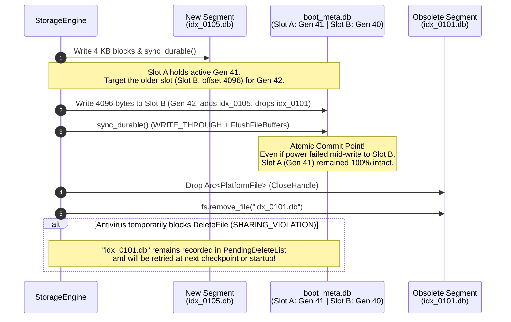
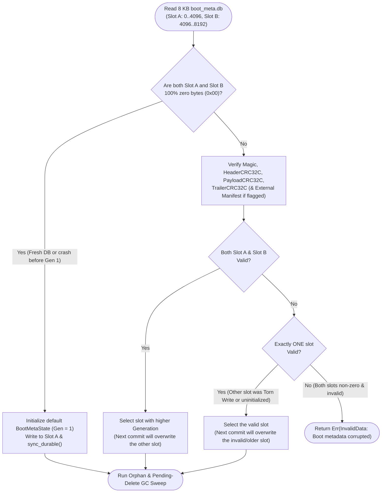

# Chapter 1.2: Atomic Bootstrapping — Ping-Pong Metadata, Hybrid Manifests, and Rename-Free GC

This chapter defines the detailed architecture of **Step 1-2: Boot Metadata (`boot_meta.db`), Hardware-Accelerated CRC32C (`src/util/crc32c.rs`), and Deferred Garbage Collection (`src/meta/`)**.

In an LSM/WiscKey storage engine, immutable index and blob segments are continuously created by MemTable flushes and merged or retired by background compaction and LRU eviction. The database must maintain an authoritative, crash-safe record of **which segment files are currently live**, **which WAL epochs are active**, and **which obsolete files are awaiting deletion**—without ever relying on atomic file renaming (`MoveFileEx` / `rename`).

---

## 1. Why Rename-Based Metadata Fails on Windows and SMB

Most Unix-born LSM engines (such as LevelDB and RocksDB) track their active file set using a rolling `MANIFEST-NNNNNN` log and a tiny text file named `CURRENT`. Whenever a new manifest is created, the engine writes `CURRENT.tmp` and calls `rename("CURRENT.tmp", "CURRENT")` (`MoveFileExW(..., MOVEFILE_REPLACE_EXISTING)` on Windows), relying on POSIX atomic rename semantics.

On Windows desktops and SMB/CIFS shares, this pattern suffers from three well-known failure modes:

1. **Antivirus Minifilter `SHARING_VIOLATION`:** Endpoint security and antivirus minifilter drivers intercept file creation and close events to scan newly written files. If `MoveFileExW` is called while a filter still holds an internal reference to `CURRENT` or `CURRENT.tmp`, the rename fails with `ERROR_SHARING_VIOLATION` (`32`) or `ERROR_ACCESS_DENIED` (`5`).
2. **`STATUS_DELETE_PENDING` Collisions:** Replacing an existing filename on Windows NTFS or Samba internally marks the target file for deletion. If any handle (including an OS indexer or SMB lease cleanup) briefly lingers, recreating or renaming onto that filename fails until the kernel purges the file object.
3. **Directory Metadata Flush Overhead:** Creating and renaming temporary files mutates directory entries in the NTFS Master File Table (`$MFT`), requiring directory-level metadata synchronization and breaking SMB directory leases.

### The `aydb` Solution: In-Place Ping-Pong Slots + Monotonic Sequence IDs

`aydb` eliminates file renaming completely:
* Every segment file (`idx_<SeqID>.db`, `blob_std_<SeqID>.db`, `blob_lru_<TblID>_<SeqID>.db`, `manifest_<SeqID>.db`) is assigned a strictly monotonic 64-bit `SeqID` that is **never reused**.
* The authoritative pointer to the active database state lives inside a fixed 8 KB file, **`boot_meta.db`**, pre-allocated at database creation with `PreallocStrategy::PhysicalZeroFill` and opened with `OpenHint::MutableSyncLog` (`dwShareMode = 0 | FILE_FLAG_OVERLAPPED | FILE_FLAG_WRITE_THROUGH`).
* `boot_meta.db` is divided into two 4 KB sector-aligned slots: **Slot A (`0..4096`)** and **Slot B (`4096..8192`)**. Each checkpoint alternates between Slot A and Slot B ("ping-pong buffering").



---

## 2. Exact 4096-Byte Binary Layout of a `boot_meta.db` Slot

Each of the two slots (`Slot A` at offset `0`, `Slot B` at offset `4096`) is exactly **4096 bytes**—matching both the standard OS virtual memory page size and the 4 KB physical sector size (`4Kn`) of modern NVMe/SSD drives. All multi-byte integers are encoded in **Little-Endian (LE)** format.

```text
 0                   1                   2                   3
 0 1 2 3 4 5 6 7 8 9 0 1 2 3 4 5 6 7 8 9 0 1 2 3 4 5 6 7 8 9 0 1
+-+-+-+-+-+-+-+-+-+-+-+-+-+-+-+-+-+-+-+-+-+-+-+-+-+-+-+-+-+-+-+-+
|          Magic "AYDB"         | FormatVersion |     Flags     |  0..8
+-+-+-+-+-+-+-+-+-+-+-+-+-+-+-+-+-+-+-+-+-+-+-+-+-+-+-+-+-+-+-+-+
|                        Generation (u64)                       |  8..16
|                                                               |
+-+-+-+-+-+-+-+-+-+-+-+-+-+-+-+-+-+-+-+-+-+-+-+-+-+-+-+-+-+-+-+-+
|                        NextSeqId (u64)                        | 16..24
|                                                               |
+-+-+-+-+-+-+-+-+-+-+-+-+-+-+-+-+-+-+-+-+-+-+-+-+-+-+-+-+-+-+-+-+
|                         NextLsn (u64)                         | 24..32
|                                                               |
+-+-+-+-+-+-+-+-+-+-+-+-+-+-+-+-+-+-+-+-+-+-+-+-+-+-+-+-+-+-+-+-+
|                    ActiveSyncWalEpoch (u64)                   | 32..40
|                                                               |
+-+-+-+-+-+-+-+-+-+-+-+-+-+-+-+-+-+-+-+-+-+-+-+-+-+-+-+-+-+-+-+-+
|                    ActiveBufWalEpoch (u64)                    | 40..48
|                                                               |
+-+-+-+-+-+-+-+-+-+-+-+-+-+-+-+-+-+-+-+-+-+-+-+-+-+-+-+-+-+-+-+-+
|       PayloadLen (u32)        |      PayloadCrc32c (u32)      | 48..56
+-+-+-+-+-+-+-+-+-+-+-+-+-+-+-+-+-+-+-+-+-+-+-+-+-+-+-+-+-+-+-+-+
|         Reserved (0)          |      HeaderCrc32c (u32)       | 56..64
+-+-+-+-+-+-+-+-+-+-+-+-+-+-+-+-+-+-+-+-+-+-+-+-+-+-+-+-+-+-+-+-+
|                                                               |
~                     Payload Area (4028 B)                     ~ 64..4092
|        (Inline Catalog OR 20B External Manifest Pointer)      |
+-+-+-+-+-+-+-+-+-+-+-+-+-+-+-+-+-+-+-+-+-+-+-+-+-+-+-+-+-+-+-+-+
|                    SlotTrailerCrc32c (u32)                    | 4092..4096
+-+-+-+-+-+-+-+-+-+-+-+-+-+-+-+-+-+-+-+-+-+-+-+-+-+-+-+-+-+-+-+-+
```

### 2.1 Fixed 64-Byte Slot Header (`0..64`) and 4-Byte Trailer (`4092..4096`)

| Byte Offset | Size | Field Name | Type | Description |
| :--- | :--- | :--- | :--- | :--- |
| `0..4` | 4 B | `magic` | `[u8; 4]` | Constant ASCII `"AYDB"` (`[0x41, 0x59, 0x44, 0x42]`). |
| `4..6` | 2 B | `format_version` | `u16` | Binary format version (`1`). |
| `6..8` | 2 B | `flags` | `u16` | Bit `0` (`0x0001`): `FLAG_EXTERNAL_MANIFEST`. `0` = inline payload; `1` = external `manifest_<SeqID>.db`. Bits `1..15` must be `0`. |
| `8..16` | 8 B | `generation` | `u64` | Strictly monotonic slot commit number (`1, 2, 3, ...`). |
| `16..24` | 8 B | `next_seq_id` | `u64` | Next available segment sequence ID (`>= 1`). |
| `24..32` | 8 B | `checkpoint_lsn` | `u64` | Highest `LSN` already flushed into immutable segments (`WAL` records with `lsn <= checkpoint_lsn` have already been persisted). |
| `32..40` | 8 B | `sync_wal_epoch` | `u64` | Active epoch number for `wal_sync.db` (`>= 1`). |
| `40..48` | 8 B | `buf_wal_epoch` | `u64` | Active epoch number for `wal_buf.db` (`>= 1`). |
| `48..52` | 4 B | `payload_len` | `u32` | Byte length of the valid data inside `64 .. 64 + payload_len` (`<= 4028`). |
| `52..56` | 4 B | `payload_crc32c` | `u32` | CRC32C checksum computed over `slot[64 .. 64 + payload_len]`. |
| `56..60` | 4 B | `reserved` | `u32` | Reserved for future alignment (`0`). |
| `60..64` | 4 B | `header_crc32c` | `u32` | CRC32C checksum computed over `slot[0..60]`. |
| `64..4092` | 4028 B | `payload` | `[u8; 4028]` | Catalog payload bytes (zero-padded from `64 + payload_len` to `4092`). |
| `4092..4096` | 4 B | `trailer_crc32c` | `u32` | CRC32C checksum computed over the entire preceding 4092 bytes (`slot[0..4092]`). |

#### Why Dual/Triple Checksums (`header_crc32c`, `payload_crc32c`, and `trailer_crc32c`)?
While modern SSDs have 4 KB physical pages, some legacy disks, virtualized storage controllers, or network SMB transports fragment a 4 KB write into eight **512-byte sub-sectors**. If power fails after the first 512 bytes of a 4 KB slot are written (updating the header at `0..64`) but before the final 512-byte sub-sector (`3584..4096`) hits media, `header_crc32c` alone would pass while the tail of the slot still contained bytes from two generations ago!
Placing `trailer_crc32c` at bytes `4092..4096` (the final 4 bytes of the 8th 512-byte sub-sector) guarantees that **both the head and the tail of the 4 KB page must arrive intact** for the slot to validate.

---

## 3. Hybrid Inline + External Manifest Overflow Architecture

A 4028-byte inline payload area comfortably holds over **120 segment descriptors and table quota entries**—more than enough for 99.9% of desktop database deployments. However, a storage engine must never hit a hard failure ceiling if an application creates hundreds of tables or accumulates many uncompacted segments during a burst load.

`aydb` uses a **Hybrid Inline + External Manifest Overflow** design:

1. **Fast Path — Inline Mode (`payload_bytes.len() <= 4028`, `FLAG_EXTERNAL_MANIFEST = 0`):**
   * The serialized catalog payload is written directly into `slot[64 .. 64 + payload_len]`.
   * Booting or checkpointing requires **zero extra files** and **zero extra I/O**: a single 4 KB write to `boot_meta.db` commits the entire state.
2. **Overflow Path — External Manifest Mode (`payload_bytes.len() > 4028`, `FLAG_EXTERNAL_MANIFEST = 1`):**
   * The engine allocates a new `manifest_seq_id` from `next_seq_id` and writes `[Magic "AYMF" (4B) | Version (2B) | Reserved (2B) | PayloadLen (4B) | PayloadCRC32C (4B) | PayloadBytes...]` to an immutable file `manifest_<SeqID>.db`, followed by `sync_durable()`.
   * Inside the `boot_meta.db` slot's payload area (`64..84`, `payload_len = 20`), the engine stores a 20-byte external pointer:
     `[manifest_seq_id: u64 | manifest_file_len: u64 | manifest_payload_crc32c: u32]`.
   * The previous generation's `manifest_<OldSeqID>.db` (if any) is added to `pending_delete_files` so it is automatically garbage-collected once the new slot commits!

### 3.1 Catalog Payload Binary Format

Whether stored inline in `slot[64..4092]` or inside `manifest_<SeqID>.db`, the catalog payload uses the exact same deterministic binary encoding:

```text
CatalogPayload :=
  [num_idx_segments: u32]
    num_idx_segments * IdxSegmentMeta {
      seq_id: u64,
      file_len: u64,
      level: u16,
      reserved: u16,
      record_count: u32,
    } (24 bytes each)
  [num_std_blob_segments: u32]
    num_std_blob_segments * StdBlobSegmentMeta {
      seq_id: u64,
      file_len: u64,
      dead_bytes: u64,
    } (24 bytes each)
  [num_lru_blob_segments: u32]
    num_lru_blob_segments * LruBlobSegmentMeta {
      seq_id: u64,
      file_len: u64,
      dead_bytes: u64,
      table_id: u16,
      reserved: [u8; 6],
    } (32 bytes each)
  [num_table_quotas: u32]
    num_table_quotas * TableQuotaMeta {
      table_id: u16,
      eviction_policy: u8, // 0 = None, 1 = Lru
      reserved: [u8; 5],
      max_bytes: u64,
      current_logical_bytes: u64,
    } (24 bytes each)
  [num_pending_deletes: u32]
    num_pending_deletes * PendingDeleteEntry {
      name_len: u16,
      name_bytes: [u8; name_len] (UTF-8 flat filename, e.g., "idx_0000000000000001.db")
    }
```

---

## 4. Crash Recovery & Slot Selection State Machine

When `BootMetaManager::open_or_recover` opens `boot_meta.db` (8192 bytes), it reads both Slot A (`0..4096`) and Slot B (`4096..8192`) and evaluates them according to a strict truth table:



### Handling Fallback When an External Manifest Is Missing
If the higher-generation slot has `FLAG_EXTERNAL_MANIFEST = 1`, `BootMetaManager` also verifies that the referenced `manifest_<SeqID>.db` exists and matches `manifest_payload_crc32c`. If a disk fault corrupted the new manifest file, the manager automatically falls back to the other slot if that older slot is completely valid!

---

## 5. Rename-Free Deferred Garbage Collection & Orphan Sweep

File deletion in `aydb` operates via two complementary mechanisms so that neither Windows Defender / minifilter scanners nor mid-compaction power outages ever leak disk space or crash the engine:

1. **Deferred Deletion Queue (`pending_delete_files`):**
   * When a checkpoint retires obsolete segments (e.g., `idx_0001.db` after compaction, or `blob_lru_0001_0005.db` after 100% LRU eviction), those filenames are first recorded in `pending_delete_files` inside the newly committed `boot_meta.db` slot.
   * Immediately after the new `boot_meta.db` slot is durable (and all in-process `Arc<PlatformFile>` handles to those obsolete files have been dropped), the engine calls `fs.remove_file(name)` for each entry in `pending_delete_files`.
   * Any file that is successfully deleted (or already `NotFound`) is removed from the in-memory `pending_delete_files` set (and will disappear from `boot_meta.db` on the next checkpoint).
   * Any file whose deletion fails with a transient OS error (such as `ERROR_SHARING_VIOLATION` or `ERROR_ACCESS_DENIED` while an antivirus scanner inspects it) remains in `pending_delete_files` and is automatically retried on subsequent checkpoints and at next database startup.
2. **Startup Orphan Sweep:**
   * Suppose power fails while the engine is halfway through writing a new `idx_0009.db` during a MemTable flush, *before* `boot_meta.db` is updated to reference `idx_0009.db`.
   * Upon recovery, after selecting the winning `BootMetaState`, the engine enumerates the directory via `fs.list_files()`. Any segment or manifest file (`idx_*.db`, `blob_std_*.db`, `blob_lru_*.db`, `manifest_*.db`) that is **not** referenced by the winning `BootMetaState` (and not referenced by the standby slot's external manifest, to protect rollback safety until the next commit) is identified as an uncommitted orphan and immediately deleted (or queued in `pending_delete_files` if locked by antivirus).

---

## 6. Hardware-Accelerated CRC32C (`src/util/crc32c.rs`)

Every storage layer in `aydb` (`boot_meta.db`, `wal_sync.db`, `wal_buf.db`, `idx_<SeqID>.db`, and `blob_*_<SeqID>.db`) relies on **CRC32C** (the Castagnoli polynomial `0x1EDC6F41`, bit-reflected `0x82F63B78`) for end-to-end data integrity and torn-write detection.

To maintain zero external crate dependencies while achieving hardware-line-rate checksumming:
* **x86 / x86_64 Hardware Acceleration (`SSE4.2`):** Uses `std::arch::is_x86_feature_detected!("sse4.2")` to dispatch to `_mm_crc32_u64` (processing 8 bytes per instruction cycle at **~15–25 GB/s**) and `_mm_crc32_u8` for tail bytes.
* **ARM64 Hardware Acceleration (`crc` target feature):** Uses `std::arch::is_aarch64_feature_detected!("crc")` with `__crc32cd` / `__crc32cb`.
* **Portable Slice-by-8 Software Fallback:** Provides a `const`-generated $8 \times 256$ lookup table (`CRC32C_TABLE: [[u32; 256]; 8]`) processing 8 bytes per loop iteration in pure safe Rust (~1.5–2.5 GB/s), which also serves as the ground-truth oracle in unit tests to verify the hardware-accelerated path!
