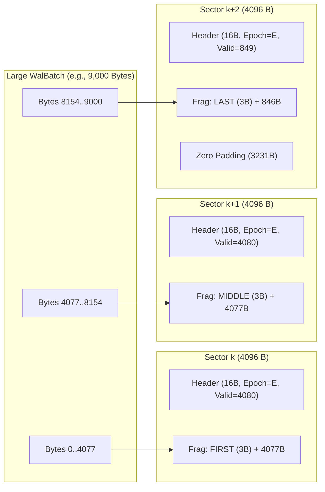
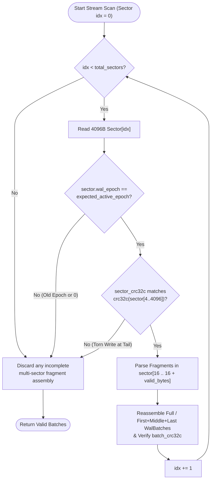

# Chapter 1.3: Durability Without Stalls — Pre-Allocated Epoch WAL & Two-Stream Crash Recovery

This chapter defines the detailed architecture of **Step 1-3: The Pre-Allocated Fixed-Size Write-Ahead Log (`src/wal/`) and Two-Stream Crash Recovery**.

In an LSM/WiscKey storage engine, recent mutations are buffered in an in-memory `MemTable` until enough data accumulates to flush an immutable `idx_<SeqID>.db` segment. To ensure those in-memory mutations are not lost if the application crashes or power fails before the `MemTable` flushes, every mutation must first be recorded in a sequential **Write-Ahead Log (WAL)**.

---

## 1. Core Architectural Challenges in Desktop & SMB WAL Design

A conventional rolling WAL (creating a new log file per MemTable flush, appending variable-length records, extending EOF on every write, and deleting old WAL files) exhibits four severe problems on Windows and SMB:

1. **NTFS MFT Size-Extension Contention:** Appending to a growing file updates `EndOfFile` and `ValidDataLength` in the NTFS Master File Table (`$MFT`) on every write.
2. **Antivirus & Samba File Churn:** Frequently creating and deleting multi-megabyte WAL files triggers antivirus minifilter scans and breaks SMB handle leases.
3. **Torn Overwrites When Packing Small Sync Commits into 4 KB Sectors:** If Transaction 1 commits 100 bytes to `Sector 0` (`Sync`), and Transaction 2 later appends 100 bytes to the *same* `Sector 0` and overwrites `Sector 0` on disk, a power outage during Transaction 2's sector overwrite can tear `Sector 0` and **destroy already-committed Transaction 1**.
4. **Double `fsync` Stalls with Out-of-Line Blobs:** Flushing both `blob_*.db` and `wal_*.db` on every write would halve write throughput.

### How `aydb` Solves All Four Challenges

1. **Pre-Allocated Fixed-Size Sector Rings (`WalEpoch` Reuse):**
   `wal_sync.db` (default `8 MB` = 2,048 sectors of 4 KB, `PhysicalZeroFill`) and `wal_buf.db` (default `16 MB` = 4,096 sectors of 4 KB, `LogicalExtendOnly`) are pre-allocated once and never resized or deleted. When a `MemTable` flushes, the engine increments `sync_wal_epoch` and `buf_wal_epoch` in `boot_meta.db` and wraps the write cursor back to Sector 0 with **zero file truncation and zero disk clearing**.
2. **Strict Sector Isolation for `wal_sync.db` vs. Dense Sector Packing for `wal_buf.db`:**
   * **`wal_sync.db` (`Durability::Sync`):** Every synchronous commit batch advances to a fresh 4 KB sector boundary. Once a 4 KB sector in `wal_sync.db` is written and acknowledged, it is **never overwritten again during the same `WalEpoch`**, making torn-overwrite corruption of committed data mathematically impossible.
   * **`wal_buf.db` (`Durability::Buffered`):** Multiple buffered commits are packed back-to-back inside the current 4 KB sector buffer and written through to the OS Page Cache (`CcCopyWrite`), surviving `kill -9` / `TerminateProcess` while achieving high storage density.
3. **Two-Stream `LSN` Merge Recovery + `Write-Blob-Before-WAL` Verification:**
   Upon recovery, valid batches from `wal_sync.db` and `wal_buf.db` are extracted independently, filtered by `lsn > checkpoint_lsn`, and merge-sorted in ascending `LSN` order. Any `PutBlobPtr` record whose target blob range fails CRC32C verification (because a power outage occurred before the buffered blob write reached disk) is safely skipped as an incomplete write rather than corrupting the database.

---

## 2. Exact 4096-Byte WAL Sector & Fragment Framing Format

Both `wal_sync.db` and `wal_buf.db` use the exact same 4096-byte sector format. Because an atomic write batch (`WalBatch`) may be smaller than 4 KB (multiple batches in one sector in `wal_buf.db`) or larger than 4 KB (spanning multiple consecutive 4 KB sectors), payloads are framed using **LevelDB/RocksDB-style record fragmentation** inside each sector.

```text
 0                   1                   2                   3
 0 1 2 3 4 5 6 7 8 9 0 1 2 3 4 5 6 7 8 9 0 1 2 3 4 5 6 7 8 9 0 1
+-+-+-+-+-+-+-+-+-+-+-+-+-+-+-+-+-+-+-+-+-+-+-+-+-+-+-+-+-+-+-+-+
|                      SectorCrc32c (u32)                       |  0..4
+-+-+-+-+-+-+-+-+-+-+-+-+-+-+-+-+-+-+-+-+-+-+-+-+-+-+-+-+-+-+-+-+
|                        WalEpoch (u64)                         |  4..12
|                                                               |
+-+-+-+-+-+-+-+-+-+-+-+-+-+-+-+-+-+-+-+-+-+-+-+-+-+-+-+-+-+-+-+-+
|       ValidBytes (u16)        |       SectorFlags (u16)       | 12..16
+-+-+-+-+-+-+-+-+-+-+-+-+-+-+-+-+-+-+-+-+-+-+-+-+-+-+-+-+-+-+-+-+
| FragType (1B) | FragLen (u16) |     Fragment Payload ...      | 16..16+ValidBytes
+-+-+-+-+-+-+-+-+-+-+-+-+-+-+-+-+-+-+-+-+-+-+-+-+-+-+-+-+-+-+-+-+
|              Zero Padding (16 + ValidBytes .. 4096)           |
+-+-+-+-+-+-+-+-+-+-+-+-+-+-+-+-+-+-+-+-+-+-+-+-+-+-+-+-+-+-+-+-+
```

### 2.1 16-Byte Sector Header (`0..16`)

| Byte Offset | Size | Field Name | Type | Description |
| :--- | :--- | :--- | :--- | :--- |
| `0..4` | 4 B | `sector_crc32c` | `u32` (LE) | CRC32C checksum computed over the remaining **4092 bytes** of the sector (`sector[4..4096]`), covering `wal_epoch`, `valid_bytes`, `sector_flags`, all fragments, and zero padding through byte `4095`. |
| `4..12` | 8 B | `wal_epoch` | `u64` (LE) | Active epoch counter when this sector was written (`>= 1`). During recovery, if `wal_epoch != expected_epoch`, the scanner has reached the end of the log. |
| `12..14` | 2 B | `valid_bytes` | `u16` (LE) | Number of active fragment bytes inside `sector[16 .. 16 + valid_bytes]` (`0..=4080`). |
| `14..16` | 2 B | `sector_flags` | `u16` (LE) | Reserved flags (`0`). |

> **Why Checksum All 4092 Bytes (`4..4096`) Instead of Only `16 + valid_bytes`?**
> Covering the full 4 KB sector through byte `4095` guarantees that even if a 4 KB write is torn across 512-byte sub-sectors, any stale bytes left at the tail of the sector from a previous epoch will invalidate `sector_crc32c`. And with SSE4.2 hardware CRC32C running at ~20 GB/s, checksumming 4092 bytes takes only **~200 nanoseconds**!

### 2.2 Fragment Framing Inside `sector[16 .. 16 + valid_bytes]`

Within the 4080-byte sector payload window, one or more fragments are laid out sequentially. Each fragment starts with a **3-byte Fragment Header**:

* `frag_type` (`u8`, 1 B):
  * `1` (`FragmentType::Full`): The entire serialized `WalBatch` fits inside this single fragment.
  * `2` (`FragmentType::First`): First chunk of a `WalBatch` that spans into the next sector.
  * `3` (`FragmentType::Middle`): Intermediate chunk of a multi-sector `WalBatch`.
  * `4` (`FragmentType::Last`): Final chunk completing a multi-sector `WalBatch`.
* `frag_len` (`u16` LE, 2 B): Byte length of `frag_data` immediately following (`<= 4077`).
* `frag_data` (`[u8; frag_len]`): Slice of the serialized `WalBatch`.



### 2.3 Serialized `WalBatch` & `WalRecord` Format

Once fragments are reassembled into a complete `WalBatch` byte slice, its layout is:

```text
WalBatch :=
  [lsn: u64 (8B LE)]           // Monotonic global Log Sequence Number for this batch
  [batch_crc32c: u32 (4B LE)]  // End-to-end CRC32C over the encoded records below
  [record_count: u32 (4B LE)]  // Number of atomic KV mutations in this batch
  record_count * WalRecord

WalRecord :=
  [op_type: u8 (1B)]
    - 1 = PutInline:
        [key_len: u32 (4B LE)] [key: [u8; key_len]]
        [val_len: u32 (4B LE)] [val: [u8; val_len]]
    - 2 = PutBlobPtr:
        [key_len: u32 (4B LE)] [key: [u8; key_len]]
        [blob_kind: u8 (1B)]   // 0 = Standard Blob, 1 = Per-Table LRU Blob
        [table_id: u16 (2B LE)]// 0 for Standard Blob; TableID for LRU Blob
        [blob_seq_id: u64 (8B LE)]
        [blob_offset: u32 (4B LE)]
        [blob_len: u32 (4B LE)]
        [blob_crc32c: u32 (4B LE)]
    - 3 = Delete (Tombstone):
        [key_len: u32 (4B LE)] [key: [u8; key_len]]
```

---

## 3. Write & Epoch Rotation Mechanics

### 3.1 `wal_sync.db` (`Durability::Sync`) vs. `wal_buf.db` (`Durability::Buffered`)

| Property | `wal_sync.db` (`Durability::Sync`) | `wal_buf.db` (`Durability::Buffered`) |
| :--- | :--- | :--- |
| **Default File Size** | `8 MB` (`2,048` sectors of 4 KB) | `16 MB` (`4,096` sectors of 4 KB) |
| **Pre-allocation** | `PreallocStrategy::PhysicalZeroFill` (`VDL == EOF`) | `PreallocStrategy::LogicalExtendOnly` |
| **OS Open Hint** | `OpenHint::MutableSyncLog` (`FILE_FLAG_WRITE_THROUGH`) | `OpenHint::MutableBufferedLog` (`FILE_FLAG_SEQUENTIAL_SCAN`) |
| **Sector Packing Policy** | **Sector-Isolated:** Every `append_batch` call starts at a fresh 4 KB sector boundary and advances the cursor to the next 4 KB boundary so committed sectors are never overwritten in place. | **Densely Packed:** Small batches are packed into the active 4 KB in-memory sector buffer (if remaining space `>= 3 + batch_bytes.len()`, or split across sectors) and immediately written to the OS Page Cache. |
| **Crash Guarantee** | Durable when the commit returns (survives process crash, OS panic, and power loss, assuming the device honours write-through). | Survives process crash / `kill -9` / `TerminateProcess` (via OS Page Cache). Power loss / OS crash may roll back recent unsynced commits. |

#### Subtlety in `wal_buf.db` In-Place Sector Packing and Power Loss
In `wal_buf.db`, suppose a 4 KB sector buffer in memory receives Batch 1 (`100 B`), which is written to `Sector k` in the OS Page Cache (`write_all_at`), and then receives Batch 2 (`100 B`), updating `Sector k` in the OS Page Cache with both Batch 1 and Batch 2.
* Because `wal_buf.db` is opened **without** `FILE_FLAG_WRITE_THROUGH`, `write_all_at` updates the 256 KB VACB view in RAM inside the Windows Cache Manager (`CcCopyWrite`).
* If the process is killed via `TerminateProcess`, the intact 4 KB sector containing both Batch 1 and Batch 2 sits in kernel RAM and flushes cleanly to disk.
* If a full power outage occurs while the OS Lazy Writer is flushing `Sector k` to disk, `Durability::Buffered` explicitly permits rolling back recent unflushed seconds of cache mutations; even if `Sector k` tears on power loss, `SectorCrc32c` catches it and truncates the buffered stream cleanly at `Sector k`.

### 3.2 Handling Ring Full (`ErrorKind::StorageFull` $\rightarrow$ Trigger MemTable Flush)
Because a fixed-size WAL ring holds a single active `WalEpoch` at a time, if an incoming batch requires $M$ sectors and `current_sector_idx + M > total_sectors`, the writer returns `WalAppendResult::RingFull`. The coordinator (`StorageEngine`) responds by flushing the active `MemTable` to a new `idx_<SeqID>.db`, advancing `sync_wal_epoch` / `buf_wal_epoch` in `boot_meta.db`, calling `wal.reset_for_new_epoch(new_epoch)` (which resets `current_sector_idx = 0` in $O(1)$ without touching the disk), and retrying the append.

---

## 4. Two-Stream Crash Recovery State Machine

During `WalRecovery::recover_two_streams`, the engine scans `wal_sync.db` (expecting `boot_meta.sync_wal_epoch`) and `wal_buf.db` (expecting `boot_meta.buf_wal_epoch`) from Sector 0 to `total_sectors - 1`:



Recovery halts at the first torn or old-epoch sector. Because write-back can reorder, later sectors of the same epoch may already be on disk beyond that point, so after recovery the engine **always rotates both WAL epochs** (flushing the MemTable first if non-empty, otherwise rotating epochs only) regardless of whether any batch was recovered. This costs one `boot_meta.db` commit per open and guarantees no pre-crash sector can be read as part of the new stream. Likewise, at each buffered-WAL durability point the open `wal_buf.db` sector is sealed (written, then the cursor advances to a fresh sector) so a synced sector is never rewritten in place; a torn rewrite would otherwise discard batches that were already synced while a later `wal_sync.db` batch depending on them survived. The cost is at most one partly used sector per sync point.

If a WAL write or sync fails at runtime, the engine is poisoned: mutations fail until reopen, reads continue, and the failed commit's outcome is unknown after reopen (present or absent, never partial).

Once both `sync_batches` and `buf_batches` have been recovered:
1. Any batch with `batch.lsn <= boot_meta.checkpoint_lsn` is filtered out (already persisted in an `idx_<SeqID>.db` segment).
2. The two sorted slices (`sync_batches` and `buf_batches`) are merged in $O(N)$ by ascending `batch.lsn`.
3. For each `WalRecord::PutBlobPtr`, the recovery coordinator invokes a caller-supplied `BlobValidator` callback (`Fn(&BlobPtr) -> bool`). Following the **`Write-Blob-Before-WAL`** protocol, if a power outage prevented an un-fsynced blob payload from reaching disk, `BlobValidator` returns `false` and that uncommitted record is safely skipped without aborting recovery!

---

## 5. Empirical Benchmark Results (`examples/meta_wal_bench.rs`)

Executed via `cargo run --release --example meta_wal_bench` on Windows (Local NTFS / NVMe).

### 5.1 WAL Write Throughput & Latency Across Durability Modes

| WAL Stream & Mode | Records / Batch | Throughput (`records/sec`) | Latency / Record | Crash Resilience Guarantee |
| :--- | ---: | ---: | ---: | :--- |
| **`wal_sync.db` (`SyncSectorIsolated`)** | `1` | `12,736 rec/s` | `78.52 µs` | Durable on return (assumes write-through is honoured) |
| **`wal_sync.db` (`SyncSectorIsolated`)** | `10` | `130,803 rec/s` | `7.65 µs` | Durable on return (assumes write-through is honoured) |
| **`wal_sync.db` (`SyncSectorIsolated`)** | `50` | **`568,372 rec/s`** | **`1.76 µs`** | Durable on return (assumes write-through is honoured) |
| **`wal_buf.db` (`BufferedImmediateOsCache`)** | `1` | **`282,076 rec/s`** | **`3.55 µs`** | Survives process kill (`kill -9` / `TerminateProcess`); OS crash may lose recent tail |
| **`wal_buf.db` (`BufferedUserSpaceCoalesced`)** | `1` | **`6,482,562 rec/s`** | **`0.15 µs` (`150 ns`)** | Flushed to OS Page Cache every 4 KB sector |

### 5.2 Epoch Rotation vs. Zero-Fill & Crash Recovery Scan Speed

| Operation | Measured Time | Effective Bandwidth / Comparison |
| :--- | ---: | :--- |
| **$O(1)$ Epoch Rotation (`reset_for_new_epoch`)** | **`200 ns`** (`0.0002 ms`) | **`55,750×` faster** than zero-filling a 16 MB WAL (`11.15 ms`) |
| **Crash Recovery Scan (`1,238` sectors / `50,000` batches)** | **`8.84 ms`** | **`547.3 MB/s`** (includes both 4 KB sector CRC32C and batch CRC32C verification) |

#### Key Engineering Takeaways
1. **Why Dual-Mode Buffering (`BufferedImmediateOsCache` vs. `BufferedUserSpaceCoalesced`) Matters:**
   * Writing every single 80-byte record immediately to the OS Page Cache (`BufferedImmediateOsCache`) achieves **`282,076 records/sec` (`3.55 µs/op`)** while keeping each commit in the OS page cache, so it survives the process being terminated via `TerminateProcess` (`kill -9`) a microsecond later (an OS crash or power loss could still roll it back).
   * For bulk cache imports where user-space 4 KB sector coalescing (`BufferedUserSpaceCoalesced`) is used, throughput jumps **`23×` to `6.48 million records/sec` (`150 ns/op`)** because only 1 `WriteFile` syscall is issued per ~50 records (every 4 KB).
2. **Eliminating Checkpoint Stalls via `WalEpoch`:** Rotating `wal_buf.db` after a MemTable flush takes **`200 ns`** instead of an `11.15 ms` disk zero-fill, and recovering 50,000 buffered commits on startup finishes in **`8.84 ms`**.

