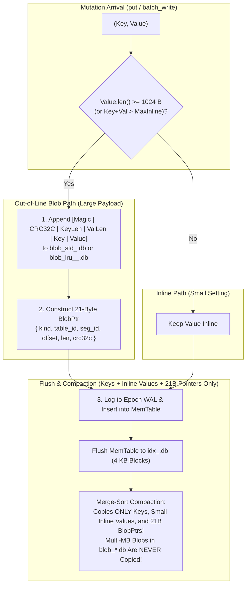

# Chapter 1.4: WiscKey KV Separation, 4 KB Block SSTables, Sparse Fence Pointers, and Compaction

This chapter defines the detailed architecture of **Step 1-4: Out-of-Line Blob Segments (`src/blob/`), Bounded MemTable (`src/memtable/`), 4 KB Block Index Segments with In-Heap Bloom Filters and Sparse Fence Pointers (`src/index/`), and Merge Compaction**.

---

## 1. The WiscKey Separation Principle: Decoupling Compaction from Value Size

In a classic LSM-Tree (such as LevelDB or RocksDB), keys and values are stored together inside sorted SSTable files. Whenever background compaction merges overlapping SSTables to reclaim overwritten or deleted entries, every value is read from disk and rewritten to a new SSTable—producing a write amplification factor of $10\times$ to $30\times$.

`aydb` implements **WiscKey-style Key-Value Separation** governed by `INLINE_THRESHOLD` (default: `1024 bytes`):



---

## 2. Out-of-Line Blob Segment Format (`blob_std_<SeqID>.db` & `blob_lru_<TblID>_<SeqID>.db`)

Blob segments are append-only files opened with `OpenHint::ImmutableSequential` (`FILE_FLAG_SEQUENTIAL_SCAN`), enabling the Windows Cache Manager to prefetch 256 KB VACB windows during sequential reads and automatically release pages behind the cursor.

### 2.1 Framed Blob Record Binary Layout

Every blob appended to a blob segment is framed with a 16-byte header followed by the key and value bytes:

```text
 0                   1                   2                   3
 0 1 2 3 4 5 6 7 8 9 0 1 2 3 4 5 6 7 8 9 0 1 2 3 4 5 6 7 8 9 0 1
+-+-+-+-+-+-+-+-+-+-+-+-+-+-+-+-+-+-+-+-+-+-+-+-+-+-+-+-+-+-+-+-+
|          Magic "AYBL"         |         BlobCrc32c (u32)      |  0..8
+-+-+-+-+-+-+-+-+-+-+-+-+-+-+-+-+-+-+-+-+-+-+-+-+-+-+-+-+-+-+-+-+
|          KeyLen (u32)         |          ValLen (u32)         |  8..16
+-+-+-+-+-+-+-+-+-+-+-+-+-+-+-+-+-+-+-+-+-+-+-+-+-+-+-+-+-+-+-+-+
|                        Key (KeyLen B)                         | 16..16+KeyLen
+-+-+-+-+-+-+-+-+-+-+-+-+-+-+-+-+-+-+-+-+-+-+-+-+-+-+-+-+-+-+-+-+
|                       Value (ValLen B)                        | ..16+KeyLen+ValLen
+-+-+-+-+-+-+-+-+-+-+-+-+-+-+-+-+-+-+-+-+-+-+-+-+-+-+-+-+-+-+-+-+
```

* **`magic` (`0..4`):** Constant ASCII `"AYBL"` (`[0x41, 0x59, 0x42, 0x4C]`).
* **`blob_crc32c` (`4..8`, `u32` LE):** CRC32C computed over bytes `8 .. 16 + KeyLen + ValLen` (covering `KeyLen`, `ValLen`, `Key`, and `Value`).
* **Why Embed `Key` Inside the Blob Record?**
  Storing `Key` alongside `Value` serves two critical purposes:
  1. **Point-Read Verification:** When dereferencing a `BlobPtr`, the reader verifies not only `blob_crc32c` matching `ptr.crc32c`, but also that the embedded `Key` matches the lookup key.
  2. **Self-Describing Segments:** If an offline recovery tool or future garbage collector scans a `blob_std_<SeqID>.db` file directly, every record is self-identifying without requiring an external reverse index.

### 2.2 Safe Dereferencing Under `Write-Blob-Before-WAL`

When reading a blob referenced by `BlobPtr { kind, table_id, seg_id, offset, len, crc32c }`:
1. The reader issues a single positional `read_exact_at` of `len` bytes at `offset`.
2. If the file is shorter than `offset + len` (`UnexpectedEof`), or if `magic != b"AYBL"`, or if the computed `crc32c` does not equal `ptr.crc32c`:
   * Rather than raising a fatal corruption error, the reader returns `Ok(None)` (treating the record as an uncommitted write from a prior power outage or an already-evicted cache entry).

---

## 3. Immutable Index Segment Format (`idx_<SeqID>.db`)

An `idx_<SeqID>.db` file is an immutable sorted string table (SSTable) opened with `OpenHint::ImmutableRandom` (`FILE_FLAG_RANDOM_ACCESS`).

### 3.1 Overall File Structure

To avoid scanning all 4 KB data blocks when reopening a database at startup, `idx_<SeqID>.db` stores its **Data Blocks** first (aligned to 4096-byte boundaries), followed by a compact **Filter & Fence Index Section**, and ending with a fixed **48-byte Footer**:

```text
+-----------------------------------------------------------------------+
| Data Block 0 (4096 B, Offset 0)                                       |
+-----------------------------------------------------------------------+
| Data Block 1 (4096 B, Offset 4096)                                    |
+-----------------------------------------------------------------------+
| ...                                                                   |
+-----------------------------------------------------------------------+
| Data Block B-1 (4096 B, Offset (B-1)*4096)                            |
+-----------------------------------------------------------------------+
| Bloom Filter Bitset & Sparse Fence Pointer Directory                  |
| (Offset: B*4096, Length: meta_len, Protected by meta_crc32c)          |
+-----------------------------------------------------------------------+
| Fixed 48-Byte Segment Footer (Magic "AYIX", Counts, Offsets, CRC32C)  |
+-----------------------------------------------------------------------+
```

At runtime, **only the Bloom Filter and the Sparse Fence Pointer Directory remain in process heap memory**. The 4 KB Data Blocks stay on disk / in the OS Page Cache and are fetched via a single 4 KB `read_exact_at` call on demand.

### 3.2 Exact 4096-Byte Index Data Block Layout

Inside each 4 KB Data Block, sorted entries grow **upward** from byte `0`, while a compact `u16` **Entry Offset Directory** grows **downward** from byte `4088`, allowing $O(\log K)$ binary search directly inside the raw 4 KB byte buffer without linear scanning or heap allocation!

```text
 0                                                 4088-2K      4088        4096
+------------+------------+-----+------------+----+------------+-----------+
|  Entry 0   |  Entry 1   | ... | Entry K-1  | 00 | Off[0..K]  |  Trailer  |
| (Variable) | (Variable) |     | (Variable) |Pad | (K * u16)  |   (8 B)   |
+------------+------------+-----+------------+----+------------+-----------+
 ^            ^                                    |          |
 |____________|____________________________________|__________|
              Offsets enable O(log K) binary search in place!
```

* **Encoded Entry Format (at `block[entry_offset]`):**
  * `key_len: u16` (2 B LE)
  * `entry_type: u8` (1 B): `1 = InlineValue`, `2 = BlobPtr`, `3 = Tombstone`
  * `lsn: u64` (8 B LE): Mutation sequence number
  * `key: [u8; key_len]`
  * `value_payload`:
    * For `InlineValue (1)`: `[val_len: u16 (2B LE) | value: [u8; val_len]]`
    * For `BlobPtr (2)`: `[kind: u8 (1B) | table_id: u16 (2B) | seg_id: u64 (8B) | offset: u32 (4B) | len: u32 (4B) | crc32c: u32 (4B)]` (21 B)
    * For `Tombstone (3)`: Empty (`0 B`)
* **Entry Offset Directory (`4088 - 2 * K .. 4088`):**
  * $K$ little-endian `u16` values (`off_0, off_1, ..., off_{K-1}`), where `off_i` is the starting byte offset of `Entry i` within the 4096-byte block.
* **8-Byte Block Trailer (`4088..4096`):**
  * `4088..4090` (`u16` LE): `num_entries` ($K$)
  * `4090..4092` (`u16` LE): `block_flags` (`0`)
  * `4092..4096` (`u32` LE): `block_crc32c` — Hardware CRC32C of `block[0..4092]`.

### 3.3 In-Heap Bloom Filter & Sparse Fence Pointers

1. **Kirsch-Mitzenmacher Double-Hashing Bloom Filter:**
   * Given `bits_per_key = 10` (default), the filter allocates $M = \max(64, N \times 10)$ bits ($1.25\text{ bytes/key}$) and uses $k = 7$ hash probes derived from two independent hardware CRC32C seeds:
     $$h_i(x) = (h_1(x) + i \cdot h_2(x)) \bmod M \quad (i = 0 \dots 6)$$
   * Before touching the disk or OS page cache for `idx_<SeqID>.db`, `bloom.may_contain(key)` checks 7 bits in RAM in **~10 nanoseconds**, rejecting **~99.1%** of point lookups for keys not present in that segment!
2. **Sparse Fence Pointers:**
   * Maintains a sorted `Vec<FencePointer>` in RAM where entry $b$ holds the **first key (`Entry 0`)** of Data Block $b$.
   * When `bloom.may_contain(key)` returns `true`, the reader binary-searches `fence_pointers` (`partition_point(|fp| fp.first_key.as_slice() <= key)`):
     * If the partition point is `0`, `key` is smaller than the very first key in the segment $\rightarrow$ immediate miss with zero I/O!
     * Otherwise, candidate block index is `b = partition_point - 1`. Because keys never span across 4 KB blocks, **at most one 4 KB block (`b`) can possibly contain `key`**. The reader issues a single `read_exact_at(4096, b * 4096)`, verifies `block_crc32c`, and binary-searches the block's `u16` offset directory!

---

## 4. Bounded `MemTable` & Merge-Sort Compaction

### 4.1 Bounded `MemTable` (`src/memtable/mod.rs`)
* Backed by an ordered `BTreeMap<Vec<u8>, MemEntry>` where `MemEntry` holds `{ lsn: u64, value: IndexValue }` (`Inline(Vec<u8>)`, `Blob(BlobPtr)`, or `Tombstone`).
* Tracks exact byte usage (`approximate_bytes`). Because large values (`>= 1024 B`) are converted into 21-byte `BlobPtr` structs *before* entering the `MemTable`, a **4 MB `MemTable` can buffer tens of thousands of multi-megabyte HTTP cache insertions** without exhausting its 4 MB heap cap!

### 4.2 Multi-Way Merge Compaction (`compact_idx_segments`)
* Takes $M$ input `IdxSegmentReader` instances (ordered newest to oldest), streams their 4 KB blocks sequentially, and performs a $K$-way merge sort by key:
  * When multiple segments contain the same key, only the entry with the highest `lsn` is retained; older versions are discarded.
  * If `drop_tombstones = true` (when compacting all existing segments into a single base segment), `IndexValue::Tombstone` entries are stripped completely, reclaiming deleted key space.
  * When an overwritten or deleted entry was a `BlobPtr` pointing to `blob_std_<SeqID>.db` (or `blob_lru`), compaction reports the reclaimed `dead_bytes` per `(BlobKind, table_id, seg_id)` so `BootMetaState` can track dead blob ratios and unlink 100%-dead blob segments without copying a single blob byte!
