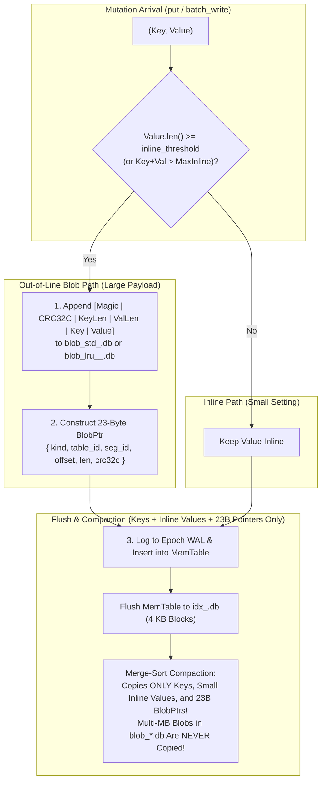

# Chapter 1.4: WiscKey KV Separation, 4 KB Block SSTables, Sparse Fence Pointers, and Compaction

This chapter defines the detailed architecture of **Step 1-4: Out-of-Line Blob Segments (`src/blob/`), Bounded MemTable (`src/memtable/`), 4 KB Block Index Segments with In-Heap Bloom Filters and Sparse Fence Pointers (`src/index/`), and Merge Compaction**.

---

## 1. The WiscKey Separation Principle: Decoupling Compaction from Value Size

In a classic LSM-Tree (such as LevelDB or RocksDB), keys and values are stored together inside sorted SSTable files. Whenever background compaction merges overlapping SSTables to reclaim overwritten or deleted entries, every value is read from disk and rewritten to a new SSTable—producing a write amplification factor of $10\times$ to $30\times$.

`aydb` implements **WiscKey-style Key-Value Separation** to decouple LSM compaction bandwidth from payload volume. Small records remain stored inline within index blocks, while larger payloads are appended to dedicated blob files and referenced via compact 23-byte pointers:



### 1.1 Configurable Inline Thresholds (`inline_threshold_bytes` & `inline_max`)

The boundary between inline and out-of-line storage is fully configurable:
* **Global Engine Default (`EngineConfig::inline_threshold_bytes`):** Defaults to `1024 bytes` (`1 KB`).
* **Per-Table Virtual Table DDL (`inline_max=<bytes>`):** Allows individual tables to specify custom inline limits (e.g., `CREATE VIRTUAL TABLE documents USING aydb(inline_max=2048, ...);`).
* **Physical Upper Bound (`IndexEntry::inline_fits_in_block`):**
  An inline entry must fit entirely within a single 4 KB index block without crossing block boundaries. Because each 4 KB block reserves an 8-byte trailer and a 2-byte offset directory entry per record, the physical upper bound is strictly enforced:
  $$13 + \text{key\_len} + \text{val\_len} \le \text{MAX\_SINGLE\_BLOCK\_ENTRY\_BYTES}$$
  This limits the maximum possible inline threshold to approximately $3.5\text{ KB} - 4\text{ KB}$ minus the primary key length.

### 1.2 Workload Trade-Offs and Defaults

Selecting the appropriate inline threshold balances write amplification against point-read latency:

1. **Why 1 KB Remains the Default for Capped LRU Tables (`blob_lru`):**
   For tables declared with logical size bounds (`MAX_BYTES`) and automatic LRU purging (`EVICTION = 'LRU'`), maintaining the `1 KB` threshold is essential. Capped tables place large payloads into dedicated `blob_lru_<TblID>_<SeqID>.db` files. When all blobs in an LRU generation are evicted, the engine drops the entire segment file via an $O(1)$ file deletion (Copy-less Eviction) with **zero compaction overhead**. If multi-kilobyte payloads were stored inline inside `idx_*.db`, reclaiming their space would require rewriting entire SSTables during compaction, causing severe write stalls on high-churn caches.
2. **Raising `inline_max` for 1 KB – 3 KB Workloads (e.g., YCSB 2 KB Records):**
   WiscKey separation is most effective when values are large (multiple kilobytes to megabytes) and write amplification dominates. For medium-sized records ($1\text{ KB} - 3\text{ KB}$), the extra random I/O indirection (a separate `ReadFile` and CRC check on `blob_*.db`) costs more latency than WiscKey saves on write amplification. Raising `inline_max` to `2048` or `3500` eliminates this second read, bringing point-read performance close to in-process B-Trees, at the expense of fewer entries per 4 KB index block (more fence pointers in heap) and higher compaction write volume.

---

## 2. Out-of-Line Blob Segment Format (`blob_std_<SeqID>.db` & `blob_lru_<TblID>_<SeqID>.db`)

Blob segments are append-only files opened with `OpenHint::ImmutableSequential` (`FILE_FLAG_SEQUENTIAL_SCAN`), enabling the Windows Cache Manager to prefetch 256 KB VACB windows during sequential reads and automatically release pages behind the cursor.

### 2.1 Framed Blob Record Binary Layout

Every blob appended to a blob segment is framed with a 16-byte header followed by the key and value bytes:

```text
 0                   1                   2                   3
 0 1 2 3 4 5 6 7 8 9 0 1 2 3 4 5 6 7 8 9 0 1 2 3 4 5 6 7 8 9 0 1
+-+-+-+-+-+-+-+-+-+-+-+-+-+-+-+-+-+-+-+-+-+-+-+-+-+-+-+-+-+-+-+-+
|          Magic "AYBL"         |         BlobCrc32c (u32)      |  0..8
+-+-+-+-+-+-+-+-+-+-+-+-+-+-+-+-+-+-+-+-+-+-+-+-+-+-+-+-+-+-+-+-+
|          KeyLen (u32)         |          ValLen (u32)         |  8..16
+-+-+-+-+-+-+-+-+-+-+-+-+-+-+-+-+-+-+-+-+-+-+-+-+-+-+-+-+-+-+-+-+
|                        Key (KeyLen B)                         | 16..16+KeyLen
+-+-+-+-+-+-+-+-+-+-+-+-+-+-+-+-+-+-+-+-+-+-+-+-+-+-+-+-+-+-+-+-+
|                       Value (ValLen B)                        | ..16+KeyLen+ValLen
+-+-+-+-+-+-+-+-+-+-+-+-+-+-+-+-+-+-+-+-+-+-+-+-+-+-+-+-+-+-+-+-+
```

* **`magic` (`0..4`):** Constant ASCII `"AYBL"` (`[0x41, 0x59, 0x42, 0x4C]`).
* **`blob_crc32c` (`4..8`, `u32` LE):** CRC32C computed over bytes `8 .. 16 + KeyLen + ValLen` (covering `KeyLen`, `ValLen`, `Key`, and `Value`).
* **Why Embed `Key` Inside the Blob Record?**
  Storing `Key` alongside `Value` serves two critical purposes:
  1. **Point-Read Verification:** When dereferencing a `BlobPtr`, the reader verifies not only `blob_crc32c` matching `ptr.crc32c`, but also that the embedded `Key` matches the lookup key.
  2. **Self-Describing Segments:** If an offline recovery tool or future garbage collector scans a `blob_std_<SeqID>.db` file directly, every record is self-identifying without requiring an external reverse index.

### 2.2 Safe Dereferencing Under `Write-Blob-Before-WAL`

When reading a blob referenced by `BlobPtr { kind, table_id, seg_id, offset, len, crc32c }`:
1. The reader issues a single positional `read_exact_at` of `len` bytes at `offset`.
2. If the file is shorter than `offset + len` (`UnexpectedEof`), or if `magic != b"AYBL"`, or if the computed `crc32c` does not equal `ptr.crc32c`:
   * Rather than raising a fatal corruption error, the reader returns `Ok(None)` (treating the record as an uncommitted write from a prior power outage or an already-evicted cache entry).

---

## 3. Immutable Index Segment Format (`idx_<SeqID>.db`)

An `idx_<SeqID>.db` file is an immutable sorted string table (SSTable) opened with `OpenHint::ImmutableRandom` (`FILE_FLAG_RANDOM_ACCESS`).

### 3.1 Overall File Structure

To avoid scanning all 4 KB data blocks when reopening a database at startup, `idx_<SeqID>.db` stores its **Data Blocks** first (aligned to 4096-byte boundaries), followed by a compact **Filter & Fence Index Section**, and ending with a fixed **48-byte Footer**:

```text
+-----------------------------------------------------------------------+
| Data Block 0 (4096 B, Offset 0)                                       |
+-----------------------------------------------------------------------+
| Data Block 1 (4096 B, Offset 4096)                                    |
+-----------------------------------------------------------------------+
| ...                                                                   |
+-----------------------------------------------------------------------+
| Data Block B-1 (4096 B, Offset (B-1)*4096)                            |
+-----------------------------------------------------------------------+
| Bloom Filter Bitset & Sparse Fence Pointer Directory                  |
| (Offset: B*4096, Length: meta_len, Protected by meta_crc32c)          |
+-----------------------------------------------------------------------+
| Fixed 48-Byte Segment Footer (Magic "AYIX", Counts, Offsets, CRC32C)  |
+-----------------------------------------------------------------------+
```

At runtime, **the Bloom Filter and the Sparse Fence Pointer Directory remain in process heap memory** (consuming only hundreds of KB to a few MB). By default, the 4 KB Data Blocks stay on disk / in the OS Page Cache and are fetched via a single 4 KB `read_exact_at` call on demand; when the optional verified block cache is enabled (`block_cache_bytes > 0`), hot verified 4 KB data blocks are retained in user space (§3.4).

### 3.2 Exact 4096-Byte Index Data Block Layout

Inside each 4 KB Data Block, sorted entries grow **upward** from byte `0`, while a compact `u16` **Entry Offset Directory** grows **downward** from byte `4088`, allowing $O(\log K)$ binary search directly inside the raw 4 KB byte buffer without linear scanning or heap allocation!

```text
 0                                                 4088-2K      4088        4096
+------------+------------+-----+------------+----+------------+-----------+
|  Entry 0   |  Entry 1   | ... | Entry K-1  | 00 | Off[0..K]  |  Trailer  |
| (Variable) | (Variable) |     | (Variable) |Pad | (K * u16)  |   (8 B)   |
+------------+------------+-----+------------+----+------------+-----------+
 ^            ^                                    |          |
 |____________|____________________________________|__________|
              Offsets enable O(log K) binary search in place!
```

* **Encoded Entry Format (at `block[entry_offset]`):**
  * `key_len: u16` (2 B LE)
  * `entry_type: u8` (1 B): `1 = InlineValue`, `2 = BlobPtr`, `3 = Tombstone`
  * `lsn: u64` (8 B LE): Mutation sequence number
  * `key: [u8; key_len]`
  * `value_payload`:
    * For `InlineValue (1)`: `[val_len: u16 (2B LE) | value: [u8; val_len]]`
    * For `BlobPtr (2)`: `[kind: u8 (1B) | table_id: u16 (2B) | seg_id: u64 (8B) | offset: u32 (4B) | len: u32 (4B) | crc32c: u32 (4B)]` (23 B)
    * For `Tombstone (3)`: Empty (`0 B`)
* **Entry Offset Directory (`4088 - 2 * K .. 4088`):**
  * $K$ little-endian `u16` values (`off_0, off_1, ..., off_{K-1}`), where `off_i` is the starting byte offset of `Entry i` within the 4096-byte block.
* **8-Byte Block Trailer (`4088..4096`):**
  * `4088..4090` (`u16` LE): `num_entries` ($K$)
  * `4090..4092` (`u16` LE): `block_flags` (`0`)
  * `4092..4096` (`u32` LE): `block_crc32c` — Hardware CRC32C of `block[0..4092]`.

### 3.3 In-Heap Bloom Filter & Sparse Fence Pointers

1. **Kirsch-Mitzenmacher Double-Hashing Bloom Filter:**
   * Given `bits_per_key = 10` (default), the filter allocates $M = \max(64, N \times 10)$ bits ($1.25\text{ bytes/key}$) and uses $k = 7$ hash probes derived from two independent hardware CRC32C seeds:
     $$h_i(x) = (h_1(x) + i \cdot h_2(x)) \bmod M \quad (i = 0 \dots 6)$$
   * Before touching the disk or OS page cache for `idx_<SeqID>.db`, `bloom.may_contain(key)` checks 7 bits in RAM in **~10 nanoseconds**, rejecting **~99.1%** of point lookups for keys not present in that segment!
2. **Sparse Fence Pointers:**
   * Maintains a sorted `Vec<FencePointer>` in RAM where entry $b$ holds the **first key (`Entry 0`)** of Data Block $b$.
   * When `bloom.may_contain(key)` returns `true`, the reader binary-searches `fence_pointers` (`partition_point(|fp| fp.first_key.as_slice() <= key)`):
     * If the partition point is `0`, `key` is smaller than the very first key in the segment $\rightarrow$ immediate miss with zero I/O!
     * Otherwise, candidate block index is `b = partition_point - 1`. Because keys never span across 4 KB blocks, **at most one 4 KB block (`b`) can possibly contain `key`**. The reader issues a single `read_exact_at(4096, b * 4096)`, verifies `block_crc32c`, and binary-searches the block's `u16` offset directory!

### 3.4 Optional Bounded Verified Block Cache & Small Blob Cache

While sparse fence pointers and Bloom filters in heap memory keep default memory overhead minimal, reading uncached 4 KB blocks from the OS page cache still requires a user/kernel privilege transition (`NtReadFile` / `pread`) plus a hardware CRC32C verification pass over 4,092 bytes. For workloads where point-read latency is critical, `aydb` supports an **optional, strictly-bounded in-process cache** for verified blocks and small blobs configured via `EngineConfig`:

#### 1. Cache Partitioning and Keying
* **4 KB Index Block Cache (`block_cache_bytes`):**
  * **Key:** `(seq_id: u64, block_idx: u32)`
  * **Value:** The verified 4096-byte `idx` data block.
  * **Verification Skip:** Data enters the cache only after successfully passing `block_crc32c` validation. Cache hits skip the 4 KB CRC32C recalculation entirely, reducing lookup latency from microseconds to tens of nanoseconds.
* **Small Blob Record Cache (`blob_cache_bytes`):**
  * **Key:** `(kind: BlobKind, table_id: u16, seg_id: u64, offset: u32)`
  * **Value:** Verified payload for small blobs ($\le 16\text{ KB}$).
  * **Independent Sub-Budget:** Small blobs are allocated from a separate memory pool so high-churn blob access cannot evict hot 4 KB index blocks.
  * **Active Segment Append Safety:** For the currently active, append-only blob segment, records are eligible for caching **only if they reside strictly below `flushed_offset()`**. Uncommitted or in-flight appends at the segment tail are never cached.

#### 2. Lifetime, Invalidation, and Scan Resistance
* **Immutability & Zero Cache Invalidation Hazards:** Completed `idx` and `blob` segments are immutable and `SeqID`s are never recycled (`ARCHITECTURE.md` §2.3). Consequently, cached blocks and blobs remain permanently valid for the entire active lifetime of the segment.
* **Automatic Invalidation on Segment Compaction/Reclamation:** When background compaction commits a replacement index segment, or when LRU reclamation deletes an obsolete `blob_lru` segment file, all cache entries corresponding to the retired `seq_id` are purged wholesale.
* **Scan-Resistance (Bulk Scan Bypass):** Compaction readers (a streaming reader that fetches one block at a time; `OpenHint::BackgroundBulk` exists but is not used for these files) and unbounded full-table scans bypass insertion into the cache (read-through without caching), preventing bulk sequential operations from polluting or displacing the hot point-lookup cache working set.
* **Heap Accounting:** The data-holding budgets are fixed and the remaining structures scale with the workload:
  $$\text{Heap} \approx \text{memtable\_capacity\_bytes} + \text{block\_cache\_bytes} + \text{blob\_cache\_bytes} + \text{bloom\_and\_fence\_metadata} + \text{transaction\_overlay} + \text{access\_tracker} + \text{rowid\_map}$$
  The Bloom filters and fence pointers grow with the database size, the transaction overlay is limited by `max_transaction_bytes` (default 64 MB), the access tracker by `max_in_memory_access_ticks` entries, and the SQLite adapter's rowid map retains at most 262,144 entries once cursors close. Both cache budgets default to 4 MB; setting `block_cache_bytes = 0` and `blob_cache_bytes = 0` disables in-process block and blob caching, preserving the zero-cache footprint for memory-constrained environments.

---

## 4. Bounded `MemTable` & Merge-Sort Compaction

### 4.1 Bounded `MemTable` (`src/memtable/mod.rs`)
* Backed by an ordered `BTreeMap<Vec<u8>, MemEntry>` where `MemEntry` holds `{ lsn: u64, value: IndexValue }` (`Inline(Vec<u8>)`, `Blob(BlobPtr)`, or `Tombstone`).
* Tracks exact byte usage (`approximate_bytes`). Because large values (`>= 1024 B`) are converted into 23-byte `BlobPtr` structs *before* entering the `MemTable`, a **4 MB `MemTable` can buffer tens of thousands of multi-megabyte HTTP cache insertions** without exhausting its 4 MB heap cap!

### 4.2 Multi-Way Merge Compaction (`compact_idx_segments`)
* Takes $M$ input `IdxSegmentReader` instances (ordered newest to oldest), streams their 4 KB blocks sequentially, and performs a $K$-way merge sort by key:
  * When multiple segments contain the same key, only the entry with the highest `lsn` is retained; older versions are discarded.
  * If `drop_tombstones = true` (when compacting all existing segments into a single base segment), `IndexValue::Tombstone` entries are stripped completely, reclaiming deleted key space.
  * When an overwritten or deleted entry was a `BlobPtr` pointing to `blob_std_<SeqID>.db` (or `blob_lru`), compaction reports the reclaimed `dead_bytes` per `(BlobKind, table_id, seg_id)` so `BootMetaState` can track dead blob ratios and unlink 100%-dead blob segments without copying a single blob byte!

---

## 5. Empirical Benchmark Results (`examples/wisckey_bench.rs`)

Executed on Windows 11 NVMe via `cargo run --release --example wisckey_bench`.

### 5.1 Benchmark 1: WiscKey KV Separation vs. Inline Storage (`INLINE_THRESHOLD` Validation)

Measuring 4-way merge compaction and point-read latency across 4 segments $\times$ 1,500 partitioned keys:

| Value Size | Storage Mode | Point Read Latency | 4-Way Compaction Time | Compaction Write Volume | In-Heap Index (Fence + Bloom) |
| :--- | :--- | ---: | ---: | ---: | ---: |
| **128 B** | **Inline** | `3.91 µs` | `5.11 ms` | `0.91 MB` | `14.99 KB` |
| **128 B** | **WiscKey** | `6.94 µs` | `3.42 ms` | `0.28 MB` | `9.62 KB` |
| **512 B** | **Inline** | `4.26 µs` | `12.34 ms` | `3.37 MB` | `35.81 KB` |
| **512 B** | **WiscKey** | `7.83 µs` | `3.84 ms` | `0.28 MB` | `9.62 KB` |
| **1024 B** | **Inline** | `4.60 µs` | `28.15 ms` | `7.85 MB` | `73.73 KB` |
| **1024 B** | **WiscKey** | `8.34 µs` | `2.98 ms` | `0.28 MB` | `9.62 KB` |
| **2048 B** | **Inline** | `9.50 µs` | `80.12 ms` | `23.54 MB` | `206.54 KB` |
| **2048 B** | **WiscKey** | `8.28 µs` | `2.74 ms` | `0.28 MB` | `9.62 KB` |

* **Architectural Takeaway:**
  * At **128 B**, Inline storage avoids a second `pread` (`3.91 µs` vs. `6.94 µs`) while adding minimal compaction overhead (`5.11 ms`).
  * At **1024 B (`INLINE_THRESHOLD`)** and **2048 B**, Inline compaction write volume explodes to `7.85 MB` (`28×` WiscKey) and `23.54 MB` (`84×` WiscKey), slowing compaction by **`9.4×` to `29.2×`** and bloating in-heap sparse fence pointers by **`7.7×` to `21.5×`** (`206.54 KB` vs. `9.62 KB`) because each 4 KB block can only fit 1–3 entries! Meanwhile, WiscKey keeps compaction write volume (`0.28 MB`), compaction latency (`~2.7–3.8 ms`), and heap index footprint (`9.62 KB`) **completely invariant to value size**.

### 5.2 Benchmark 2: Bloom Filter `bits_per_key` Trade-off Across 10 Active Segments

Measuring negative lookup latency (key absent from all 10 segments, but falling within every segment's `[first_key .. last_key]` fence range) and oldest-segment hit latency (must check 9 newer segments before hitting `seg[0]`) across 10 segments $\times$ 2,000 keys (`20,000` keys total):

| `bits_per_key` | Total Bloom RAM (10 Segs) | Measured False Positive Rate | Negative Lookup Latency | Oldest-Segment Hit Latency |
| :--- | ---: | ---: | ---: | ---: |
| **`0` (Disabled)** | `0.00 KB` | `100.00%` | `33.12 µs` | `33.02 µs` |
| **`6 bits/key`** | `14.65 KB` | `5.41%` | `2.39 µs` (`13.9×` faster) | `5.47 µs` (`6.0×` faster) |
| **`10 bits/key` (Default)** | `24.41 KB` | `1.02%` | **`0.75 µs` (`44.2×` faster)** | **`4.24 µs` (`7.8×` faster)** |
| **`14 bits/key`** | `34.18 KB` | `0.15%` | `0.52 µs` (`63.7×` faster) | `3.77 µs` (`8.8×` faster) |

* **Architectural Takeaway:**
  Without a Bloom Filter (`0 bits/key`), every negative lookup or oldest-segment lookup must issue 9–10 separate 4 KB positional `pread` syscalls (`33.12 µs`). At the default **`10 bits/key`** ($1.25\text{ B/key}$, `24.41 KB` total for 20,000 keys), false positives drop to **`1.02%`**, cutting negative lookup latency by **`44.2×`** (`0.75 µs`) and oldest-segment hit latency by **`7.8×`** (`4.24 µs` — paying practically a single `pread` on `seg[0]`).

### 5.3 Benchmark 3: 4 KB Data Block In-Place Lookup (`u16` Offset Directory Binary Search vs. Linear Scan)

| Lookup Algorithm Inside Verified 4 KB Block (`88` Entries) | Latency per Lookup | Relative Speedup |
| :--- | ---: | ---: |
| **$O(K)$ Sequential Entry Linear Scan** | `363.6 ns` | `1.00×` |
| **$O(\log K)$ Downward-Growing `u16` Offset Directory Binary Search** | **`151.1 ns`** | **`2.41×` faster** |

