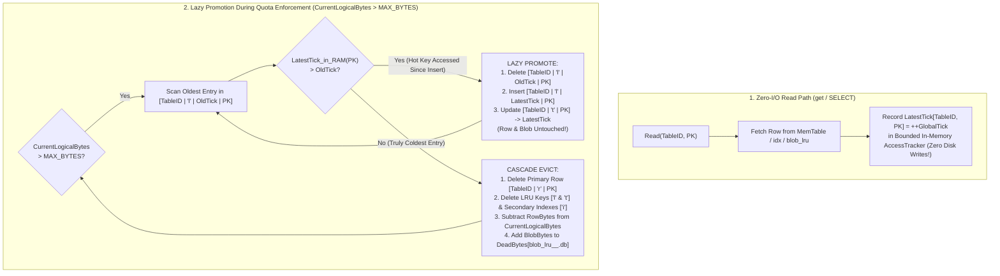

# Chapter 1.5: Capped Tables (`MAX_BYTES`), Delayed LRU Eviction, Memcomparable Keys, and Unified Engine API

This chapter defines the detailed architecture of **Step 1-5: Memcomparable Key Encoding (`src/index/key_codec.rs`), Coalesced In-Memory `AccessTick` & Lazy LRU Promotion (`src/lru/mod.rs`), Copy-less Per-Table Blob Eviction, and the Unified Phase 1 `StorageEngine` Coordinator (`src/engine/mod.rs`)**.

---

## 1. Memcomparable Binary Key Encoding (`src/index/key_codec.rs`)

Because `aydb` stores all tables, secondary indexes, and LRU eviction queues inside a unified sorted key space (`MemTable` and `idx_<SeqID>.db`), every logical record key must serialize into a byte sequence whose **unsigned lexicographical byte order (`memcmp`) matches its logical sort order**.

### 1.1 Key Namespace Prefixes

Every internal key begins with a 2-byte big-endian `TableID` (`u16::to_be_bytes()`) followed by a 1-byte namespace tag:

```text
 0                   1                   2
 0 1 2 3 4 5 6 7 8 9 0 1 2 3 4 5 6 7 8 9 0 1 2 3 ...
+-+-+-+-+-+-+-+-+-+-+-+-+-+-+-+-+-+-+-+-+-+-+-+-+...
|         TableID (u16 BE)      | Namespace (1B)| Key Payload ...
+-+-+-+-+-+-+-+-+-+-+-+-+-+-+-+-+-+-+-+-+-+-+-+-+...
```

| Namespace Tag | ASCII | Format | Purpose |
| :--- | :---: | :--- | :--- |
| **Primary Row Key** | `'r'` (`0x72`) | `[TableID: u16 BE \| 'r' \| EncodedPK]` | Maps primary key to row payload (inline bytes or 23-byte `BlobPtr`) |
| **Secondary Index Key** | `'i'` (`0x69`) | `[TableID: u16 BE \| 'i' \| IndexID: u16 BE \| EncodedCol \| EncodedPK]` | Maps indexed column value + primary key to empty value (`[]`) |
| **LRU Queue Key** | `'l'` (`0x6C`) | `[TableID: u16 BE \| 'l' \| AccessTick: u64 BE \| EncodedPK]` | Orders rows of a capped table from oldest `AccessTick` to newest |
| **Reverse Tick Lookup** | `'t'` (`0x74`) | `[TableID: u16 BE \| 't' \| EncodedPK]` | Stores a `RowMetaRecord` (recorded tick, logical size, and secondary index values) for exact quota accounting, lazy LRU verification, and index cleanup |

### 1.2 Order-Preserving Primitive Encodings

1. **Unsigned 64-Bit Integer (`u64`, e.g., `AccessTick`):**
   * Stored in 8-byte Big-Endian (`val.to_be_bytes()`). Smaller ticks sort first during forward prefix scans over `[TableID | 'l' | ...]`.
2. **Signed 64-Bit Integer (`i64`, e.g., `INTEGER` Primary/Secondary Key):**
   * Flip the sign bit (`(val as u64) ^ (1u64 << 63)`) and encode in 8-byte Big-Endian:
     * `i64::MIN` (`-9223372036854775808`) $\rightarrow$ `0x0000_0000_0000_0000`
     * `-1` $\rightarrow$ `0x7FFF_FFFF_FFFF_FFFF`
     * `0` $\rightarrow$ `0x8000_0000_0000_0000`
     * `i64::MAX` (`+9223372036854775807`) $\rightarrow$ `0xFFFF_FFFF_FFFF_FFFF`
3. **Variable-Length Byte Slice / UTF-8 String (Escape-Terminated Composite Format):**
   * When composite keys concatenate a variable-length column (`EncodedCol`) followed by `EncodedPK`, raw concatenation without a delimiter would violate prefix ordering (e.g., `"a" + "b"` vs. `"ab" + ""`).
   * Every variable-length component escapes `0x00` bytes as `0x00 0xFF` and appends the 2-byte terminator `0x00 0x01`. Because `0x01 < 0xFF`, a shorter prefix string always sorts strictly before a longer string that begins with that prefix (`"a" -> [0x61, 0x00, 0x01]` < `"a\0" -> [0x61, 0x00, 0xFF, 0x00, 0x01]`).

---

## 2. Coalesced In-Memory `AccessTick` & Lazy LRU Promotion

In a naive LRU-managed database, every `get()` / `SELECT` on a cached item writes a new timestamp to the WAL and index tree—turning 100% read workloads into heavy disk-write workloads and destroying SSD lifespan and SMB throughput.

`aydb` eliminates read-path disk I/O via **Two-Stage Lazy LRU Tracking**:



### 2.1 Why Lazy Promotion Beats Eager LRU Index Maintenance
* **Zero Index Churn While Below Quota:** As long as `CurrentLogicalBytes <= MAX_BYTES`, reading hot cache keys thousands of times per second mutates only a single `u64` entry in the in-memory `AccessTracker` hash map (`~25 nanoseconds`, zero WAL records, zero MemTable insertions).
* **Bounded Tracker:** When the in-memory `AccessTracker` reaches its entry cap (default: `65,536` distinct keys), the older half of its ticks is dropped, and those keys fall back to their recorded tick. Ticks are not written back at a flush or checkpoint; they take effect through lazy promotion during eviction.
* **Exact $O(1)$ Quota Accounting via `'t'` Metadata Key:** Because `[TableID | 't' | EncodedPK]` stores both the currently indexed `RecordedTick: u64` and `LogicalSize: u32`, overwriting or explicitly deleting a key `PK` immediately knows the exact `OldTick` to tombstone (`[TableID | 'l' | OldTick | PK]`) and the exact `LogicalSize` to subtract from `CurrentLogicalBytes` without having to read the old multi-megabyte blob from disk!

---

## 3. Per-Table Physical Isolation & $O(1)$ Copy-less Blob Segment Eviction

When a Capped Table (e.g., a virtual table declared with `max_bytes = 1073741824`) stores out-of-line blobs (`>= 1024 B`), `aydb` routes those blobs to **per-table LRU blob segments** (`blob_lru_<TblID>_<SeqID>.db`) rather than mixing them into `blob_std_<SeqID>.db`:

1. **No Cross-Table Fragmentation:** Permanent user tables (`blob_std_<SeqID>.db`) never share physical files with high-churn cache tables (`blob_lru_0001_<SeqID>.db`).
2. **Segment Rolling & Dead-Byte Accounting:**
   * Each `blob_lru_<TblID>_<SeqID>.db` rolls to a new `SeqID` once its size reaches `max_blob_segment_bytes` (default: `64 MB`, configurable down to `64 KB` for testing/small caches).
   * The engine tracks `{ file_len, dead_bytes }` per blob segment. Whenever a row referencing `blob_lru_<TblID>_<SeqID>.db` is overwritten, deleted, or LRU-evicted, its framed blob length is added to `dead_bytes`.
3. **$O(1)$ Copy-less Segment Deletion:**
   * Because LRU eviction retires entries in chronological `AccessTick` order, older `blob_lru_<TblID>_<SeqID>.db` segments naturally become fully dead.
   * The moment a sealed `blob_lru_<TblID>_<SeqID>.db` segment is fully dead, the engine drops its reader handle and **deletes the entire physical file via `remove_file`** (or leaves it in `pending_delete_files` if it cannot be removed yet)—reclaiming tens of megabytes of disk space in $O(1)$ time with **zero blob-to-blob copying**!

---

## 4. Unified Phase 1 `StorageEngine` API (`src/engine/mod.rs`)

`StorageEngine<FS: PlatformFs>` integrates all five Phase 1 subsystems behind one coordinator API. Callers that share it between threads wrap it in `Arc<RwLock<_>>`:

| Method | Description |
| :--- | :--- |
| `StorageEngine::open(fs, config)` | Recovers `boot_meta.db`, reserves `SeqID`s above existing files, loads active `idx_<SeqID>.db` & `blob_*.db` segments, replays the two-stream WAL (`wal_sync.db` + `wal_buf.db`), rebuilds in-memory quota/LRU state, rotates both WAL epochs, and sweeps orphaned files. |
| `register_capped_table(table_id, max_bytes)` | Configures a `TableID` as a Capped Table with automatic `MAX_BYTES` LRU eviction and dedicated `blob_lru_<TblID>_<SeqID>.db` storage. |
| `put_row(table_id, pk, value, secondary_keys, durability)` | Writes a row (plus optional secondary index entries), routes payloads `>= inline_threshold` to `blob_std` or `blob_lru`, logs to the Epoch WAL, updates `MemTable`, and enforces `MAX_BYTES` quota via lazy-promoted LRU eviction. |
| `get_row(table_id, pk)` | Looks up `[TableID \| 'r' \| pk]` across `MemTable` and active `idx_<SeqID>.db` segments (protected by Bloom filters & sparse fence pointers), dereferences `BlobPtr` if out-of-line, and updates the in-memory `AccessTracker` in $O(1)$ with zero disk writes. |
| `delete_row(table_id, pk, durability)` | Tombstones the primary row, secondary indexes, and LRU queue entry, decrements `CurrentLogicalBytes`, and reclaims fully dead blob segments. Returns whether a row was deleted. |
| `scan_table(table_id)` / `lookup_by_secondary_index(table_id, index_id, col_val)` | Performs a merged forward range scan across `MemTable` and all `idx_<SeqID>.db` segments in memcomparable key order. |
| `flush_memtable()` | Flushes the active `MemTable` to a new `idx_<SeqID>.db` segment, rotates both WAL epochs (`sync_wal_epoch`, `buf_wal_epoch`, and `checkpoint_lsn`), and commits `boot_meta.db`. |
| `compact()` | Runs multi-way merge compaction across active `idx_<SeqID>.db` segments, commits the new segment list to `boot_meta.db`, and unlinks superseded segments via Deferred GC. |
| `checkpoint()` | Brings persisted state up to date so that the next `open` has no replay work. Dropping the engine does not do this. |
| `begin_transaction()` / `commit_transaction()` / `rollback_transaction()` | Groups mutations into one atomic WAL batch. Uncommitted writes live in a private overlay until the commit. The `*_for_conn` variants add connection ownership for SQL. |

---

## 5. Empirical Benchmark Results (`examples/lru_engine_bench.rs`)

Executed via `cargo run --release --example lru_engine_bench` at commit `6ae760e` on Windows 11 (local NTFS, Crucial P3 NVMe SSD). Figures are medians of five runs.

### 5.1 Benchmark 1: Capped Table Read-Path LRU Tracking (`CoalescedLazyPromotion` vs. `EagerWriteOnRead`)

Measuring 50,000 hot cache-hit reads on the oldest 100 keys of a 500-key Capped Table, followed by 100 new key insertions that exceed `MAX_BYTES` and trigger LRU eviction:

| LRU Read Tracking Mode | Read Throughput | Read Latency | WAL Batches Emitted | Lazy Promotions |
| :--- | ---: | ---: | ---: | ---: |
| **`EagerWriteOnRead` (Naive Baseline)** | `234,001 ops/s` | `4.27 µs` | `50,000` | `0` |
| **`CoalescedLazyPromotion` (`aydb` Default)** | **`4,620,944 ops/s` (`19.7×` faster)** | **`0.22 µs`** | **`100` (`500×` fewer)** | **`100`** |

* **Architectural Takeaway:**
  * Updating the LRU timestamp on disk on every `get_row()` (`EagerWriteOnRead`) emits `50,000` WAL batches and `150,000` MemTable records for a pure read workload, throttling read throughput to `234.0 K ops/s` (`4.27 µs`).
  * `CoalescedLazyPromotion` records read hits in the bounded in-memory `AccessTracker` (`0.22 µs` per read, **`19.7×` faster**, zero disk I/O during reads). When 100 new insertions subsequently push the table over `MAX_BYTES`, the eviction scanner lazily promotes the 100 accessed keys once (`100` WAL batches total — a **`500×` reduction** in index write amplification) while evicting the 100 truly cold keys!

### 5.2 Benchmark 2: Steady-State `MAX_BYTES` Eviction & $O(1)$ Copy-less Blob Segment Deletion

Continuously writing `16.0 MB` (`4,096` blobs of `4 KB` each) into a Capped Table configured with **`MAX_BYTES = 2.0 MB`** and `max_blob_segment_bytes = 512 KB`:

| Cumulative Data Written | Logical Live Bytes | Active `blob_lru` Segments on Disk | Cumulative Rows Evicted | Sustained Write Throughput |
| :--- | ---: | ---: | ---: | ---: |
| **`16.0 MB` (Steady State)** | `2.00 MB` | `5` (`~2.5 MB` physical) | `3,587` | **`74.4 MB/s`** |

* **Architectural Takeaway:**
  1. **Strict Quota Enforcement & Constant Physical Footprint:** Across `16.0 MB` of continuous writes (`8×` the table's `2.0 MB` quota), logical live bytes remain strictly capped at **`2.00 MB`**, and the number of physical `blob_lru_0001_<SeqID>.db` files on disk stays constant at **`5` segments** (`4` sealed 512 KB segments + `1` active segment) as drained segments are unlinked in $O(1)$ time with zero blob copying.
  2. **$O(1)$ Amortized Eviction Cursor (`eviction_cursor_tick`):** By maintaining a persistent `eviction_cursor_tick` per Capped Table and seeking directly to `[TableID | 'l' | cursor_tick]` via Sparse Fence Pointers (`scan_prefix_from`), the eviction scanner skips historical tombstones in $O(1)$ time, maintaining about **`74.4 MB/s`** of write+evict throughput regardless of how many thousands of items have been evicted!

