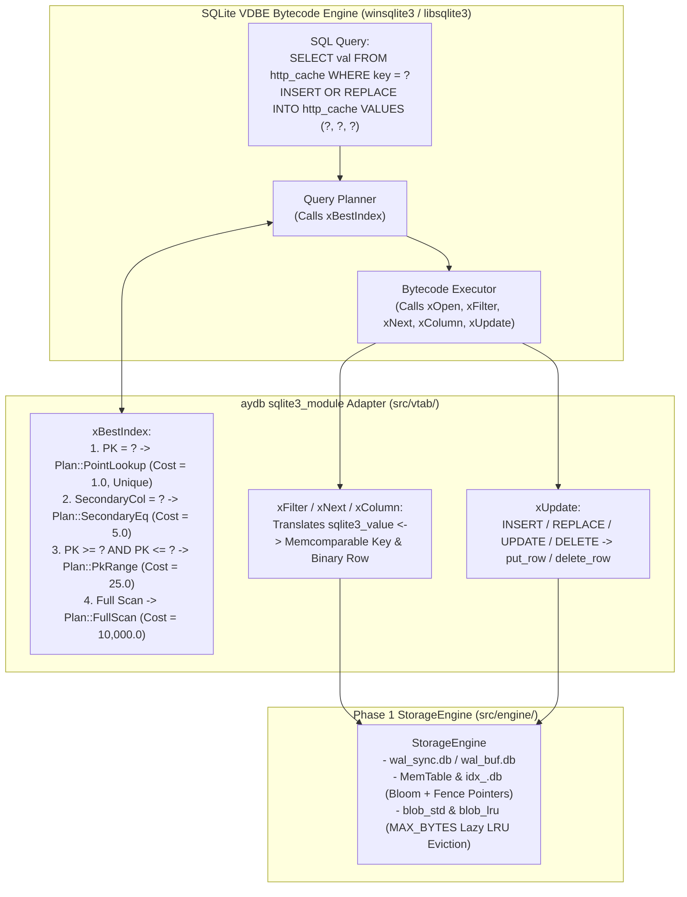

# Phase 2 Overview: SQLite Virtual Table Adapter (`sqlite3_module`) & Comparative Benchmarking

This document introduces **Phase 2** of the `aydb` project: bridging the Phase 1 storage engine (`StorageEngine`) into SQLite's query processor via the **SQLite Virtual Table (`sqlite3_module`) C ABI** and conducting an empirical head-to-head benchmark comparison against **Vanilla SQLite (`PRAGMA journal_mode = WAL`)**.

---

## 1. Why Build a SQLite Virtual Table Adapter in Phase 2?

Before building a standalone SQL parser and optimizer in Phase 3, integrating `aydb` as a SQLite Virtual Table (`USING aydb(...)`) delivers two immediate architectural benefits:

1. **Full SQL Expressiveness from Day One:**
   Applications can immediately execute complex SQL queries (`JOIN`, `GROUP BY`, `HAVING`, window functions, subqueries, prepared statements) via SQLite's battle-tested VDBE bytecode engine while storing all underlying table rows, secondary indexes, and LRU-capped blobs inside `aydb`.
2. **Apples-to-Apples Empirical Benchmarking Against Vanilla SQLite:**
   Because both a standard SQLite B-Tree table (`CREATE TABLE ...`) and an `aydb` Virtual Table (`CREATE VIRTUAL TABLE ... USING aydb(...)`) execute through the exact same SQLite C API (`sqlite3_prepare_v2` / `sqlite3_step`), we can measure the true storage-engine delta—comparing SQLite's B-Tree + WAL architecture against `aydb`'s WiscKey KV Separation + Two-Stream Epoch WAL + Copy-less LRU Eviction under identical SQL workloads.

---

## 2. Zero-External-Dependency Native SQLite Linking

Consistent with Phase 1's zero-dependency philosophy (`Cargo.toml` `[dependencies]` remains empty), `aydb` links directly against the operating system's native SQLite library (`#[cfg_attr(windows, link(name = "winsqlite3"))]` / `#[cfg_attr(unix, link(name = "sqlite3"))]`), which is shipped as a standard system component on Windows 10/11 (`C:\Windows\System32\winsqlite3.dll`), macOS (`/usr/lib/libsqlite3.dylib`), and Linux (`libsqlite3.so`).

---

## 3. Architecture of the `aydb` Virtual Table Adapter (`src/vtab/`)

---

## 4. Phase 2 Chapter & Module Breakdown

| Step | Textbook Chapter | Rust Modules | Key Engineering Topics & Empirical Benchmarks |
| :--- | :--- | :--- | :--- |
| **Step 2-1** | [`01_SQLITE_VTAB_ADAPTER.md`](./01_SQLITE_VTAB_ADAPTER.md) | `src/vtab/ffi.rs` `src/vtab/row_codec.rs` `src/vtab/mod.rs` | - Compact multi-column binary row format (`NULL`/`INT`/`FLOAT`/`TEXT`/`BLOB`) - `CREATE VIRTUAL TABLE ... USING aydb(...)` DDL argument grammar - `xBestIndex` constraint pushdown (`PK = ?`, `PK` ranges, secondary index `col = ?`) - `xUpdate` conflict resolution (`INSERT OR REPLACE` / `UPDATE` / `DELETE`) |
| **Step 2-2** | [`02_SQLITE_VS_AYDB_BENCHMARKS.md`](./02_SQLITE_VS_AYDB_BENCHMARKS.md) | `examples/sqlite_vs_aydb_bench.rs` | - **Benchmark 1:** Small Sync Config Updates (`100 B`, `SYNCHRONOUS = FULL` vs. `wal_sync.db`) - **Benchmark 2:** Large Blob Cache Churn (`16 KB` blobs, `MAX_BYTES` LRU Eviction: Vanilla SQLite B-Tree + SQL LRU Trigger vs. `aydb` Virtual Table WiscKey + Copy-less GC) - **Benchmark 3:** Read-Heavy Cache Hit LRU Tracking (`SELECT` + `UPDATE last_tick` in SQLite vs. `aydb` Coalesced In-Memory `AccessTracker`) |
