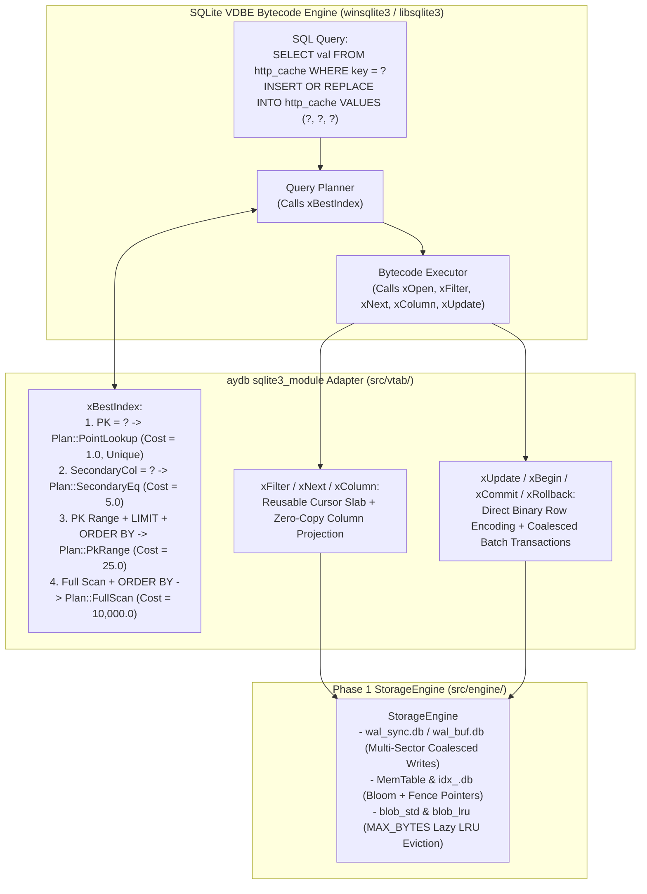

# Phase 2 Overview: SQLite Virtual Table Adapter (`sqlite3_module`) & Comparative Benchmarking

This document introduces **Phase 2** of the `aydb` project: bridging the Phase 1 storage engine (`StorageEngine`) into SQLite's query processor via the **SQLite Virtual Table (`sqlite3_module`) C ABI** and conducting an empirical head-to-head benchmark comparison against **Vanilla SQLite (`PRAGMA journal_mode = WAL`)**.

---

## 1. Why Build a SQLite Virtual Table Adapter in Phase 2?

Before building a standalone SQL parser and optimizer in Phase 3, integrating `aydb` as a SQLite Virtual Table (`USING aydb(...)`) delivers two immediate architectural benefits:

1. **Full SQL Expressiveness from Day One:**
   Applications can immediately execute complex SQL queries (`JOIN`, `GROUP BY`, `HAVING`, window functions, subqueries, prepared statements) via SQLite's battle-tested VDBE bytecode engine while storing all underlying table rows, secondary indexes, and LRU-capped blobs inside `aydb`.
2. **Apples-to-Apples Empirical Benchmarking Against Vanilla SQLite:**
   Because both a standard SQLite B-Tree table (`CREATE TABLE ...`) and an `aydb` Virtual Table (`CREATE VIRTUAL TABLE ... USING aydb(...)`) execute through the exact same SQLite C API (`sqlite3_prepare_v2` / `sqlite3_step`), we can measure the true storage-engine delta—comparing SQLite's B-Tree + WAL architecture against `aydb`'s WiscKey KV Separation + Two-Stream Epoch WAL + Copy-less LRU Eviction under identical SQL workloads.

---

## 2. Zero-External-Dependency Native SQLite Linking

Consistent with Phase 1's zero-dependency philosophy (`Cargo.toml` `[dependencies]` remains empty), `aydb` links directly against the operating system's native SQLite library (`#[cfg_attr(windows, link(name = "winsqlite3"))]` / `#[cfg_attr(unix, link(name = "sqlite3"))]`), which is shipped as a standard system component on Windows 10/11 (`C:\Windows\System32\winsqlite3.dll`), macOS (`/usr/lib/libsqlite3.dylib`), and Linux (`libsqlite3.so`).

---

## 3. Architecture of the `aydb` Virtual Table Adapter (`src/vtab/`)

---

## 4. Phase 2 Chapter & Module Breakdown

| Step | Textbook Chapter | Rust Modules | Key Engineering Topics & Empirical Benchmarks |
| :--- | :--- | :--- | :--- |
| **Step 2-1** | [`01_SQLITE_VTAB_ADAPTER.md`](./01_SQLITE_VTAB_ADAPTER.md) | `src/vtab/ffi.rs` `src/vtab/row_codec.rs` `src/vtab/mod.rs` | - Compact multi-column binary row format (`NULL`/`INT`/`FLOAT`/`TEXT`/`BLOB`) with zero-copy `xColumn` projection (`project_column_zero_copy`), unified exact numeric keys, lossless sub-ULP negative float keys, column affinity & collation (`BINARY`/`NOCASE`/`RTRIM`), storage-class-tagged memcomparable keys, and direct `sqlite3_value*` encoding (`encode_sqlite_values_direct`) - `CREATE VIRTUAL TABLE ... USING aydb(...)` DDL argument grammar with persistent catalog-backed `table_id` assignment - `xBestIndex` constraint pushdown (`PK = ?`, `PK` ranges + `ORDER BY pk ASC/DESC` reverse streaming, secondary index `col = ?`, chunked 256-row streaming cursor, and `colUsed` keys-only projection) - Reusable contiguous cursor slab (`AydbCursor::slab` & `spans`), bounded `RowidMap`, and lock-free reversible integer `rowid` mapping - `xUpdate` primary-key uniqueness & `ON CONFLICT`, connection-scoped transaction isolation, two-phase `xSync` prepare, `xBegin`/`xCommit`/`xRollback` ACID undo-log transactions, `xSavepoint`/`xRelease`/`xRollbackTo`, and `xDestroy` (`DROP TABLE`) |
| **Step 2-2** | [`02_SQLITE_VS_AYDB_BENCHMARKS.md`](./02_SQLITE_VS_AYDB_BENCHMARKS.md) | `examples/sqlite_vs_aydb_bench.rs` | - **Benchmark 1:** Small Sync Config Updates (`128 B`: **`15,322 tx/s` vs. `1,020 tx/s`**, **`15.0×` faster**) - **Benchmark 2:** Large Blob Cache Churn (`16 KB` blobs, `4.0 MB` Cap: **`154.6 MB/s` vs. `86.5 MB/s`**, **`1.79×` faster**, strict `3.98 MB` cap vs. `8.15 MB` SQLite bloat) - **Benchmark 3:** Read-Heavy Cache Hit LRU Tracking (**`215,506 ops/s` vs. `27,376 ops/s`**, **`7.87×` faster**, `0 MB` disk writes) |
| **Step 2-3** | [`03_STANDARD_SQL_BENCHMARKS.md`](./03_STANDARD_SQL_BENCHMARKS.md) | `examples/standard_sql_bench.rs` | - **Suite 0:** Pre-Benchmark Differential SQL Equivalence Verification (`verify_differential_sql_equivalence`: 100% result & state match across mixed numeric types, affinities, collations, failed `UNIQUE` statements, `SAVEPOINT`s, cross-connection isolation, and mixed SQLite+`aydb` 2PC transactions) - **Suite 1:** Selected `Speedtest1`-Style Workload (`Tests 100..240` under `BufferedImmediateOsCache` vs `NORMAL`: **`2.76×` faster** PK `SELECT`, **`2.11×` faster** SecIdx `SELECT`, **`1.15×` faster** PK Range Scan; **`67.55 ms`** vs. `62.95 ms` total at `4 MB` `MemTable`, `205.99 ms` at `128 KB` SSTable) - **Suite 2:** `YCSB`-Style Workloads `A–F` (Zipfian $\theta = 0.99$: **`1.35×–4.32×` faster** across point-read/update workloads `A, B, C, D, F` at `256 B` Inline, up to **`1.21M ops/s`**, and **`1.24×–1.44×` faster** from on-disk `128 KB` SSTables; **`1.60×` faster** on `Workload D` at `2,048 B` WiscKey) - **Suite 3:** `TPC-B`-Style (`pgbench`-like) 4-Table OLTP Workload (**`110,257 TPS` (`7.08×`, SSTable: `45,774 TPS` / `2.95×`)** Buffered & **`13,817 TPS` (`26.12×`, SSTable: `9,969 TPS` / `22.73×`)** Full Sync) |
