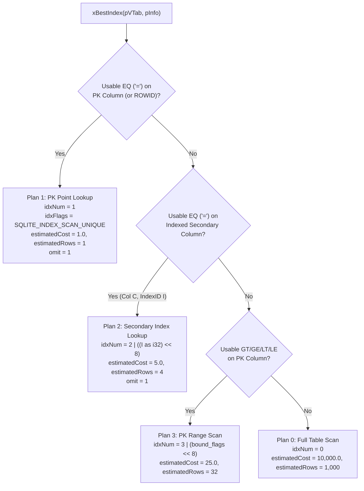

# Chapter 2.1: SQLite Virtual Table Adapter (`sqlite3_module`), Row Codec, and Constraint Pushdown

This chapter specifies the detailed design of **Step 2-1: Native SQLite FFI (`src/vtab/ffi.rs`), Multi-Column Binary Row Serialization (`src/vtab/row_codec.rs`), and the `aydb` Virtual Table Module (`src/vtab/mod.rs`)**.

---

## 1. Virtual Table DDL Syntax & Schema Declaration

When a user or application executes:

```sql
CREATE VIRTUAL TABLE http_cache USING aydb(
    table_id = 1,
    max_bytes = 2097152,
    durability = 'buffered',
    columns = 'url TEXT PRIMARY KEY, status INT, body BLOB, content_type TEXT',
    indexes = 'content_type, status'
);
```

`aydb`'s `xCreate` / `xConnect` callback parses the key-value arguments passed in `argv[3..]`:

1. **`table_id` (`u16`):** Unique 16-bit table identifier inside the `StorageEngine` namespace.
2. **`max_bytes` (`u64`, optional, default `0` = unbounded):** If `> 0`, registers `table_id` as a Capped Table (`engine.register_capped_table(table_id, max_bytes)`) with automatic LRU eviction and dedicated `blob_lru_<TblID>_<SeqID>.db` storage.
3. **`durability` (`'sync'` or `'buffered'`, default `'buffered'`):** Controls whether mutations on this virtual table commit via `WriteDurability::SyncTransactional` (`wal_sync.db`) or `WriteDurability::BufferedFast` (`wal_buf.db`).
4. **`columns` (SQL column list):** Parsed to identify the column names, affinities (`INT`, `TEXT`, `BLOB`, `REAL`), and the `PRIMARY KEY` column index (`pk_col_idx`). The adapter constructs a standard `CREATE TABLE x(...)` statement and passes it to `sqlite3_declare_vtab(db, c_sql)`.
5. **`indexes` (comma-separated column names, optional):** Assigns deterministic `IndexID`s (`1, 2, ...`) to the specified secondary index columns so `xUpdate` automatically maintains `[TableID | 'i' | IndexID | EncodedCol | EncodedPK]` entries and `xBestIndex` pushes down equality predicates (`WHERE content_type = ?`).

---

## 2. Multi-Column Binary Row Codec (`src/vtab/row_codec.rs`)

While the primary key column is encoded using `src/lru/key_codec.rs` (memcomparable format) to serve as the `StorageEngine` row key (`[TableID | 'r' | EncodedPK]`), the non-PK columns of a row are packed into a compact binary row payload with an $O(1)$ column-offset header so `xColumn` can project individual columns without decoding preceding variable-length blobs:

```text
 0                   1                   2                   3
 0 1 2 3 4 5 6 7 8 9 0 1 2 3 4 5 6 7 8 9 0 1 2 3 4 5 6 7 8 9 0 1
+-+-+-+-+-+-+-+-+-+-+-+-+-+-+-+-+-+-+-+-+-+-+-+-+-+-+-+-+-+-+-+-+
|         ColCount (u16)        |       ReservedFlags (u16)     |  0..4
+-+-+-+-+-+-+-+-+-+-+-+-+-+-+-+-+-+-+-+-+-+-+-+-+-+-+-+-+-+-+-+-+
| Col 0 Type(1B)|                  Col 0 Payload Offset (u32)   |  4..9
+-+-+-+-+-+-+-+-+-+-+-+-+-+-+-+-+-+-+-+-+-+-+-+-+-+-+-+-+-+-+-+-+
| ...           |                  Col C-1 Payload Offset (u32) |
+-+-+-+-+-+-+-+-+-+-+-+-+-+-+-+-+-+-+-+-+-+-+-+-+-+-+-+-+-+-+-+-+
|                     Packed Column Payloads                    |
+-+-+-+-+-+-+-+-+-+-+-+-+-+-+-+-+-+-+-+-+-+-+-+-+-+-+-+-+-+-+-+-+
```

* **Column Type Tags (`u8`):**
  * `0 = Null` (0 payload bytes)
  * `1 = Integer` (8 bytes: little-endian `i64`)
  * `2 = Float` (8 bytes: little-endian IEEE-754 `f64`)
  * `3 = Text` (`[len: u32 LE | utf8_bytes]`)
  * `4 = Blob` (`[len: u32 LE | raw_bytes]`)
* **Why Store a 5-Byte Directory Entry (`[Type: u8 | Offset: u32]`) per Column?**
  When a query runs `SELECT status FROM http_cache WHERE url = 'https://...'` on a row that also contains a `1 MB` `body BLOB` column, `xColumn` inspects `Col 1` directly at `Offset[1]` in $O(1)$ time without touching or copying the `1 MB` blob column!

---

## 3. Query Planning & Constraint Pushdown (`xBestIndex` $\leftrightarrow$ `xFilter`)

SQLite's query planner invokes `xBestIndex` one or more times with candidate `aConstraint[]` arrays representing `WHERE` clause predicates. `aydb` evaluates the usable constraints and assigns one of four deterministic execution plans encoded in `idxNum`:



### 3.1 How `xFilter` Executes Each Plan
* **Plan 1 (`PK Point Lookup`, `idxNum == 1`):**
  Encodes `argv[0]` into `EncodedPK`, calls `engine.get_row(table_id, &encoded_pk)` directly (which hits the `MemTable` or a single Bloom-filtered `idx` 4 KB block + optional `blob` dereference, and updates the in-memory `AccessTracker` in $O(1)$), and populates a 1-row cursor.
* **Plan 2 (`Secondary Index Lookup`, `idxNum & 0xFF == 2`):**
  Extracts `index_id = (idxNum >> 8) as u16`, encodes `argv[0]` into `col_bytes`, calls `engine.lookup_by_secondary_index(table_id, index_id, &col_bytes)` to obtain matching primary keys, and fetches the corresponding rows.
* **Plan 3 (`PK Range Scan`, `idxNum & 0xFF == 3`):**
  Performs an ordered scan over the table's primary key namespace, filtering by the lower/upper memcomparable key bounds passed in `argv`.
* **Plan 0 (`Full Table Scan`, `idxNum == 0`):**
  Calls `engine.scan_table(table_id)` to iterate all live rows in primary key order.

---

## 4. Mutation Mapping (`xUpdate` & Conflict Resolution)

SQLite routes `INSERT`, `UPDATE`, and `DELETE` statements on a virtual table to a single callback:
`xUpdate(pVTab, argc, argv, pRowid)`:

| Operation | `argc` & `argv` Condition | `aydb` Execution Path |
| :--- | :--- | :--- |
| **`DELETE`** | `argc == 1` (`argv[0]` is old PK / rowid) | Extracts `old_pk` from `argv[0]` (or cursor map) and calls `engine.delete_row(table_id, &old_pk, durability)`. |
| **`INSERT` / `REPLACE`** | `argc > 1` and `sqlite3_value_type(argv[0]) == SQLITE_NULL` | Extracts `new_pk` from `argv[2 + pk_col_idx]`, encodes all columns via `RowCodec`, builds secondary index pairs `(index_id, col_bytes)`, and calls `engine.put_row(table_id, &new_pk, &row_bytes, &sec_keys, durability)`. Because `put_row` natively overwrites existing keys and cleans up old blobs/LRU entries, `INSERT OR REPLACE` works in a single pass! |
| **`UPDATE`** | `argc > 1` and `sqlite3_value_type(argv[0]) != SQLITE_NULL` | If `old_pk != new_pk`, deletes `old_pk` first, then upserts `new_pk` via `engine.put_row(...)`. |
