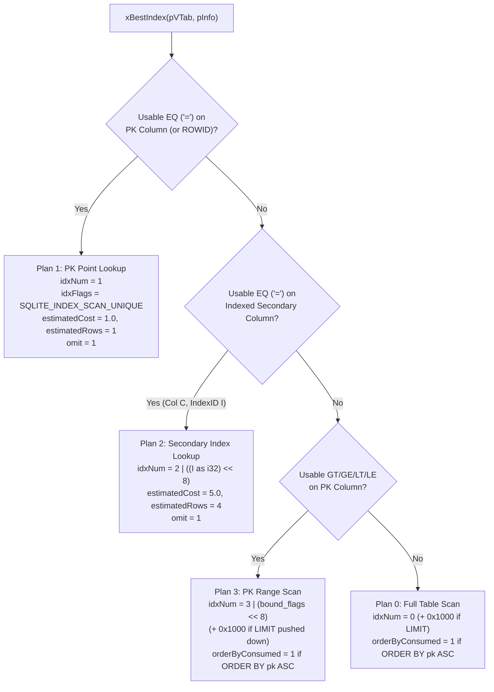

# Chapter 2.1: SQLite Virtual Table Adapter (`sqlite3_module`), Row Codec, and Constraint Pushdown

This chapter specifies the detailed design of **Step 2-1: Native SQLite FFI (`src/vtab/ffi.rs`), Multi-Column Binary Row Serialization (`src/vtab/row_codec.rs`), and the `aydb` Virtual Table Module (`src/vtab/mod.rs`)**.

---

## 1. Virtual Table DDL Syntax & Schema Declaration

When a user or application executes:

```sql
CREATE VIRTUAL TABLE http_cache USING aydb(
    table_id = 1,
    max_bytes = 2097152,
    durability = 'buffered',
    columns = 'url TEXT PRIMARY KEY, status INT, body BLOB, content_type TEXT',
    indexes = 'content_type, status'
);
```

`aydb`'s `xCreate` / `xConnect` callback parses the key-value arguments passed in `argv[3..]`. Validation is strict (`src/vtab/ddl.rs`): an unknown option key, an argument that is not of the form `key=value`, a value that does not parse (`table_id = 0`, a non-numeric `max_bytes`, `inline_max` above 4096, a `durability` or `on_corrupt` value other than the listed ones), an unknown collation, a table-level constraint in `columns` (`PRIMARY KEY(...)`, `UNIQUE(...)`, `CHECK(...)`, `FOREIGN KEY(...)`, `CONSTRAINT ...`), or an `indexes` entry that names no declared column makes the statement fail with `SQLITE_ERROR` instead of being silently ignored.

1. **`table_id` (`u16`, optional):** Unique 16-bit table identifier (`!= 0`) inside the `StorageEngine` namespace. If omitted, `StorageEngine::register_or_resolve_vtab` resolves or auto-assigns a collision-free `table_id` persisted in the engine catalog (`[0, 0, 'c', table_name]`).
2. **`max_bytes` (`u64`, optional, default `0` = unbounded):** If `> 0`, registers `table_id` as a Capped Table (`engine.register_capped_table(table_id, max_bytes)`) with automatic LRU eviction and dedicated `blob_lru_<TblID>_<SeqID>.db` storage.
3. **`durability` (`'sync'` or `'buffered'`, default `'buffered'`):** Controls whether mutations on this virtual table commit via `WriteDurability::SyncTransactional` (`wal_sync.db`) or `WriteDurability::BufferedFast` (`wal_buf.db`).
4. **`on_corrupt` (`'error'` or `'evict'`, default `'evict'` for capped tables and `'error'` otherwise):** Policy for out-of-line blobs that fail verification (CRC/magic/key mismatch, short read, or a missing segment) after the engine has opened. Such failures are genuine corruption (WAL-replayed blob pointers are validated during recovery and index-referenced blobs are synced before their checkpoint). `error` fails reads of the affected row with `SQLITE_CORRUPT` (naming table id and primary key in the engine error; counted by `StorageEngine::corrupt_blob_detections()`); PK-only queries (`SELECT pk ...`, `DELETE ... WHERE pk = ?`) never read the blob, so you can locate and delete bad rows, and the delete also cleans their secondary-index and LRU entries even if the row-meta record is corrupt. `evict` treats the row as absent and queues it for automatic deletion at the next safe write point (outermost commit / put / delete / flush; never from a read, and skipped while a transaction is open). Evict-mode scans verify blobs eagerly rather than lazily. Runtime-only: re-applied from the DDL on every connect, no on-disk format change. Unknown values make `CREATE VIRTUAL TABLE` fail.
5. **`columns` (SQL column list):** Parsed using top-level comma splitting (`split_top_level_commas`, preserving parenthesized type modifiers like `DECIMAL(10, 2)`) to identify column names, affinities (`INT`, `TEXT`, `BLOB`, `REAL`, `NUMERIC`), and the `PRIMARY KEY` column index (`pk_col_idx`). The adapter constructs a standard `CREATE TABLE x(...)` statement and passes it to `sqlite3_declare_vtab(db, c_sql)`.
6. **`indexes` (comma-separated column names, optional):** Assigns deterministic `IndexID`s (`1, 2, ...`) to the specified secondary index columns so `xUpdate` automatically maintains `[TableID | 'i' | IndexID | EncodedCol | EncodedPK]` entries and `xBestIndex` pushes down equality predicates (`WHERE content_type = ?`).

---

## 2. Multi-Column Binary Row Codec (`src/vtab/row_codec.rs`)

While the primary key column is encoded using `src/lru/key_codec.rs` (memcomparable format) to serve as the `StorageEngine` row key (`[TableID | 'r' | EncodedPK]`), the non-PK columns of a row are packed into a compact binary row payload with an $O(1)$ column-offset header so `xColumn` can project individual columns without decoding preceding variable-length blobs:

```text
 0                   1                   2                   3
 0 1 2 3 4 5 6 7 8 9 0 1 2 3 4 5 6 7 8 9 0 1 2 3 4 5 6 7 8 9 0 1
+-+-+-+-+-+-+-+-+-+-+-+-+-+-+-+-+-+-+-+-+-+-+-+-+-+-+-+-+-+-+-+-+
|         ColCount (u16)        |       ReservedFlags (u16)     |  0..4
+-+-+-+-+-+-+-+-+-+-+-+-+-+-+-+-+-+-+-+-+-+-+-+-+-+-+-+-+-+-+-+-+
| Col 0 Type(1B)|                  Col 0 Payload Offset (u32)   |  4..9
+-+-+-+-+-+-+-+-+-+-+-+-+-+-+-+-+-+-+-+-+-+-+-+-+-+-+-+-+-+-+-+-+
| ...           |                  Col C-1 Payload Offset (u32) |
+-+-+-+-+-+-+-+-+-+-+-+-+-+-+-+-+-+-+-+-+-+-+-+-+-+-+-+-+-+-+-+-+
|                     Packed Column Payloads                    |
+-+-+-+-+-+-+-+-+-+-+-+-+-+-+-+-+-+-+-+-+-+-+-+-+-+-+-+-+-+-+-+-+
```

* **Column Type Tags (`u8`):**
  * `0 = Null` (0 payload bytes)
  * `1 = Integer` (8 bytes: little-endian `i64`)
  * `2 = Float` (8 bytes: little-endian IEEE-754 `f64`)
  * `3 = Text` (`[len: u32 LE | utf8_bytes]`)
  * `4 = Blob` (`[len: u32 LE | raw_bytes]`)
* **Why Store a 5-Byte Directory Entry (`[Type: u8 | Offset: u32]`) per Column?**
  When a query runs `SELECT status FROM http_cache WHERE url = 'https://...'` on a row that also contains a `1 MB` `body BLOB` column, `xColumn` inspects `Col 1` directly at `Offset[1]` in $O(1)$ time without touching or copying the `1 MB` blob column!
* **Zero-Copy Column Projection (`project_column_zero_copy`):**
  Rather than decoding a `ColValue` enum that allocates intermediate `String` or `Vec<u8>` buffers on the Rust heap during `xColumn`, `project_column_zero_copy` reads the 5-byte directory entry directly from the cursor's contiguous byte slab (`&[u8]`) and passes raw borrowed byte slices (`*const u8`) straight to `sqlite3_result_text` / `sqlite3_result_blob` (`SQLITE_TRANSIENT`), achieving **zero Rust heap allocations per projected column**.
* **Direct FFI Serialization (`encode_sqlite_values_direct`):**
  On `INSERT` and `UPDATE` (`xUpdate`), `encode_sqlite_values_direct` reads `sqlite3_value` pointers directly over FFI and serializes the 5-byte column directory and payloads in a single pass into a pre-sized `Vec<u8>`, bypassing any intermediate `Vec<ColValue>` allocation.

---

## 3. Query Planning & Constraint Pushdown (`xBestIndex` $\leftrightarrow$ `xFilter`)

SQLite's query planner invokes `xBestIndex` one or more times with candidate `aConstraint[]` arrays representing `WHERE` clause predicates, `aOrderBy[]` terms, and optional `LIMIT` constraints (`SQLITE_INDEX_CONSTRAINT_LIMIT`). `aydb` evaluates the usable constraints and assigns one of four deterministic execution plans encoded in `idxNum`, along with optional `LIMIT` and `ORDER BY` pushdown flags:



### 3.1 How `xFilter` Executes Each Plan (Reusable Contiguous Cursor Slab)
To avoid allocating a new `Vec<(Vec<u8>, Vec<u8>)>` of heap-allocated rows on every `SELECT` or range scan, each `AydbCursor` owns a reusable contiguous byte slab (`slab: Vec<u8>`) and a lightweight offset span index (`spans: Vec<(u32, u32, u32, u32)>`). On each `xFilter` call, `slab.clear()` and `spans.clear()` reset the cursor in $O(1)$ without freeing capacity:

* **Plan 1 (`PK Point Lookup`, `idxNum == 1`):**
  Encodes `argv[0]` into stack-buffered `EncodedPK` (`[u8; 64]` fast path for `INT`/`REAL`), calls `engine.get_row_into(table_id, &encoded_pk, &mut cursor.slab)` directly (which hits the `MemTable` or a single Bloom-filtered `idx` 4 KB block + optional `blob` dereference, and updates the in-memory `AccessTracker` in $O(1)$), and pushes a single `(pk_start, pk_end, val_start, val_end)` span.
* **Plan 2 (`Secondary Index Lookup`, `idxNum & 0xFF == 2`):**
  Extracts `index_id = ((idxNum >> 8) & 0x0F) as u16`, encodes `argv[0]` into `col_bytes`, calls `engine.lookup_by_secondary_index(table_id, index_id, &col_bytes)` to obtain matching primary keys, and appends the matching rows into `cursor.slab`.
* **Plan 3 (`PK Range Scan`, `idxNum & 0xFF == 3`):**
  Extracts the lower/upper memcomparable key bounds (`GT`/`GE`/`LT`/`LE`) and optional pushed-down `LIMIT` (`(idxNum & 0x1000) != 0`), then calls `engine.scan_table_values_into(table_id, lower_bound, upper_bound, limit, &mut cursor.slab, &mut cursor.spans)`. Because `[TableID | 'r' | EncodedPK]` is stored in memcomparable order, `scan_range_values_into` seeks directly to the lower bound in both the `MemTable` (`BTreeMap::range`) and on-disk `idx_<SeqID>.db` segments (via Sparse Fence Pointers), stopping immediately at `upper_bound` or `limit` without scanning unrelated keys. Furthermore, if the query specifies `ORDER BY pk ASC`, `xBestIndex` sets `orderByConsumed = 1` so SQLite skips its ephemeral B-Tree sorter (`USE TEMP B-TREE FOR ORDER BY`).
* **Plan 0 (`Full Table Scan`, `idxNum & 0xFF == 0`):**
  Calls `engine.scan_table_values_into(table_id, None, None, limit, &mut cursor.slab, &mut cursor.spans)` to stream live rows directly into the cursor's contiguous byte slab.

### 3.2 Chunked 256-Row Streaming & Lazy Per-Row Blob Dereference
To prevent allocating unbounded memory when scanning large tables while keeping SQLite VDBE query plans fully expressive (e.g. queries with residual `WHERE` filters, `LIMIT`, or `ORDER BY`), `AydbCursor` streams records in bounded chunks of `CURSOR_STREAM_CHUNK_ROWS = 256` rows.
* **Separated Blob Over-Fetching Problem:** When records exceed the inline threshold (`> 1,024 B`) and reside in WiscKey `blob_std_*.db` segments, eagerly dereferencing all 256 blobs on every chunk fetch severely penalizes short range queries (such as `SELECT ... WHERE id >= ? LIMIT 10`), forcing ~25× unnecessary `ReadFile` + `CRC32C` operations for rows SQLite never examines.
* **Lazy Blob Dereference Design:**
  1. **Chunk Scan (`scan_range_into_slab` / `scan_secondary_index_into_slab`):** Inline values are appended to `cursor.slab` as usual. For external blobs (`ValueFormat::Blob(blob_ptr)`), the scanner flushes active writer buffers once, records a placeholder span `(0, 0)` in `cursor.spans`, and stores `Some(blob_ptr)` in `cursor.lazy_blobs: Vec<Option<BlobPtr>>`, preserving the primary key in `cursor.pks`.
  2. **Fast-Path Column Projections:** In `vtab_column`, if the requested column is the primary key (`col_idx == vtab.pk_col_idx` with `ColCollation::Binary`) or the pseudo-rowid column (`i_col < 0`), `aydb` decodes the value directly from `cursor.pks[cursor.pos]` without touching the blob or the slab. On PK-only queries or `COUNT(*)`, zero external blobs are read!
  3. **On-Demand Dereference:** When any non-PK column of a lazy row is requested, `StorageEngine::dereference_lazy_blob_into` fetches the blob payload directly into `cursor.slab`, updates `cursor.spans[cursor.pos]`, and resets `cursor.lazy_blobs[cursor.pos] = None`. All subsequent column accesses for that row read from the cached slab offset with zero extra I/O.

---

## 4. Mutation Mapping (`xUpdate`), Reversible `ROWID`, & Transaction Coalescing

### 4.1 `xUpdate` Dispatch & Conflict Resolution
SQLite routes `INSERT`, `UPDATE`, and `DELETE` statements on a virtual table to a single callback:
`xUpdate(pVTab, argc, argv, pRowid)`:

| Operation | `argc` & `argv` Condition | `aydb` Execution Path |
| :--- | :--- | :--- |
| **`DELETE`** | `argc == 1` (`argv[0]` is old PK / rowid) | Extracts `old_pk` from `argv[0]` (via reversible 8-byte `i64` decoding or fallback `rowid_to_pk` map) and calls `engine.delete_row(table_id, &old_pk, durability)`. |
| **`INSERT` / `REPLACE`** | `argc > 1` and `sqlite3_value_type(argv[0]) == SQLITE_NULL` | Extracts `new_pk` from `argv[2 + pk_col_idx]`, encodes all columns directly via `encode_sqlite_values_direct`, builds secondary index pairs `(index_id, col_bytes)`, and calls `engine.put_row_owned(table_id, &new_pk, row_bytes, &sec_keys, durability)`. Because `put_row_owned` natively overwrites existing keys and cleans up old blobs/LRU entries, `INSERT OR REPLACE` works in a single pass! |
| **`UPDATE`** | `argc > 1` and `sqlite3_value_type(argv[0]) != SQLITE_NULL` | Resolves `old_pk` from `argv[0]`. If `old_pk != new_pk`, deletes `old_pk` first, then upserts `new_pk` via `engine.put_row_owned(...)`. |

### 4.2 Lock-Free Reversible 8-Byte `ROWID` Mapping
SQLite's Virtual Table bytecode sequences two-phase mutations (`DELETE` and `UPDATE`) by reading a 64-bit integer `rowid` via `xRowid` during cursor scan and passing that `rowid` back as `argv[0]` in `xUpdate`.
* For any 8-byte memcomparable primary key (`INT` or `REAL` PKs), `aydb` decodes the 8-byte key directly into its exact `i64` bit pattern (`decode_i64_memcomparable`) in `xRowid` without acquiring any mutex or inserting into a hash map. When `xUpdate` receives `argv[0]` and `has_non_int_pks` is `false`, it reverses the bijection (`encode_i64_memcomparable(rid)`) in $O(1)$ on the stack.
* Only when a variable-length `TEXT` or `BLOB` primary key (`pk.len() != 8`) is stored does `aydb` set `has_non_int_pks = true` and record the FNV-1a 64-bit hash in `rowid_to_pk`, falling back gracefully to `encode_i64_memcomparable(rid)` whenever an 8-byte key is not in the map.

### 4.3 Transaction Lifecycle Callbacks (`xBegin`, `xCommit`, `xRollback`) & Multi-Sector WAL Coalescing
To eliminate per-row 4 KB WAL sector padding on multi-row `BEGIN ... COMMIT` transactions and multi-table OLTP workloads (such as TPC-B):
1. **`xBegin` (`engine.begin_transaction()`):** Activates in-memory WAL batch buffering (`in_transaction = true`).
2. **Row Mutations inside a Transaction:** Each `put_row_owned` / `delete_row` serializes its WAL records (`PutInline`, `PutBlobPtr`, `Delete`) directly into `pending_tx_buf` and transfers ownership of the row buffer into the `MemTable` (`apply_wal_batch_owned`) with **zero heap clones**, so subsequent reads inside the same transaction immediately observe the uncommitted changes (read-your-own-writes).
3. **`xCommit` (`engine.commit_transaction()`):** Packs all accumulated records in `pending_tx_buf` tightly across contiguous 4 KB sectors inside `WalStreamWriter::multi_sector_buf` and issues a **single coalesced `write_all_at` I/O call** to `wal_buf.db` or `wal_sync.db`.
4. **`xRollback` (`engine.rollback_transaction()`):** Discards `pending_tx_buf` without touching disk and reconstructs the `MemTable` from the committed WAL streams (`wal_sync.db` + `wal_buf.db`), strictly preserving ACID atomicity and rollback semantics.
