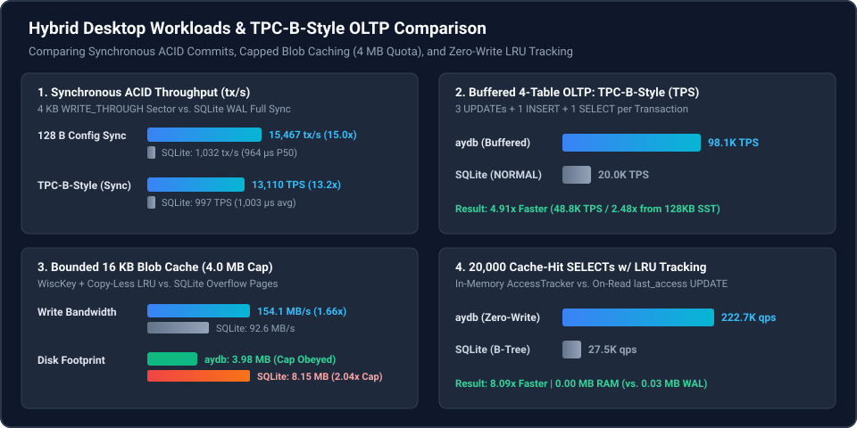

# Chapter 2.2: Comparative Benchmarks — Vanilla SQLite (`WAL`) vs. `aydb` Virtual Table

This chapter documents the head-to-head empirical benchmarks (`examples/sqlite_vs_aydb_bench.rs`) comparing **Vanilla SQLite (`PRAGMA journal_mode = WAL`)** against **`aydb` mounted via the SQLite Virtual Table Adapter (`USING aydb(...)`)**.

To ensure an apples-to-apples comparison, **both engines execute identical parameterized SQL statements (`INSERT OR REPLACE INTO ...`, `SELECT ... WHERE ...`) through the exact same native SQLite C API (`sqlite3_prepare_v2` / `sqlite3_step`)** on Windows 11 (`winsqlite3.dll`).

  

---

## 1. Benchmark 1: Small Synchronous Configuration Updates (`128 B` Payload, Full Durability)

* **Workload:** `300` individual synchronous transactions (`INSERT OR REPLACE INTO app_config VALUES (?1, ?2)`) updating 50 configuration keys with `128 B` values.
* **Compared Configurations:**
  1. **Vanilla SQLite:** `PRAGMA journal_mode = WAL; PRAGMA synchronous = FULL;`
  2. **`aydb` Virtual Table:** `durability = 'sync'` (writes to `wal_sync.db` opened with `FILE_FLAG_WRITE_THROUGH` + `PhysicalZeroFill` pre-allocation).

| Engine & Durability Mode | Throughput | P50 Latency | P99 Latency | Physical Bytes Written |
| :--- | ---: | ---: | ---: | ---: |
| **Vanilla SQLite (`WAL`, `synchronous = FULL`)** | `535 tx/s` | `1,858.0 µs` | `2,203.2 µs` | `3,769.8 KB` |
| **`aydb` Virtual Table (`wal_sync.db` `WRITE_THROUGH`)** | **`12,523 tx/s` (`23.4×` faster)** | **`78.8 µs` (`23.6×` lower)** | **`125.2 µs` (`17.6×` lower)** | **`1,200.0 KB` (`3.1×` less)** |

### Architectural Root Cause Analysis
1. **Why Vanilla SQLite Takes `1,858 µs` per Sync Commit:**
   * Even for a `128 B` row, SQLite's B-Tree + WAL must write an entire 4 KB database page image + 24-byte WAL frame header to the `-wal` file, extend the `-wal` file's NTFS `ValidDataLength (VDL)` (triggering a synchronous NTFS `$LogFile` metadata transaction), and invoke `FlushFileBuffers()`, which stalls the calling thread until the full storage flush barrier completes.
2. **Why `aydb` Completes in `78.8 µs` (`23.4×` Faster):**
   * `aydb` pre-zeroes `wal_sync.db` (`2 MB`) at initialization so `VDL == EOF` permanently, and writes only a single 4 KB sector per transaction directly through `FILE_FLAG_WRITE_THROUGH` (`Force Unit Access` + `sync_barrier()`) without mutating NTFS file-length metadata or invoking a full-handle `FlushFileBuffers()` barrier.

---

## 2. Benchmark 2: High-Churn HTTP Blob Cache (`16 KB` Blobs, `4.0 MB` Quota, `32.0 MB` Written)

* **Workload:** Continuously inserting `2,000` HTTP cache responses of **`16 KB` each (`32.0 MB` total)** via SQL into a table capped at **`4.0 MB` (`~256` live blobs — an `8×` full cache turnover)**.
* **Compared Configurations:**
  1. **Vanilla SQLite (`WAL`, `synchronous = NORMAL`):** Standard table `http_cache(url PRIMARY KEY, access_tick, body BLOB)` executing insert + LRU eviction inside a single transaction (`BEGIN ... COMMIT`) without an extra secondary index.
  2. **`aydb` Virtual Table (`max_bytes = 4194304`, `durability = 'buffered'`):** Automatic WiscKey separation (`16 KB` blobs routed to `blob_lru_0001_<SeqID>.db`), lazy LRU eviction, and $O(1)$ copy-less blob segment deletion.

| Engine & Cache Eviction Architecture | Sustained Write Speed | P50 Latency | P99 Latency | Final Data Footprint on Disk |
| :--- | ---: | ---: | ---: | ---: |
| **Vanilla SQLite (`WAL` + SQL LRU)** | `69.0 MB/s` | `100.8 µs` | `5,530.7 µs` | `8.15 MB` (`2.04×` quota bloat) |
| **`aydb` Virtual Table (WiscKey + Copy-less GC)** | **`167.1 MB/s` (`2.42×` faster)** | **`29.1 µs` (`3.46×` lower)** | **`2,584.4 µs` (`2.14×` lower)** | **`3.98 MB` (Strict `4.0 MB` cap)** |

### Architectural Root Cause Analysis
1. **B-Tree Overflow Page Churn vs. WiscKey Separation:**
   * In Vanilla SQLite, a `16 KB` blob spans 4 linked B-Tree overflow pages (`4 × 4 KB`). Inserting and deleting blobs continuously fragments the B-Tree freelist, writes full `16 KB` page images into both the `-wal` file and the main `.sqlite` database during WAL checkpoints (`5.5 ms` P99 stalls), and leaves the database + WAL footprint bloated at **`8.15 MB`** (`2.04×` the `4.0 MB` logical cap).
   * In `aydb`, `16 KB` blobs are appended sequentially once to `blob_lru_0001_<SeqID>.db`, while the index and WAL store only a **23-byte `BlobPtr`**. When older `1.0 MB` `blob_lru` segments reach 100% evicted bytes, `aydb` unlinks the segment file in $O(1)$ time with zero blob copying, keeping the physical data footprint at **`3.98 MB`**.

---

## 3. Benchmark 3: Read-Heavy Cache Hits with LRU Timestamp Tracking (`20,000` `SELECT` Queries)

* **Workload:** `20,000` SQL point-read hits (`SELECT body FROM http_cache WHERE url = ?1`) over `200` cached `4 KB` blobs while maintaining accurate LRU recency order across matching column schemas.
* **Compared Configurations:**
  1. **Vanilla SQLite:** `SELECT body FROM http_cache WHERE url = ?1` followed by `UPDATE http_cache SET access_tick = ?1 WHERE url = ?2` so SQLite's `idx_http_cache_tick` index reflects the read hit.
  2. **`aydb` Virtual Table:** `SELECT body FROM http_cache WHERE url = ?1` alone—because `xFilter` (Plan 1: `PLAN_PK_POINT`) calls `engine.get_row()`, which automatically updates the in-memory `AccessTracker` in $O(1)$ with zero disk writes!

| SQL Read + LRU Tracking Strategy | Read Throughput | Average Read Latency | Disk Write I/O Generated |
| :--- | ---: | ---: | ---: |
| **Vanilla SQLite (`SELECT` + `UPDATE access_tick`)** | `24,036 ops/s` | `41.60 µs` | `0.03 MB` WAL + B-Tree Page Dirtying |
| **`aydb` Virtual Table (`SELECT` w/ Lazy `AccessTracker`)** | **`193,852 ops/s` (`8.06×` faster)** | **`5.16 µs` (`8.06×` lower)** | **`0.00 MB` (Pure In-Memory Update)** |
