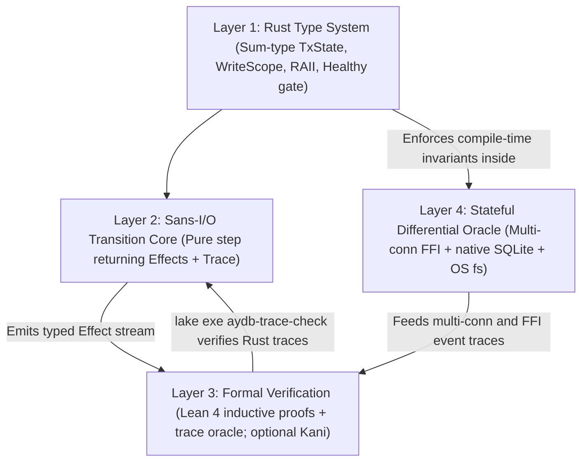
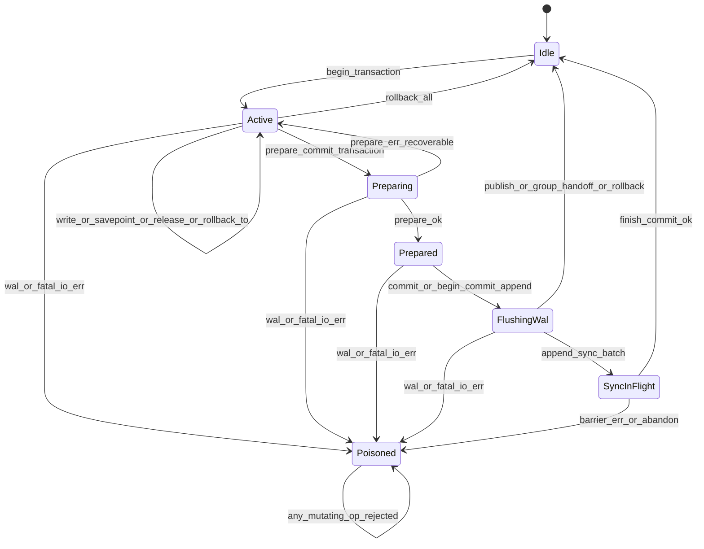

# State-Machine Type Safety and Formal Verification Plan

> **Status: Approved Plan (M0–M4 complete; Next: M5).**  
> This document defines a phased engineering plan to replace loose boolean and `Option` state flags in `aydb` with compile-time Rust state machines, extract a deterministic Sans-I/O core, back the highest-risk state protocols with Lean 4 formal proofs and trace refinement, and codify every new mechanism into durable repository rules and CI gates.

---

## 1. Motivation and Structural Root Cause

Three rounds of systematic code and design audits across `aydb` show a clear convergence pattern:

* **Round 1** eliminated localized correctness defects, FFI aliasing UB, low-level checksum/encoding errors, and foundational group-commit and LRU-reclaim holes.
* **Round 2** hardened size/resource bounds, error propagation, WAL durability ordering, and cross-subsystem failure recovery.
* **Round 3** shifted almost exclusively to **multi-feature state intersections** and **second-order interactions with earlier hardening**, rather than single-function bugs:
  * **Commit `7e68473` (`R3-H1`):** Pruning stale savepoint-created virtual tables inside `xSync` executed an internal drop path (`drop_table_with_durability`) through `commit_wal_and_memtable_core`, unintentionally clearing `tx_sync_durability_upgrade` before `prepare_commit_transaction()` observed it.
  * **Commit `7e68473` (`R3-H2`):** In-transaction rename reconciliation could fail silently on transaction-budget or poisoned-engine boundaries instead of propagating failure explicitly.
  * **Commit `8b914ed` (`R3-H3`):** A one-way boolean readiness latch (`unique_ready`) cached schema readiness per virtual-table handle across connections, hiding cross-connection DDL changes.
  * **Commit `7f0907f` (`R3-M6`):** An alternate transaction termination path left `pending_tx_sync` uncleared across resets.
  * **Commit `1082a02` (`R3-L2`):** Several blob append, relocation, and quota eviction paths required manual repetition of `check_not_poisoned()` discipline.

The underlying cause is not lack of test coverage, nor a flaw in the overall architecture. Rather, critical lifecycle protocols in the storage engine and SQLite virtual-table adapter are currently modeled as **flat product types** (independent fields stored side by side on `StorageEngine` and `PendingDdlSlot`).

### 1.1 Current State Field Inventory

In [`src/engine/mod.rs`](../../src/engine/mod.rs), transaction, durability, maintenance, and poison lifecycles span nearly thirty distinct fields on `StorageEngine`:

* **Transaction ownership & phase:** `tx_depth`, `tx_owner_conn`, `tx_prepared`, `tx_preparing`, `tx_bypass_size_limit`, `tx_sync_durability_upgrade`, `tx_sync_in_flight`
* **Pending batch & undo buffers:** `pending_tx_buf`, `pending_tx_record_count`, `pending_tx_bytes`, `pending_tx_sync`, `pending_tx_lru_clears`, `tx_overlay`, `tx_start_meta`, `savepoints`, `statement_savepoint_active`, `statement_blob_undo`
* **Transaction-scoped schema & table tracking:** `dropped_tables_in_tx`, `vtabs_created_in_tx`, `tx_vtabs`, `tx_synced_vtabs`, `quotas_modified_in_tx`, `unique_marker_modified_in_tx`
* **Deferred maintenance & scoped flags:** `deferred_flush_on_commit`, `deferred_compact_on_commit`, `reconciling_capped_table`, `relocating_std_blobs`
* **Fatal error latch:** `poisoned`

In [`src/vtab/mod.rs`](../../src/vtab/mod.rs), SQLite virtual-table lifecycle and schema readiness spread across `PendingDdlSlot` (`pending: Option<PendingDdl>`, `last_error`, `in_tx_renames`, `tx_renamed_handles`) and `AydbVTab::unique_ready_gen`.

### 1.2 Four Structural Failure Modes of Boolean-Soup Product Types

1. **Representable Illegal States:** Twenty-plus independent booleans, counters, and options allow exponentially many bit combinations, even though only a handful of protocol phases (e.g., idle, active transaction, preparing, prepared, waiting on sync barrier, poisoned) are ever valid.
2. **Ambient Mutable Mode Flags on `self`:** Flags such as `tx_bypass_size_limit` and `tx_preparing` alter downstream method behavior globally on `StorageEngine` instead of being scoped to the call frame. When an internal helper recurses or re-enters `commit_wal_and_memtable_core`, an unguarded reset can wipe state belonging to an outer transaction (`R3-H1`).
3. **Manual Multi-Path Reset Drift:** Adding a new field to `Active` transaction state currently requires updating `finalize_tx_state`, early zero-record return paths, autocommit rollback paths, and savepoint restoration independently (`R3-M6`).
4. **Discipline-Based Guard Checks:** Safety against writing after an ambiguous I/O error relies on remembering to call [`check_not_poisoned()`](../../src/engine/mod.rs#L1418) at the top of every mutating entry point and internal maintenance helper rather than letting the type system require an unpoisoned capability (`R3-L2`).

---

## 2. Four-Layer Assurance Architecture and Trade-Offs

Trying to verify 74,000 lines of mixed safe Rust, Windows/POSIX FFI, and SQLite C callbacks inside a single theorem prover would collapse under tooling friction. Instead, `aydb` separates concerns across **four complementary assurance layers** connected by a strict **trace-refinement bridge** so there is no unverified gap between formal models and production behavior.



### Layer 1 — Rust Type System (Compile-Time Invariants)

Move illegal phase combinations out of runtime assertions into Rust's type checker:
* Consolidate per-transaction fields into an explicit sum type (`enum TxState`) so "idle" literally contains zero transaction fields.
* Replace ambient boolean mode flags on `self` with explicit call-site parameters (`enum WriteScope`) and RAII drop guards (`ReconcilingCappedGuard`, `RelocatingBlobsGuard`).
* Gate storage mutation helpers behind a non-poisoned capability handle (`HealthyEngineRef` / `EngineHealth`) so a caller cannot accidentally write to disk or WAL without first proving the engine is unpoisoned.

### Layer 2 — Sans-I/O Pure Transition Core

Extract the decision-making state transitions of the high-risk protocols into pure Rust modules with **zero OS I/O, zero locks, and zero C FFI**:
* Each transition has the form `(State, Event) -> Result<(NextState, SmallVec<Effect>), TransitionError>`.
* Side effects (appending WAL bytes, issuing barrier flushes, unlinking reclaimed segments, updating memtable entries) are returned as explicit `Effect` values executed by the imperative shell in [`src/engine/mod.rs`](../../src/engine/mod.rs) and [`src/engine/tx.rs`](../../src/engine/tx.rs).
* Under `#[cfg(test)]`, every real engine run can emit a compact, deterministic JSON/line trace of `(PreStateSummary, Event, PostStateSummary, Effects)` without slowing production builds.

### Layer 3 — Formal Verification (Lean 4 Proofs + Executable Trace Oracle + Optional Kani)

Use each formal method where it gives the highest leverage:

* **Lean 4 Specification, Inductive Proofs, and Trace Oracle (`formal/lean/`):**
  * Formalize the three highest-risk protocol state machines (Section 3) as clean inductive definitions (`inductive`) and pure step functions in Lean 4, completely isolated from Cargo runtime dependencies.
  * Prove **unbounded (`∀`) temporal and structural invariants** across arbitrary savepoint nesting depth, arbitrary sequences of mixed buffered/sync statements, arbitrary numbers of virtual-table connections, and arbitrary two-stream crash/damage cuts.
  * Compile a standalone Lean executable (`lake exe aydb-trace-check`) that reads traces exported by Rust randomized and crash tests and verifies step-by-step **trace refinement** against the proven Lean transition relation. This closes the **Model–Implementation Gap**: if someone changes Rust behavior without updating and re-proving the Lean model, trace checks fail CI.
* **Kani (Optional Targeted Bounded Model Checking):**
  * Apply `#[kani::proof]` harnesses selectively to the compiled Rust Sans-I/O state machine (`tx_fsm`) and low-level binary codecs (`IdxBlockReader`, `WalRecord`, `row_codec`) to verify panic-freedom, integer arithmetic bounds, slice indexing safety, and equivalence with Lean-proven pre/postconditions directly on real Rust code.

### Layer 4 — Integrated Stateful Differential Oracle

No formal model captures SQLite's VDBE statement journal quirks, Windows `ERROR_SHARING_VIOLATION` retries, or real multi-connection locking contention. Layer 4 extends the existing randomized differential suites (`crash_tests`, `savepoint_tests`, `unique_index_tests`) to multi-connection mixed native/`aydb` workloads with concurrent background compaction, feeding observed engine state traces back into Layer 3's Lean trace checker.

### Architectural Trade-Off Comparison

| Mechanism | What It Proves | Model–Impl Gap | Build / Maintenance Cost | Role in `aydb` |
| :--- | :--- | :--- | :--- | :--- |
| **Rust Types (Sum Types, Typestate, RAII)** | No uninitialized/leaked fields; no missing resets; poison gating on mutators | Zero (checked directly by `rustc`) | Low once refactored; speeds future reviews | **Mandatory foundation (M1–M2)** |
| **Sans-I/O Core + Structured Trace** | Deterministic transition logic isolated from syscalls and C FFI | Zero inside FSM; shell executes effects | Medium refactor around `StorageEngine` fields | **Mandatory bridge (M3)** |
| **Lean 4 Proofs + Trace Oracle** | Unbounded `∀` protocol invariants (arbitrary depth, conns, cuts) + trace conformance | Closed empirically by trace refinement in CI | Medium; isolated in `formal/lean/` | **Primary formal layer (M4)** |
| **Kani Bounded Model Checker** | No panics, overflow, or OOB in actual Rust FSM and binary decoders (bounded) | Zero on verified pure Rust modules | Low–Medium if scoped to pure Rust; slow if broad | **Targeted verification (M5)** |
| **Aeneas (Rust → Lean Translation)** | Unbounded proofs directly on compiled safe Rust (eliminates trace gap) | Minimal (compiler-verified IR) | High toolchain constraints; rejects `unsafe` / complex patterns | **Optional stretch study (M6)** |
| **Verus (SMT-Backed Rust Proofs)** | Functional correctness inline with Rust code | Zero on annotated modules | Invasive annotations across `src/`; custom `rustc` fork | **Rejected** for `aydb` core |
| **Stateful Differential Testing** | SQLite FFI compliance + real crash/corruption behavior | Exercises full stack incl. SQLite & PAL | Fast to run in `cargo test` | **Always-on oracle (expanded in M5)** |

**Why not Aeneas everywhere?** Aeneas translates a restricted, purely safe subset of Rust (no `unsafe` FFI, no OS handles, limited interior mutability) into Lean 4. Evaluating Aeneas before creating a small, pure Sans-I/O core would create constant build friction. After M3 isolates `tx_fsm` as pure Rust, M6 can evaluate whether direct Aeneas translation pays off on that small slice without burdening the rest of the crate.

---

## 3. Target State Machines and Formal Invariants

Three protocols account for the deepest structural complexity observed in Rounds 1–3. Each is specified below with its target state model and numbered invariants that must hold first in Rust types/tests and then as proved theorems in Lean 4.

### 3.1 SM-1: Engine Transaction, 2PC, Write Scope, and Poison Lifecycle

Target files: [`src/engine/mod.rs`](../../src/engine/mod.rs), [`src/engine/tx.rs`](../../src/engine/tx.rs).



#### Target Rust Shape (Finalized for M1 / Planned Health Gate in M2)

Instead of ~20 independent fields on `StorageEngine`:

```rust
pub(super) enum EngineHealth {
    Healthy,
    Poisoned(String),
}

#[derive(Debug, Clone, Copy, PartialEq, Eq)]
pub(super) enum WriteScope {
    /// User writes obeying `max_transaction_bytes` and normal lifecycle transitions.
    Normal,
    /// Internal recovery/reconcile/drop/eviction writes bypassing `max_transaction_bytes`
    /// without resetting outer commit preparation or durability upgrade state.
    InternalBypass,
}

#[derive(Debug, Clone, Copy, PartialEq, Eq)]
pub(super) enum TxPhase {
    Active,
    Preparing,
    Prepared,
    FlushingWal,
    SyncInFlight,
}

pub(super) enum TxState {
    Idle,
    InTx {
        phase: TxPhase,
        tx: Box<ActiveTx>,
    },
}
```

When transitioning back to `TxState::Idle`, the `Box<ActiveTx>` holding all per-transaction state is **moved out and dropped by value**, making residual field leaks like stale `pending_tx_sync` (`R3-M6`) structurally impossible. Meanwhile `TxPhase::FlushingWal` preserves the pre-transaction `start_meta` snapshot if a `RingFull` WAL rotation occurs during final flush while reporting `is_active() == false` so WAL rotation can run cleanly. Similarly, `reconciling_capped_table` and `relocating_std_blobs` move behind `ReconcilingCappedGuard` and `RelocatingBlobsGuard` RAII guards whose `Drop` restores prior state on every early `?` return.

#### Formal Invariants (`INV-TX-*`)

* **`INV-TX-1` (Idle Cleanliness):** Whenever `tx_state` is `TxState::Idle`, no uncommitted overlay entries, open savepoints, pending transaction buffers, `pending_tx_sync` flags, or `tx_vtabs`/`tx_synced_vtabs` memberships exist.
* **`INV-TX-2` (Sync Durability Monotonicity):** If any `WriteDurability::SyncTransactional` table joins `ActiveTx` (whether via writes, no-op participation, or `xSync` after savepoint prunes), `sync_durability_upgrade` remains latched across `WriteScope::InternalBypass` writes and partial savepoint rollbacks until the outer transaction commits or fully rolls back to `Idle`.
* **`INV-TX-3` (2PC Exclusivity and Finality):** From `TxPhase::Prepared`, transitions may only enter commit completion (`FlushingWal` / `SyncInFlight` / `Idle`), `rollback` (`Idle`), or `Poisoned`; nested `WriteScope::InternalBypass` writes preserve `Prepared` and `synced_vtabs`, whereas ordinary user DML (`WriteScope::Normal`) explicitly transitions back to `Active` and clears `synced_vtabs` + `sync_durability_upgrade`.
* **`INV-TX-4` (Poison Absorption):** From `EngineHealth::Poisoned`, no transition step may emit any mutating storage `Effect` (WAL append, blob append, segment creation, relocation flush, or quota eviction write); all mutating steps preserve `Poisoned` and return the poison error.
* **`INV-TX-5` (Savepoint Stack Discipline):** Explicit savepoint IDs and `STATEMENT_SAVEPOINT` (`i32::MIN`) obey strict LIFO nesting; rolling back or releasing a savepoint preserves outer durability requirements and restores metadata/row overlays to the exact captured watermark.
* **`INV-TX-6` (Scoped Guard Integrity):** `ReconcilingCappedGuard` (`reconciling_capped_table`) and `RelocatingBlobsGuard` (`relocating_std_blobs`) are mutually scoped to a single call stack and always restore their cleared state on normal return or error unwind.

### 3.2 SM-2: VTab Connection DDL and Multi-Connection UNIQUE Marker Protocol

Target files: [`src/vtab/mod.rs`](../../src/vtab/mod.rs), [`src/engine/unique_index.rs`](../../src/engine/unique_index.rs), [`src/engine/reader.rs`](../../src/engine/reader.rs).

#### Structural Consolidation

Replace the four mutually interacting mutexes inside `PendingDdlSlot` with a single lock-ordered `ConnDdlState` enum distinguishing:
* `Idle`
* `StagedAutocommit(AutocommitDdl)` (`Drop` or `Rename`)
* `ExplicitTx { commit_hook_armed: bool, renames: Vec<InTxRename>, renamed_handles: Vec<(u16, Arc<Mutex<String>>)> }`

Model the multi-connection UNIQUE readiness protocol explicitly alongside `StorageEngine::unique_marker_gen`, `unique_marker_modified_in_tx`, `AydbVTab::unique_ready_gen`, and `EngineReader::unique_marker()`.

#### Formal Invariants (`INV-VTAB-*`)

* **`INV-VTAB-1` (Unique Latch Soundness):** A virtual table connection may execute `PLAN_UNIQUE_EQ` or skip full-table `UNIQUE` conflict scans using `unique_ready_gen = g` only when `g != 0` and the active read view's persisted marker generation equals `g` and carries the complete `0xFFFF` marker covering all declared `UNIQUE` columns. Any cross-connection schema change advances `unique_marker_gen`, forcing fallback or rebuild before relying on the index (`R3-H3`, `R3-M3`).
* **`INV-VTAB-2` (Unsupported Connect-Only Immutability):** If a connected table carries unsupported DDL traits (`vtab.unsupported.is_some()`), write paths abort before mutating persisted `UNIQUE` markers or triggering migration (`R3-M7`).
* **`INV-VTAB-3` (Fail-Closed Rename Reconciliation):** Any `InTxRename` rolled back by SQLite's statement journal must be reconciled in reverse order; errors from engine poisoning or I/O abort the transaction phase cleanly rather than clearing queued items silently (`R3-H2`).
* **`INV-VTAB-4` (Savepoint-Guarded Lazy `xConnect`):** Owner lazy `xConnect` activates existing persisted tables independently of `quota_registered`, registering any missing capped-table quota under `STATEMENT_SAVEPOINT` so quota registration failures leave table metadata intact (`R3-M4`).

### 3.3 SM-3: Two-Stream Epoch WAL Recovery, Damage Detection, and Salvage

Target files: [`src/wal/recovery.rs`](../../src/wal/recovery.rs), [`src/engine/salvage.rs`](../../src/engine/salvage.rs), [`src/engine/wal_links.rs`](../../src/engine/wal_links.rs).

Formalize two-stream LSN merge recovery (`wal_sync.db` + `wal_buf.db`), predecessor link chaining (`WalLinks`), watermark flooring (`first_lost_lsn = min(cut, floor)`), `WalDamagePolicy::{Truncate, Fail}`, and multi-chunk catalog taint propagation.

#### Formal Invariants (`INV-WAL-*`)

* **`INV-WAL-1` (Prefix Recovery):** Under `Truncate` or clean crash recovery, the replayed batch set is always a valid global-LSN prefix respecting all durable watermarks (`INV` from [ARCHITECTURE.md](../ARCHITECTURE.md) §4.6).
* **`INV-WAL-2` (Damage Detection Completeness):** Media damage removing any batch at or below the durable watermark (`floor > last_good`) always yields `Some(WalDamage)` under `Fail` and `Truncate` with `first_lost_lsn = min(cut, floor)`.
* **`INV-WAL-3` (Fail-Policy Non-Mutation):** Under `WalDamagePolicy::Fail`, when damage is detected or recovery refuses to open, zero file modifications, truncations, preallocations, or file creations occur.
* **`INV-WAL-4` (Salvage Catalog Taint Soundness):** Every catalog record belonging to an incomplete or straddling multi-chunk transaction taints the affected table names/IDs before evaluating later discarded transactions, ensuring salvaged rows cannot be attributed to a reused or renamed table (`R3-M8`).

---

## 4. Phased Implementation Milestones (M0–M6)

Every milestone must leave all Cargo targets green and conclude with **both verification gates and rule codification** before moving to the next milestone.

| Milestone | Scope | Concrete Deliverables | Verification Gate | Rule Codification |
| :--- | :--- | :--- | :--- | :--- |
| **M0: Plan Alignment (Done)** | Finalize design plan and confirm initial decisions (Section 7) | [`STATE_MACHINE_AND_FORMAL_VERIFICATION.md`](STATE_MACHINE_AND_FORMAL_VERIFICATION.md), index link in [`docs/README.md`](../README.md) | Docs link & heading check; user review sign-off | Establish 3-tier rule roadmap (Section 5) |
| **M1: Engine `TxState`, `WriteScope`, RAII (Done)** | Replace loose engine tx/bypass/reconcile/relocate flags in `StorageEngine` | `enum TxPhase`, `enum TxState`, `struct ActiveTx`, `enum WriteScope`, `ReconcilingCappedGuard`, `RelocatingBlobsGuard` in `src/engine/` | Full `cargo test --all-targets`, `clippy`, `fmt`, `cargo doc`, `reliability_bench` | Codified **State Machine & Flag Hygiene Rule** in `.agents/rules/state-machine-conventions.md` & [`DEVELOPMENT.md`](../DEVELOPMENT.md) §3.1 |
| **M2: Poison Gate & VTab `ConnDdlSlot` (Done)** | Enforce capability-checked writes and typed VTab DDL state | `HealthGatedStorage` / `HealthyEngine` / `EngineHealth` wrapper (`src/engine/mod.rs`); single-lock `ConnDdlSlot` + `UniqueReadyLatch` (`src/vtab/`) | Full `cargo test --all-targets`, `clippy`, `fmt`, `cargo doc`, `reliability_bench` | Codified **Poison Capability**, **`ConnDdlSlot`**, and **`UniqueReadyLatch`** rules in `.agents/rules/state-machine-conventions.md` & [`DEVELOPMENT.md`](../DEVELOPMENT.md) §3.1 |
| **M3: Sans-I/O Core & Trace Recorder (Done)** | Extract pure transition module decoupled from PAL & SQLite C FFI | [`src/engine/tx_fsm.rs`](../../src/engine/tx_fsm.rs) (`TxCore` with private fields, `TxMachine`, `TxEvent`, `TxEffect`, `#[must_use] TxEffects`, pure `step`) + `StorageEngine::apply_tx_event` wiring; `#[cfg(test)] TxTraceRecorder` (Schema v1 NDJSON, `normalize_ids()`, `replay_verify()`) | Purity gate test, `INV-TX-1..5` unit tests, live engine/SQLite VTab replay equivalence & NDJSON golden tests, full `cargo test --all-targets`, `clippy`, `fmt`, `cargo doc`, `reliability_bench` | Codified **Sans-I/O Purity Boundary** and **Trace Recorder** rules in `.agents/rules/state-machine-conventions.md` & [`DEVELOPMENT.md`](../DEVELOPMENT.md) §3.1 |
| **M4: Lean 4 Proofs & Trace CI Gate (Done)** | Formalize SM-1, SM-2, SM-3 in Lean 4 + trace oracle + CI job | Isolated `formal/lean/` (`lean-toolchain`, `lakefile.toml`, [`TxFsm.lean`](../../formal/lean/AydbFormal/TxFsm.lean), [`UniqueProtocol.lean`](../../formal/lean/AydbFormal/UniqueProtocol.lean), [`WalRecovery.lean`](../../formal/lean/AydbFormal/WalRecovery.lean), [`AxiomCheck.lean`](../../formal/lean/AydbFormal/AxiomCheck.lean), [`check_axioms.py`](../../formal/lean/check_axioms.py), [`Json.lean`](../../formal/lean/AydbFormal/Json.lean), [`TraceCheck.lean`](../../formal/lean/TraceCheck.lean), [`fixtures/`](../../formal/lean/fixtures/)); `formal` job in [`.github/workflows/ci.yml`](../../.github/workflows/ci.yml); optional Lean hook in [`.githooks/pre-commit`](../../.githooks/pre-commit) | Zero `sorry`; all 47 theorems clean via `check_axioms.py` (`#print axioms`); `lake exe aydb-trace-check` passes on committed fixtures + live exported Rust traces (5 traces / 112 entries) + tamper rejection; offline `cargo test --all-targets` (`767 passed`) / `clippy` / `fmt` / `doc` green | Codified **Formal Model Lockstep**, **Zero-`sorry` & Axiom Hygiene**, and **Trace Refinement** rules in `.agents/rules/formal-verification.md` & [`DEVELOPMENT.md`](../DEVELOPMENT.md) §3.2 |
| **M5: Multi-Conn Differential & Kani** | Stress real FFI concurrency and bounded Rust codec/FSM safety | Multi-conn + mixed native/`aydb` + DDL + compaction differential oracle exporting traces to Lean; `#[kani::proof]` harnesses on `tx_fsm`, `WalRecord`, `IdxBlockReader`, `row_codec` | Deterministic randomized multi-conn suite + Kani checks in Trybot/scheduled CI | Add **Differential Oracle** & **Kani Harness** conventions |
| **M6 (Stretch): Aeneas Evaluation** | Evaluate translating extracted safe `tx_fsm` directly from Rust to Lean 4 | Short feasibility spike on `tx_fsm` alone; adopt only if maintenance cost fits workflow | Prototype builds cleanly or documents concrete rejection criteria | Document outcome in [`ARCHITECTURE.md`](../ARCHITECTURE.md) / plan status |

---

## 5. Continuous Rule and Convention Codification Framework

Introducing typed state machines and Lean proofs without updating team and agent workflows leads to **rule decay**: a future bug fix silently adds another `bool` onto `StorageEngine`, or updates Rust code without syncing the Lean specification. Every mechanism introduced in M1–M5 is locked in across a **3-Tier Enforcement Model**:

### 5.1 Three-Tier Enforcement Model

1. **Tier 1 — Automated / Hard Gates (Compiler & CI)**
   * Rust type privacy (`pub(super)` boundaries forcing state transitions through validated methods) and `#[must_use]` on `Effect` batches and RAII guards.
   * Pre-commit checks ([`.githooks/pre-commit`](../../.githooks/pre-commit)) for `cargo fmt` and `cargo clippy --all-targets -- -D warnings`, plus an optional Lean check when `lake` is present locally and files under `formal/lean/` changed.
   * Hard CI gate in [`.github/workflows/ci.yml`](../../.github/workflows/ci.yml): dedicated `formal` job verifying `lake build`, checking `#print axioms` so zero `sorry` or non-standard axioms exist, and running `lake exe aydb-trace-check` over traces generated by Rust tests.
2. **Tier 2 — Human Engineering Standards ([`docs/DEVELOPMENT.md`](../DEVELOPMENT.md))**
   * Extend §3 ("Design-First, Phase-by-Phase Workflow") and add dedicated subsections defining when new state belongs in a `TxState` variant vs. a separate state machine, how Sans-I/O modules are bounded, and when formal specifications must move in lockstep with code.
3. **Tier 3 — AI Agent Guardrails (`.agents/rules/`)**
   * Add focused, modular rule files under `.agents/rules/` alongside `local-memory.md` (local-only, excluded via `.gitignore`) as each milestone lands, so future coding and audit sessions automatically apply the new invariants before editing files.

### 5.2 Milestone-to-Rule Codification Matrix

| Completed Milestone | Rule / Convention Introduced | Tier 1 (Automated / Compiler / CI Gate) | Tier 2 (`docs/DEVELOPMENT.md`) | Tier 3 (`.agents/rules/`) |
| :--- | :--- | :--- | :--- | :--- |
| **M1** | **No Loose Engine Lifecycle Flags:** Phase-dependent transaction state belongs inside `enum TxState`; call-scoped modes pass `WriteScope` as arguments; temporary locks/modes use RAII guards. | `pub(super)` / module privacy + `#[must_use]` RAII guards (`scoped_guards`) | [`DEVELOPMENT.md`](../DEVELOPMENT.md) §3.1 | `.agents/rules/state-machine-conventions.md` |
| **M2** | **Capability-Gated Mutations & Single-Owner VTab DDL State:** Durable storage mutators consume `HealthyEngine<'a, FS>`; connection DDL goes through leaf-locked `ConnDdlSlot`; UNIQUE latch uses `UniqueReadyLatch`. | `mod health` private writers + `#[must_use]` `HealthyEngine` token + `ConnDdlSlot` leaf mutex + `UniqueReadyLatch` | [`DEVELOPMENT.md`](../DEVELOPMENT.md) §3.1 | `.agents/rules/state-machine-conventions.md` |
| **M3** | **Sans-I/O Purity Boundary & Trace Recorder:** `*_fsm.rs` production sections keep control fields private inside `TxCore`, never import `std::io`/`std::fs`/`std::sync`/`std::thread`/`std::time`/`PlatformFs`/`PlatformFile`/`sqlite3`/`unsafe`, return `#[must_use] TxEffects`, and record `#[cfg(test)]` Schema v1 NDJSON traces with ASLR ID normalization and replay checks. | Private `TxCore` + `#[must_use] TxEffects` + production purity test (`tx_fsm_production_code_has_no_io_lock_ffi_or_unsafe`) + `replay_verify()` | [`DEVELOPMENT.md`](../DEVELOPMENT.md) §3.1 | `.agents/rules/state-machine-conventions.md` |
| **M4** | **Formal Model Lockstep & Zero-`sorry` Policy:** Changes to SM-1 (`tx_fsm`), SM-2 (`unique_marker_gen`/`ConnDdlSlot`), or SM-3 (`WalLinks`/`judge`/`taint_catalog_names`) update `formal/lean/`, clear `check_axioms.py` (`#print axioms`), and pass `aydb-trace-check` across committed fixtures + live Rust traces while keeping offline Rust builds Lean-free. | CI `formal` job + optional `.githooks/pre-commit` (`lake build` + `check_axioms.py` + `aydb-trace-check` + tamper check) | [`DEVELOPMENT.md`](../DEVELOPMENT.md) §3.2 | `.agents/rules/formal-verification.md` |
| **M5** | **Multi-Conn Oracle & Codec Harness Gate:** Changes to cross-connection DDL/UNIQUE logic or binary decoders extend multi-conn differential tests and Kani harnesses. | Trybot / CI Kani & differential trace jobs | Extend §5 ("Crash-Consistency Tests") with multi-conn & Kani rules | Update `.agents/rules/formal-verification.md` |

### 5.3 Standard Change Checklist (Active From M4 Onward)

Any PR or commit modifying SM-1, SM-2, or SM-3 transitions must verify:
1. No new raw `bool` or `Option` flag was added outside `TxState` / `ConnDdlState` without architectural justification.
2. Internal call-frame variations use explicit `WriteScope` / RAII guards rather than ambient fields on `self`.
3. Every mutating storage operation consumes a `Healthy` capability rather than duplicating ad-hoc poison checks.
4. Lean models under `formal/lean/` compile cleanly with zero `sorry` and clean `#print axioms`.
5. Exported traces from Rust unit, differential, and crash suites pass `lake exe aydb-trace-check`.

---

## 6. Explicit Non-Goals, Risks, and Mitigations

### 6.1 Explicit Non-Goals

* **No Lean proofs over `unsafe` FFI or OS syscalls:** [`src/vtab/mod.rs`](../../src/vtab/mod.rs) raw SQLite pointers (`*mut sqlite3`, `*mut sqlite3_vtab`) and [`src/pal/`](../../src/pal/) OS file primitives remain outside Lean and are verified via Rust encapsulation, sanitizers, and differential tests.
* **Zero runtime dependency impact:** Lean 4 (`formal/lean/`) and optional Kani harnesses must add **zero crates** to normal `Cargo.toml` dependencies or runtime binary footprints.
* **No mandatory local Lean prerequisite for everyday Rust testing:** Standard `cargo test --all-targets` and `cargo run --release --example reliability_bench` must continue to compile and pass offline with Rust alone; Lean runs on exported traces in CI (`formal` job) and locally whenever `lake` is installed.

### 6.2 Risks and Mitigations

| Risk | Impact | Mitigation |
| :--- | :--- | :--- |
| **Model–Implementation Drift** | Lean proves properties of an idealized model that no longer matches Rust | Enforce automated **trace-refinement validation** (`aydb-trace-check`) in CI against traces emitted by live Rust test suites (M4), not hand-maintained examples. |
| **Proof Maintenance Bottleneck** | Feature fixes stall waiting on complex theorem repairs | Keep Lean proofs focused strictly on **3 small, stable protocol cores** (SM-1, SM-2, SM-3), never on transient formatting, tuning heuristics, or UI tooling. |
| **Rust Borrow-Checker Friction on `StorageEngine`** | Splitting `tx_state: TxState` out of `StorageEngine` complicates methods that simultaneously mutate `memtable`, `wal`, and `tx_state` | Use split-struct borrowing (passing `&mut EngineCore` alongside `&mut ActiveTx`, or extracting free helper functions taking disjoint field references) incrementally inside M1 before touching I/O in M3. |
| **CI Latency & Cache Bloat** | Installing Lean + Mathlib on every PR slows CI | Avoid heavy external dependencies such as Mathlib in `formal/lean/` unless truly needed—pure core Lean 4 + `Init`/`Std` compiles in seconds and caches cleanly via `elan` / `.lake`. |

---

## 7. Approved Design Decisions (M0)

All four initial design choices were confirmed before beginning M1:

1. **Lean 4 Workspace & CI Trigger Policy:**  
   `formal/lean/` uses core Lean 4 + `Std` (without Mathlib) to keep proof builds fast and self-contained; the CI `formal` job runs on all pushes to `main` and on pull requests touching `src/engine/`, `src/vtab/`, `src/wal/`, or `formal/lean/`.
2. **`TxState` Boundary With `CommitGate`:**  
   `SyncInFlight` resides inside `TxState` (`TxPhase::SyncInFlight`, alongside `Active`, `Preparing`, `Prepared`, and `FlushingWal`) so every transaction phase transition is governed by a single state machine rather than a split capability token.
3. **Kani Verification Cadence:**  
   Kani harnesses in M5 run on Linux inside `trybot.yml` / scheduled runs (due to solver latency), while Lean trace refinement gates qualifying pull requests in `ci.yml`.
4. **Local `.githooks/pre-commit` Behavior for `formal/lean/`:**  
   When `lake` is not installed locally, `.githooks/pre-commit` prints an informative notice and skips Lean checks so Rust-only development stays frictionless, while CI's `formal` job enforces Lean verification unconditionally.
